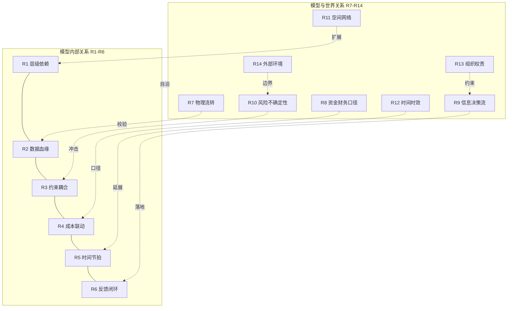

# 关系类补充与 OEM 工厂费用/因素全集：六类的缺口、遗漏的科目与因素

> 某一科目要进求解时，先看 [工厂改数与重算指南.md](../工厂改数与重算指南.md) 第 2.5 节：有的表只进报表（物料），有的改目标（边际贡献）。本文是缺口盘点，不是操作入口。
>
> 日期：2026-10-17 ｜ 工作区：`/Users/jeremylv/my_projects/volume_cost_simulation`
> 前置：`项目拓展详案-分块深挖与相互关系.md`（R1–R6 六类关系＋M1 影响矩阵）、`计算模型与模块设计.md`（8 科目）、`产量成本模型-要素拆解 (1).md`（§2.11 质量爬坡、§3 补充输入清单、§15.5 物流）。
> 数据声明：本文原型数字均为**示例数据**；行业成本结构为公开常识性量级（物料约 70–80%、人工制费约 15–25% ⚠ 需按实际工厂确认），不涉及任何具体企业真实数据。标 `⚠` 为待确认项。

---

## 0. 先回答两个问题

**问题一：六类关系够不够？**
不够。R1–R6（层级依赖、数据血缘、约束耦合、成本联动、时间节拍、反馈闭环）覆盖的是**"模型内部怎么连"**，缺的是**"模型和它没建模的世界怎么连"**。经排查，至少还有 **8 类**关系被遗漏，本文补为 R7–R14。

**问题二：OEM 工厂还有哪些费用和因素没进模型？**
原型 8 科（人工/能源/班车/外包/加班/OH/缓存持有/缺口惩罚）**只覆盖了整车成本的一小部分**。按公开量级，一辆车：物料 70–80%、人工＋制费 15–25%、物流 3–8%、质量与保修 1–3%。原型单车 3579 元（示例）是"部分制费口径"，**不等于全成本**。本文补 **16 类费用科目 + 14 类非费用因素**。

---

## 一、关系类补充：R7–R14（缺的 8 类）

### R7 物理流转关系（物料/车身/能源/人员的实体流）

**是什么**：车辆实体在各车间之间的流动（冲压件→白车身→涂装车身→整车）＋能源/水气/人员的实体供应流。R2 是数据血缘（信息流），R7 是物理流，两者必须一一对应，否则模型自洽但现场跑不通。

| 物理流 | 载体 | 缓冲 | 对应信息流 | 模型现状 |
|---|---|---|---|---|
| 冲压件 | 料架/料箱 | 冲压件库 6000 台示例 | `inv[STP,m,t]` | 已建 |
| 白车身 | WBS 吊具/滑橇 | WBS 1500 台 | `inv[BIW,m,t]` | 已建 |
| 涂装车身 | PBS/滑橇 | PBS 800 台 | `inv[PNT,m,t]` | 已建 |
| 整车 | 成品库/发运场 | 成品库 + 车位 | `x[TCF]→trips` | ⚠ 仅到产量，未到发运 |
| 电/气/水/汽 | 管网/计量表 | 无（即时） | `kw/kwh_per_unit` | 已建（合并为电） |
| 人员 | 工位/班组 | 无（即时） | `heads` | 已建 |
| 物料入厂 | JIT/JIS/仓储 | 线边库存+安全库存 | `supply` 上限 | ⚠ 只作上限，未建模库存流 |
| 返修车 | 返修区/复检 | 返修 WIP | 无 | ⚠ 缺失 |

**关键含义**：物理流有**容量、节拍、守恒**三重约束（滑橇数有限、吊具速度固定、件数守恒），信息流有**精度与时效**约束。模型里 `buffer_cap` 只是台数上限，没建滑橇/吊具数量约束，也没建返修返流。返修车回线会**占用产线时间**，相当于有效 JPH 打折——这就是 R7 缺口对产能的直接影响。

### R8 资金流与财务口径关系（钱怎么记、怎么摊、怎么结）

**是什么**：成本在会计科目的归集、分摊、结算路径。R4 是公式层面的成本联动，R8 是**会计层面**的科目映射与口径差。

| 关系 | 内容 | 影响 |
|---|---|---|
| 模型科目 ↔ 财务科目映射 | 模型"人工" ↔ 财务"直接人工"或"制造费用-人工" | 口径不一致→单车对不上账 |
| 固定/变动划分 | 模型 `oh_fixed` 是逐月常数；财务可能按产量分摊 | 产量不同→单车固定摊销不同 |
| 期间费用 vs 制造成本 | 模型未含销售/管理/研发费用 | 模型单车≠财务完全成本 |
| 权责发生 vs 现金流 | 折旧不进现金流；加班费当月进成本 | 决策看现金流时口径不同 |
| 内部分摊规则 | 共用工程（能源/食堂/安保）按面积/人数/产量分摊 | 分摊系数变→单车变 |
| 转移定价（跨厂） | 同一车型跨厂生产时的内部结算价 | 跨厂调产决策需此价 |
| 汇率折算（出口/进口件） | 出口收入、进口零件用不同汇率 | 汇率波动影响 margin |
| 存货计价 | 先进先出/加权平均影响库存资金 | 缓存持有成本口径 |

**关键含义**：这一层不建，就会出现"模型说省 1000 万、财务说没省"的尴尬。做法是**建口径对照表**（模型科目 → 财务科目 → 差异原因），每月对账时附上（拓展 1/6 已在做，此处系统化）。

### R9 信息与决策流关系（谁看什么数、谁拍什么板）

**是什么**：数据从产生到决策的传递链，以及每层的决策权限。R6 是反馈闭环（回到模型），R9 是**闭环外的组织决策路径**。

```
数据产生（MES/HR/能源/财务）→ 入湖 → 参数层（版本）
  → 测算（计划发起）→ 策略对比（AI&Data 出）→ 风险把关（Laya 建议）
  → 管理层拍板（留痕）→ 执行（计划/生产/HR/物流）
  → 偏差回馈（对账）→ 参数新版本
```

| 决策 | 数据需求 | 决策人 | 时效要求 | 当前缺口 |
|---|---|---|---|---|
| 月度排产档×班 | 需求/上限/参数 | 计划（提报）＋管理层（拍） | 月 25 日锁下月 ⚠ | 例会未运转（拓展 10） |
| 加班计划 | 缺口/加班余量 | 计划＋HR | 周 | 未建 |
| 招聘/借调 | 人数差/技能 | HR＋计划 | 提前 1–3 月 ⚠ | 提前期未建 |
| 次日排班 | 实到/需求 | 生产 | 日 | 周/日模型未建（拓展 2） |
| 投资（扩产/新增档） | 影子价格/瓶颈 | 管理层 | 季/年 | 影子价格未求（拓展 3） |
| 策略与惩罚值 | margin/风险偏好 | 管理层 | 月 | margin 未建（拓展 4） |

**关键含义**：数据有了、决策链没通，结果一样不用。R9 的抓手是**决策清单 + 留痕单**，每个决策点写清：输入什么数、谁看、谁拍、多久一次、记录什么。

### R10 风险与不确定性关系（可能发生什么、影响哪块）

**是什么**：风险事件 → 受影响变量 → 成本后果的映射。R6 是已知偏差的回写，R10 是**未知事件的冲击路径**。

| 风险类 | 事件例 | 冲击路径 | 模型体现 | 现状 |
|---|---|---|---|---|
| 需求风险 | 销量骤降/骤升 | 需求→产能→加班/缺口 | `demand` 旋钮 | 已建（场景/蒙特卡洛） |
| 供应风险 | 缺芯/断供 | `supply`→缺口 | `supply` 约束 | 已建 |
| 设备风险 | 停线/故障 | `down/avail`→产能→加班 | 旋钮 | 已建（停线扫描） |
| 人力风险 | 缺勤/离职/罢工 | 人数→产能 | `avail`（混装） | ⚠ 未拆 |
| 质量风险 | 批量返修/召回 | 有效产能↓＋保修费↑＋罚款 | 无 | ⚠ 缺失 |
| 能源风险 | 限电/电价暴涨 | `avail`/`price` | 旋钮 | 已建 |
| 汇率/贸易风险 | 汇率波动/关税 | margin | 无 | ⚠ 缺失 |
| 政策风险 | 环保限产/碳配额 | `avail`＋碳成本 | 无（限电可近似） | ⚠ 部分 |
| 安全/合规风险 | 事故停线/处罚 | `down`＋罚款 | 无 | ⚠ 缺失 |
| 自然灾害 | 台风/地震 | 全链停 | 无 | ⚠ 缺失 |

**关键含义**：风险不是一类，是**一张矩阵**（风险→路径→概率→影响→缓释措施）。模型能覆盖的（需求/供应/设备/能源）继续用旋钮；覆盖不了的（质量/汇率/合规）必须**显性列为"模型未覆盖"**，在报告里标注，不能装作没有。

### R11 空间与网络关系（车间之外的地理维度）

**是什么**：工厂布局、地理分布、运输网络、多厂协同。R1/R7 是单一工厂内的连接，R11 是**工厂围墙外**的网络。

| 维度 | 内容 | 建模含义 | 现状 |
|---|---|---|---|
| 厂内布局 | 车间顺序、距离、AGV/叉车路径 | 搬运成本/线边库存 | ⚠ 未建 |
| 供应商地理 | 本地/近程/远程集群 | JIT 可行性、入厂运费、断供风险 | ⚠ 未建 |
| 成品发运网络 | 总仓/区域 DC/经销商 | 干线运费、仓储、在途库存 | ⚠ 未建 |
| 多厂协同 | 跨厂调产、共享车型 | 转移成本、转移定价 | ⚠ 未建（拓展 9 是复制不是协同） |
| 进口/出口链路 | 港口/口岸/关务 | 关税、报关、船期 | ⚠ 未建 |

**关键含义**：物流成本的**阶梯性**（按趟/按包车，非按台）在这层体现；跨厂调产的可行性也在这层。要素拆解 §9 提到产线/工位，但空间网络层整体缺失。

### R12 时间与时效关系（不止"月周日内"）

R5 讲的是计划节拍（月/周/日），缺的是**跨周期的时效关系**：

| 时效类型 | 内容 | 建模含义 | 现状 |
|---|---|---|---|
| 提前期 Lead Time | 招聘 1–3 月、采购 L/T、设备交付 | 决策不能立即生效 | ⚠ 缺失 |
| 爬坡期 | 新车 3–6 月 JPH/FTT 渐升 | `ramp` 系数 | ⚠ 缺失（拓展 3） |
| 退出期 | 老车型减产/停产 | 需求递减曲线 | ⚠ 缺失 |
| 合同周期 | 班车/外包年合同、工资年调 | 阶梯价格变动点 | ⚠ 部分（月版参数） |
| 淡旺季周期 | 季节性/节假日/船期 | 需求与日历 | 已建 |
| 产品生命周期 | 车型换代 6–8 年 | 长期产能规划 | ⚠ 超模型范围 |
| 法规生效期 | 排放法规切换 | 合规成本/停产改造 | ⚠ 缺失 |
| 折旧周期 | 设备/模具 5–10 年 | 固定成本分摊 | OH 已含但未拆 ⚠ |

**关键含义**：提前期缺失会导致"模型说招人、现实招不到"；爬坡缺失导致新车型排产过乐观。R12 是**模型从"月快照"走向"滚动仿真"**的必补项。

### R13 组织与权责关系（RACI 之外还有）

M3 已给部门×分块 RACI，但缺组织**动态关系**：

| 关系 | 内容 | 风险 |
|---|---|---|
| 参数所有权 vs 使用权 | IE 拥有工时，计划使用 | 所有者改参数不通知使用者→结果突变 |
| 变更审批链 | 谁提、谁审、谁批、谁发布 | 越权改参数、无影响分析发布 |
| 交接班次 | 跨部门接口人对接口人 | 人一换就断（key user 梯队） |
| 考核指标冲突 | 计划考核交付，财务考核成本 | 目标不一致→各自最优 |
| 跨厂对标 | 工厂间比单车/利用率 | 口径不一致→误判 |
| 委员会 vs 单厂 | 推广委员会定核心，工厂定配置 | 边界争（CAB 已设计） |

**关键含义**：KPI 冲突是最隐蔽的关系——计划为保交付加加班，财务看成本超标，两边都"对"。解法是**统一目标函数**（这是 VCS 的最大组织价值：把目标放到一张表上）。

### R14 外部环境与社会关系

| 维度 | 内容 | 影响 | 现状 |
|---|---|---|---|
| 政策法规 | 排放（国六/欧七）、双积分、碳配额 | 合规成本、车型结构 | ⚠ 缺失 |
| 能源结构 | 绿电比例、自建光伏 | 电价/碳排 | ⚠ 缺失 |
| 社区与舆情 | 噪音/排放投诉 | 限产风险 | ⚠ 缺失 |
| 供应链生态 | 供应商能力/本地化率 | 断供风险、关税 | ⚠ 部分（supply） |
| 劳动环境 | 工会协议、加班文化 | 加班上限/补贴 | 部分（36h/800） |
| 宏观周期 | 经济波动、补贴退坡 | 需求 | 间接（demand） |

---

## 二、R1–R14 全景：关系分类总表

| 编号 | 关系类 | 一句话 | 主要载体 | 覆盖状态 |
|---|---|---|---|---|
| R1 | 层级依赖 | 谁没好谁等谁 | 分块 DAG | ✅ 已建 |
| R2 | 数据血缘 | 一个数从哪来 | 表→中间→科目 | ✅ 已建 |
| R3 | 约束耦合 | 改一个约束牵动全局 | C1–C13 | ✅ 已建 |
| R4 | 成本联动 | 一笔钱三处响 | k/i 联动 | ✅ 已建 |
| R5 | 时间节拍 | 月/周/日三层钟 | 冻结边界 | ✅ 部分（缺提前期） |
| R6 | 反馈闭环 | 三条绿虚线 | 旋钮/约束/版本 | ✅ 已建 |
| **R7** | **物理流转** | 车身实物流与信息流对应 | 缓存/滑橇/管网 | ⚠ 部分 |
| **R8** | **资金与财务口径** | 钱怎么记怎么摊 | 科目映射/分摊 | ⚠ 缺失 |
| **R9** | **信息与决策流** | 谁看什么数拍什么板 | 决策清单 | ⚠ 缺失 |
| **R10** | **风险不确定性** | 风险→路径→后果 | 风险矩阵 | ⚠ 部分 |
| **R11** | **空间与网络** | 围墙外的地理维度 | 网络模型 | ⚠ 缺失 |
| **R12** | **时间与时效** | 提前期/爬坡/周期 | ramp/LT | ⚠ 缺失 |
| **R13** | **组织与权责** | 所有权/审批/冲突 | RACI+考核 | ✅ 部分 |
| **R14** | **外部环境与社会** | 政策/碳/舆情 | 合规约束 | ⚠ 缺失 |

**归类逻辑**：R1–R6 = 模型内部关系（结构、数据、约束、成本、节拍、反馈）；R7–R14 = 模型与世界的关系（物理、财务、决策、风险、空间、时间、组织、环境）。两类加起来才算完整的关系图谱。



---

## 三、OEM 工厂费用科目全集（16 类，标出模型现状）

按三大类整理：**物料类 / 制造与人工类 / 期间与流通类**。✅ 已建 ｜ ◐ 部分 ｜ ❌ 缺失。

| # | 科目 | 明细 | 量级（整车，⚠） | 驱动 | 现状 | 建法要点 |
|---|---|---|---|---|---|---|
| 1 | **直接材料** | 钢材/铝/塑料/电子件/电池/内外饰 | 70–80% | 产量×BOM价 | ❌ | `BOM×价`，缺料走 `supply`（拓展 6） |
| 2 | **入厂物流** | JIT 取货/包车/仓储/包装/线边 | 2–5% | 趟次×费率 | ❌ | 整数 `trips`＋容量（§15.5） |
| 3 | **直接人工** | 线上操作工工资 | 5–10% | 人数×工资 | ✅ | 已建 `labor()` |
| 4 | **间接人工** | 班组长/质量/维修/物流/计划/管理 | 3–5% | 班次阶梯 | ❌ | 定员表拆 direct/indirect |
| 5 | **加班与补贴** | 加班费/夜班/高温/节假日 | 1–3% | 加班小时×单价 | ✅ | 已建（⚠ 未分平日/周末） |
| 6 | **福利与社保** | 五险一金/补充医疗/餐补/劳保 | 工资 20–40% | 人数 | ❌ | 工资乘系数，单列科目 |
| 7 | **能源** | 电/天然气/蒸汽/压缩空气/水/氮气 | 2–5% | 开动小时+产量 | ◐ | 已建电；气/汽/水/气未拆 |
| 8 | **设备折旧** | 产线/机器人/压机/烘房 | 3–6% | 资产原值/年限 | ◐ | OH 含但未拆（R8/R12） |
| 9 | **模具与工装摊销** | 车型专用模具/夹具/检具 | 1–3%（新车型集中） | 摊销期×产量 | ❌ | 按车型单独摊，影响新车型决策 |
| 10 | **维修与备件** | 预防性+故障维修/备件/外委 | 1–3% | 开动小时 | ◐ | OH 含，应与 `hours` 挂钩 |
| 11 | **质量成本** | 返修/报废/返工/质量罚金/保修准备 | 1–3% | 返修率×工时 | ❌ | FTT 折有效 JPH＋保修计提 |
| 12 | **制造费用其他** | 辅料/低值易耗/厂房/保险/IT/安全 | 2–4% | 混合 | ◐ | OH 已含固定部分 |
| 13 | **班车与员工交通** | 班车线路/通勤补贴 | 0.5–1% | 班次数 | ✅ | 已建 `bus()` |
| 14 | **外包与服务** | 劳务派遣/物流外包/保洁/安保/食堂 | 1–3% | 班次/人数 | ◐ | 已建外包班次价；其余未拆 |
| 15 | **成品物流与销售物流** | 干线运输/仓储/DC/经销商交付 | 2–5% | 趟次×距离 | ❌ | 网络层（R11） |
| 16 | **库存资金与持有** | 在制/成品/零件库存资金成本 | 0.5–2% | 库存额×利率 | ◐ | 已建缓存持有；零件/成品库存未建 |

**模型未覆盖但影响决策的"隐性科目"**（不进直接成本但影响战略）：研发费用摊销、销售与市场费用、管理费用、财务费用（利息/汇兑）、碳成本/配额、环保罚款、保险与索赔、土地与房产税、关税与增值税（出口退税）。

**原型单车 3579 元的定位**（示例）：只含 3/5/7/13 的部分＋OH 与持有，即**"可控制费口径"**。全成本口径下单车会显著更高（物料占大头）。这个差异必须在报告首页标注，否则管理层会误读。

---

## 四、OEM 工厂非费用因素全集（14 类，标出模型现状）

| # | 因素 | 内容 | 为何影响成本 | 现状 | 建法 |
|---|---|---|---|---|---|
| 1 | **一次合格率 FTT** | 直通率/返修率/报废率 | 返修占产能＝有效 JPH↓ | ❌ | `capacity×FTT`，返修工时加回 |
| 2 | **返修区能力** | 返修工位/人员/场地 | 返修排队→车出不去 | ❌ | 返修 WIP 与产线并联 |
| 3 | **爬坡曲线** | 新车型 JPH/FTT 渐升 | 前 3 月不能按设计 JPH | ❌ | `ramp[(s,t)]` |
| 4 | **换型与换色** | 冲压换模/涂装换色/车型切换 | 换型时间占产能、清洗成本 | ❌ | 换型小时＋清洗费 |
| 5 | **排序规则** | 高工时配置间隔/颜色批量 | 约束排序自由度 | ❌ | Car Sequencing（拓展 2） |
| 6 | **技能矩阵** | 谁会上哪些工位/持证 | 技能缺→人够但干不了 | ❌ | 覆盖约束（拓展 2/7） |
| 7 | **出勤率** | 请假/缺勤/季节性（春节） | 实到＜定员→产能↓ | ◐ | `avail` 折入，应单列 |
| 8 | **人员流失与招聘** | 离职率/招聘周期/培训期 | 招人 1–3 月才顶岗 | ❌ | 非对称人数约束（R12） |
| 9 | **设备 OEE** | 时间/性能/合格率三因子 | 实际 JPH＜设计 | ◐ | `avail` 折入，应拆三因子 |
| 10 | **维保窗口** | 计划检修/年检/大修 | 停机占天数 | ◐ | `down` 旋钮可近似 |
| 11 | **滑橇/吊具数量** | WBS/PBS 物理载体数量 | 限制缓存上限 | ❌ | 缓存加"载体数×间距"约束（R7） |
| 12 | **成品车位与发运能力** | 库容/承运商运力 | 产出来不及发→压库 | ❌ | 发运上限约束（R11） |
| 13 | **供应商能力与交期** | 供货上限/L/T/双源 | 断供→减产 | ◐ | `supply` 上限已有，L/T 未建 |
| 14 | **法规与合规** | 加班上限/排放/碳/环保限产 | 硬约束＋成本 | ◐ | 加班 36h 已建；碳/排放未建 |

**另需注意的工艺/工程因素**：线平衡率、工位节拍分布、机器人可用率、涂装膜厚合格率、烘房升温曲线、设备老化趋势、工装寿命、柔性线与专线的车型分配、平台共用程度（同平台多车型混线）。

---

## 五、把缺口映射回模型：数据/公式/约束/目标

| 缺口 | 加什么数据表 | 改哪个函数/约束 | 变量增减 | 优先级 |
|---|---|---|---|---|
| 物料 | `bom/part_price`（或 `mat_cost_per_unit` 简化） | `var_cost_per_unit()` | 无（改系数） | P0 |
| 入厂/成品物流 | `lane/mode/capacity/rate` | 新子模块 `logistics()` | ＋整数 `trips` | P1 |
| 间接人工 | `jph_options` 拆 `direct/indirect` | `labor()` | 无 | P1 |
| 福利社保 | `global_params` 加 `burden_rate` | `labor()` | 无 | P0（1 行） |
| 质量 FTT/返修 | `quality.csv{shop,model,FTT,rework_h}` | `capacity()`×FTT；返修工时 | 可加返修 WIP | P1 |
| 模具摊销 | `tooling.csv{model,摊销期,原值}` | 目标加摊销项 | 无 | P2 |
| 设备折旧拆分 | `asset.csv{线,原值,年限}` | 替代部分 `oh_fixed` | 无 | P2 |
| 气/汽/水 | `utility.csv{类型,单价,单耗}` | `energy()` 扩多能源 | 无 | P2 |
| 爬坡 | `ramp.csv{model,月序,factor}` | `capacity()`×ramp | 无 | P1 |
| 换型换色 | `changeover.csv{切换类型,小时,费用}` | `hours()` 扣减＋成本 | 可加整数切换次数 | P2 |
| 技能矩阵 | `skill.csv{工位,持证人数}` | 新约束 `skill_cover` | 可加技能人数变量 | P2 |
| 招聘提前期 | `hire_lead_time` | C10 加非对称界 | 无 | P2 |
| 滑橇/吊具 | `carrier.csv{车间,数量,间距}` | C8 缓存上限改算式 | 无 | P2 |
| 成品发运能力 | `shipping_cap` | 新约束 `Σx≤cap` | 无 | P1 |
| 库存资金 | `rate_capital` | 持有成本或单列 | 无 | P1 |
| 碳成本 | `carbon.csv{单价,排放因子}` | 目标加碳项 | 无 | P3 |
| 汇率/关税 | `fx/tariff` | `margin()` 修正 | 无 | P3 |
| 风险事件概率 | `risk_matrix` | 场景/蒙特卡洛扩展 | 无 | P1（治理） |
| 财务口径映射 | `account_map` | 报表层 | 无 | P0 |
| 决策清单留痕 | `decision_log` | 报表层 | 无 | P1 |

**P0（1–2 周可做，收益最大）**：福利社保系数、物料简化版、财务口径对照表。
**P1（1 季度）**：物流阶梯、间接人工、质量 FTT、爬坡、发运能力、库存资金、风险矩阵。
**P2（半年）**：折旧/模具拆分、多能源、换型、技能矩阵、提前期、滑橇约束。
**P3（战略级）**：碳成本、汇率关税、跨厂协同网络。

---

## 六、优先级判断：先补哪些

**判断三问**：
1. **影响大不大**？物料 70–80% ≫ 物流 3–8% ≫ 质量 1–3% —— 但物料不进目标不影响选档（只影响单车口径），物流与质量会影响决策，**影响决策的优先于影响口径的**。
2. **有没有数据**？福利系数（HR 现成）、发运能力（物流现成）易做；分车间气表、技能矩阵可能要补系统。
3. **决策用不用得上**？排产决策用：质量 FTT、爬坡、换型、发运能力、提前期；单车对上账用：物料、福利、折旧、口径映射。

**结论排序**：
```
P0 口径与地基：福利系数 → 物料简化 → 财务口径对照表 → 决策清单
P1 影响排产决策：质量 FTT/返修 → 爬坡 → 发运能力 → 物流阶梯 → 间接人工 → 库存资金 → 风险矩阵
P2 精度与约束：折旧/模具 → 多能源 → 换型 → 技能 → 提前期 → 滑橇
P3 战略：碳成本 → 汇率关税 → 跨厂网络
```

**不要一次全上**：每加一项都要过"数据可得性 + 对决策有影响 + 能被对账验证"三关，否则模型会变得又大又不可信。更好的做法是**先在报告里显性列出"未覆盖清单"**（含量级估计），让管理层知道边界在哪，再按优先级逐步补。

---

## 七、一句话总结

- **六类关系不够，共 14 类**：R1–R6 管模型内部（依赖/血缘/约束/成本/节拍/反馈），R7–R14 管模型与世界（物理/财务/决策/风险/空间/时间/组织/环境）。前者决定"模型自洽"，后者决定"模型可用"。
- **原型的 8 科目只覆盖整车成本的一小部分**（示例单车 3579 元是可控制费口径），全成本里物料占 70–80%、物流 3–8%、质量 1–3%、福利是工资的 20–40% 都还没进。
- **缺的不只是钱**：FTT/返修、爬坡、换型、技能、出勤、提前期、滑橇数量、发运能力、风险概率、财务口径——这些"非费用因素"对排产决策的影响往往比多算一笔费用更大。
- **补齐顺序**：P0 口径地基 → P1 影响决策 → P2 精度约束 → P3 战略。每项过"数据/影响/可对账"三关，未覆盖的先显性列出。
