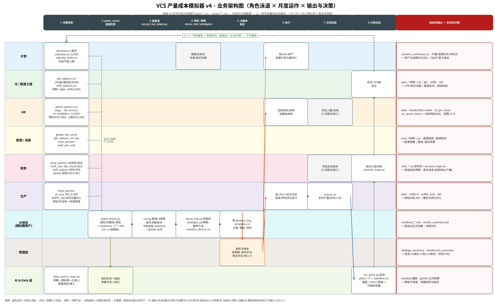
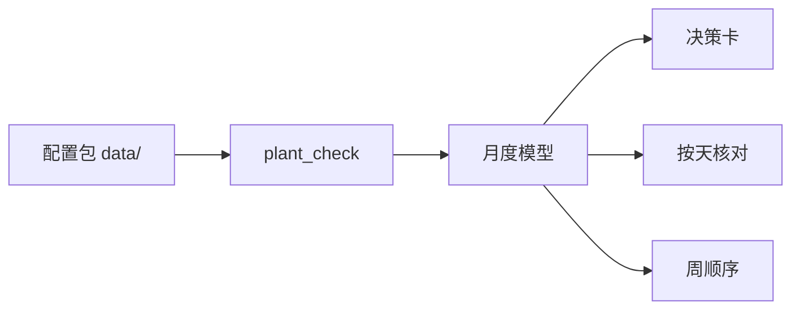
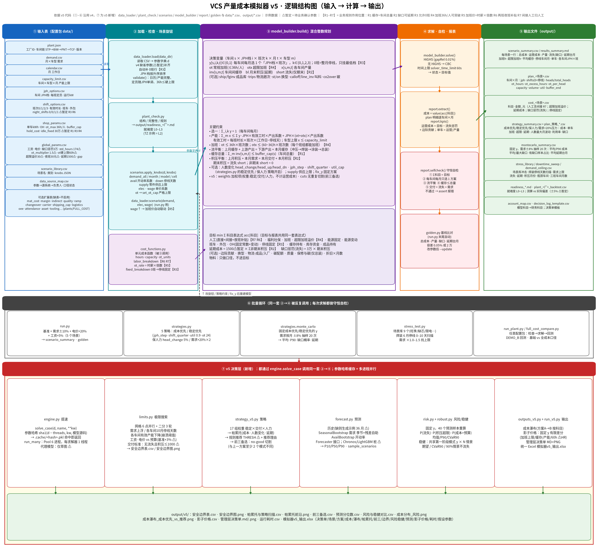

# 产量成本模拟（Volume Cost Simulation）

工厂排一年的产量，每个车间、每个月只定一件事：开多快、开几班。这一档选定以后，人工、能源、加班和制造费用一起算出来。需求、电价、停线或加人速度变了，要能指出班次改在哪几个月，差额落在哪几个科目。

这是示例实现。配置包 `TZ-cfg-2026.10-示例`。数字不是工厂实绩，也不能写成已经省下的钱。标 ⚠ 的仍待确认。代码在 [`v5.2/`](v5.2/)，许可证 [MIT](LICENSE)，声明见 [NOTICE.md](NOTICE.md)。

## 业务价值

计划、IE、人事、能源和财务各管一类基数。单独改一张表，看不出全年班次会不会变，也看不出单车成本是科目动了，还是固定费用被产量摊薄。

配置包把这些表冻在一起。求解器在交得上货的前提下，为每个车间的每个月留下成本最低的一档，交出一张能对质的结果：外部条件、班次改了没有、差额在哪些科目、哪些假设还标着 ⚠。

| 要回答的问题 | 怎么做 |
| :-- | :-- |
| 各车间各月开哪一档，才能交得上且成本最低 | 月度求解。班次可以是 0（整月停线）、1、2 或 3 |
| 只改需求、电价、工资、停线或加人速度，班次和科目怎么动 | 场景旋钮，求解代码不动。读法在 [案例解析](发布/案例解析.md) |
| 人数少跳，或把人力稳住，要多付多少 | [稳定优先、保人力](v5.2/strategies.py)。对照的是成本优先，和场景差额分开记 |
| 哪些话还不能写成已经省下 | 借调净额达到 50 万就标未验证。粗参数和 A05–A10 默认关闭。对外数字只从 [价值台账](发布/样例/价值台账.csv) 取。范围见 [模型卡](发布/模型卡.md) |

换一家工厂时，把 `v5.2/data/` 复制成新的配置包，改 `plant.json` 的配置版本。求解代码不动。每一类数该谁改，见 [设计说明第 5 节](发布/设计说明.md)。

下面这张图按角色看一个月怎么转：谁维护哪张表，求解之后谁拿到班次、加班、成本和偏差。示例包的就绪度是 L2，可以测算；没有实际产量，就不能做历史回放。图里的月度入口对应现在的 `v5.2/run.py` 和 `plant_check.py`。



## 架构

全年方案是月度模型：每个车间、每个月只留一个 JPH × 班次。按天只核对一个月里的焊装和涂装。周序列默认只出顺序和换色，不改月计划。



决策卡在数字前面写可信等级、就绪度、求解间隙，以及这笔差额能不能当成已经省下。细读在 [设计说明第 4 节](发布/设计说明.md)。

下面这张图把输入表、月度模型和输出文件画全。图下方的极限、帕累托、预测和稳健在 [`v5.2/lab/`](v5.2/lab/)，默认命令不跑。



## 先读

完整目录在 [发布/README.md](发布/README.md)。从这里进去的三份：

| 要看什么 | 文件 |
| :-- | :-- |
| 一个选择、10 月四档、哪些差额还不能说成已经省下 | [发布/设计说明.md](发布/设计说明.md) |
| 需求或电价变了以后的决策卡 | [发布/案例解析.md](发布/案例解析.md) |
| 命令、结果文件、代码目录 | [v5.2/README.md](v5.2/README.md) |

## 运行

命令在 `v5.2/` 下执行。

```bash
cd v5.2
python3 -m venv .venv
.venv/bin/pip install -r requirements.txt
.venv/bin/python plant_check.py
.venv/bin/python run.py
```

不要运行 `lab/gen_data.py`。它会覆盖 `data/` 里已经填好的表。求解结果写在本机 `v5.2/output/`，不进 Git。

## 许可

[MIT](LICENSE)，Copyright (c) 2026 Jeremy Lv。示例数据声明仍然有效：数字不是工厂实绩。
