# 产量成本模型：要素拆解与关联设计

> 改工厂的基数、策略或计算公式时，按 [工厂改数与重算指南.md](../工厂改数与重算指南.md)。下文的操作链接（要素详解、模拟器使用说明）是写作时的配套，没有放进本目录，不作为现行入口。
>
> 主题：工厂用一套新架构解析 JPH、人工、能源、排产、配置与 BOM、设备之间的关系，支持输出成本最优的排产方案，并能按输入模拟各种情况。
> 参考：一份产量成本测算系统的界面（产能限制配置；成本测算下的能源、制造费用、班车、工资、服务外包、加班费六个模块；假设 JPH 测算总览）。
> 配套文件：[要素详解.md](要素详解.md)（14 个要素逐项详解）、[模拟器使用说明.md](模拟器使用说明.md)（原型操作、输入输出、练习）、[AI&Data组合作建议-产量成本模拟器.md](AI&Data组合作建议-产量成本模拟器.md)（合作建议）。
> 架构图：技术架构见 0A，业务逻辑见 0B，业务架构与协作点见 20，多工厂复制与推广见 21。
> 说明：本文是通用的建模思路，公式和示例数字仅作说明。标 ⚠ 的地方需要按你们实际系统确认。

---

## 0. 一句话原理

**车型配置 → 工时和瓶颈节拍 → JPH → 产量（× 班次 × 日历）→ 资源用量（人、设备、能源、物料、物流）→ 成本 → 在约束下选最优方案。**

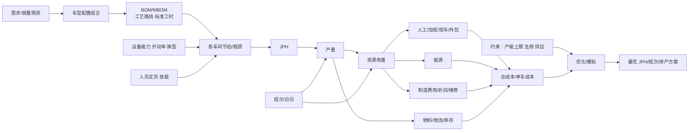

---

## 0A. 总体架构图

> 把第 1A、5、9、12–19 节的内容放到一张图里：从上到下分四层，右侧是 AI 增强。图中是**示例结构**，不是真实系统设计；标 ⚠ 的需要按实际情况确认。


（图由 `prototype/plot_architecture.py` 生成。）

**各层说明**

| 层 | 主要内容 | 对应章节 / 原型 |
| :-- | :-- | :-- |
| ① 应用 / 决策层 | 管理层看板和报表（单车成本、缺口、瓶颈车间，结果注明场景号和参数版本）；策略对比（成本优先、稳定优先、保人力、保交付）；场景模拟和压力测试；Laya 类结构化决策模型做场景识别、风险把关、策略推荐和异常分级；最后由人拍板，决策留痕 | 第 17、18、19 节；`strategies.py`、`stress_test.py` |
| ② 求解 / 计算层 | 场景层：旋钮 + 场景库，场景ID 冻结一份参数快照。子模块只做计算：人力、加班、能源、班车、外包、夜班补贴、OH、缓存持有，预先算成方案成本表。主模型只做选择：MIP（PuLP + CBC / HiGHS）为每个车间每月选一个「JPH档 × 班次」，并决定加班、缓存和产量，目标是总成本加缺货惩罚最低。结果写入结果库；月度方案交给下层的周、日排班，排不下时反馈成新约束 | 第 1A、14、15 节；`scenarios.py`、`cost_functions.py`、`model_builder.py` |
| ③ 模型 / 规则层 | 实体框架四层知识（定义、关系、规则、依据）；车间链冲压 → 焊装 → 涂装 → 总装，用缓存连接；JPH 档按车间离散取值，决定定员、功率和产能；班次模式是离散的（1/2/3 班，两班 12 小时 ⚠ 待扩展）；约束与策略假设；参数和计算方法都带版本和生效/失效日期；关联键 | 第 4.1、14.2、15、16 节 |
| ④ 数据层 | 源系统（PLM/BOM、MES/设备、人事、能源计量、财务、销售预测/S&OP）→ 华为云数仓（ODS → DWD → 带版本的参数层）；各数据域和实际数据；数据质量规则和逐月对账，偏差超过阈值时告警，并回写参数做校准 | 第 5、9、12.2 节；`data/*.csv`、`data_loader.py` |
| ⑤ AI 增强（旁路） | LLM 以实体框架为地图，负责解释结果、RAG 问答、把自然语言场景翻译成旋钮、常识审查、生成规则、建议字段映射、抽取参数。ML 小模型提供预测输入：需求、开动率、能耗、新配置工时、文本抽取、求解代理模型。原则：只提建议，数字由规则和求解器保证 | 第 13、16 节 |

**怎么读**：蓝色实线是数据向上流动（源数据 → 参数快照 → 实体与规则 → 求解 → 方案、成本、缺口 → 决策）。绿色虚线是向下的反馈：管理层选策略或提出新场景，会变成新的旋钮重新求解；实际与测算对账后的偏差，会回写成参数校准。粉色虚线是 AI 旁路，只给建议，要人确认后才生效。

mermaid 版本：

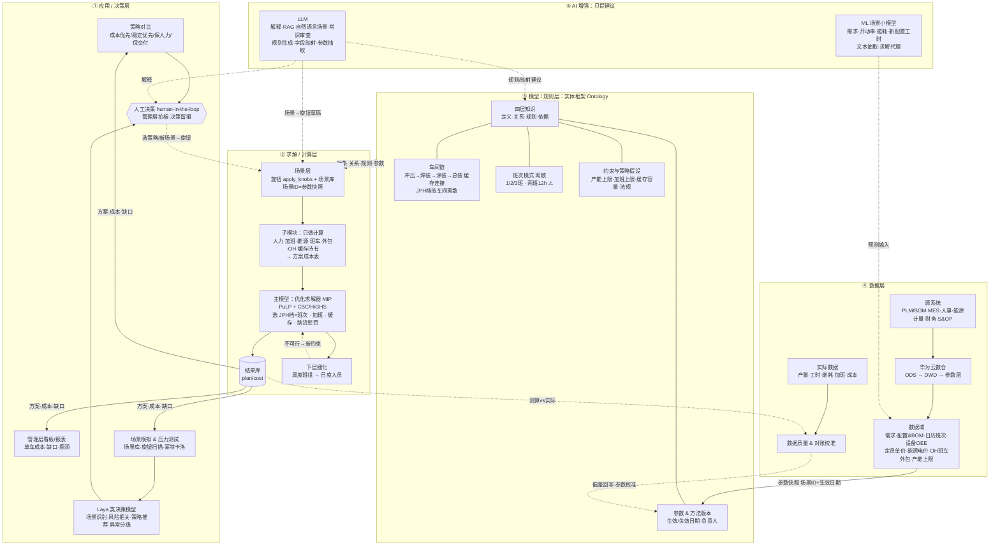

---

## 0B. 业务逻辑图

> 0A 是**技术架构**（系统分层），1A 是**数据关联**（表和关联键），20 是**业务架构**（角色、泳道、协作点）。这一节是**业务逻辑**：从需求出发，一步一步怎么判断、怎么推导，最后得出成本结论，并通过决策、执行和对账形成闭环。图中是**示例结构**，数字是原型的**示例数据**，不是工厂实绩；标 ⚠ 的需要确认。


（图由 `prototype/plot_business_logic.py` 生成。）

### 0B.1 逻辑链逐步说明

| 步骤 | 做什么 | 关键规则 / 公式 | 对应章节 |
| :-- | :-- | :-- | :-- |
| Ⓐ 业务输入 | 按「场景ID + 生效日期」取一份参数快照：① 需求（月 × 车型、车型组合、内销/出口、零件供应能力）；② 配置结构（BOM/MBOM、工艺路线、标准工时）；③ 产能与时间（JPH 档、开动率/OEE、产能上限、日历、班次模式、停线）；④ 单价与规则（工资、加班单价、夜班补贴、电价、OH、班车、外包、加班上限、缓存容量、法规）；⑤ 场景旋钮改写 ①–④ 的取值 | 一次测算只用同一版输入；BOM、工时、单价按测算月份取当时有效的版本 | 1、1A.1、14.2、18.1 |
| Ⓑ-1 所需产量 | 把各车型需求汇总成每个车间每月的所需产量和负荷工时；上游车间按下游需要量，加减缓存倒推 | 车间负荷工时 = Σ 车型需求 × 单车工时（原型未建工时表 ⚠） | 1A.5 |
| Ⓑ-2 候选产能模式 | 每个车间每月列出可选的「JPH 档 × 班次模式」，扣掉停线天数 | JPH 档按车间离散取值；班次 1/2/3 班（两班 12 小时 ⚠ 待扩展） | 15.1、15.6 |
| Ⓑ-3 正常产能 | 对每个候选模式算正常班产能，并检查产能上限 | 产能 = JPH × 每班有效小时 × 班次数 × 工作日 × 开动率/OEE（原型未乘开动率）；产量 ≤ 产能上限（车间 × 车型 × 月） | 1A.2、要素详解第 7 节 |
| Ⓑ-4 匹配判断 | 第一个判断：正常产能 ≥ 所需产量吗？是：正常班满足，看利用率和余量。否：第二个判断：缺口 ÷ JPH ≤ 加班上限吗？是：加班补足。否：换模式（升 JPH 档、加一个班次），或者让上游提前做、动用缓存，然后回到 Ⓑ-2 换下一个候选。所有模式都不够时，记为缺口，按每台缺货惩罚计入总成本 | 加班小时 = (所需产量 − 正常产能) ÷ JPH，≤ 上限；缺口 = 需求 − 总装产量 | 1A.4、15.4 |
| Ⓑ-5 车间链 | 冲压 → 焊装 → 涂装 → 总装，相邻车间用缓存连接，所以各车间可以各自选模式 | 上月缓存 + 上游产量 = 下游产量 + 本月缓存；0 ≤ 缓存 ≤ 容量；总装产量 + 缺口 ≥ 需求 | 1A.3 |
| Ⓒ 资源与成本 | 选定模式后，定员和功率就成套确定了，各子模块按「车间 × 档 × 班 × 月」算出方案成本表 | 人数 = 每班定员 × 班次数；人工 = 人数 × 工资（三班加夜班补贴）；加班费 = 加班小时 × 每班定员 × 加班单价；能源 = [功率 × (开动小时 + 加班小时) + 产量 × 单车能耗] × 电价 × 月系数；班车/外包 = 班次数 × 每班月单价；OH = 固定 OH + 产量 × 变动 OH 率；缓存持有 = 缓存台数 × 单位持有成本 | 1A.5、14.2 |
| Ⓒ 汇总 | 汇总成方案总成本和单车成本 | 方案总成本 = Σ 各科目 + 缺口 × 缺货惩罚；单车成本 = 总成本 ÷ 总装产量 | 1A.2、17.3 |
| Ⓓ-1 约束校验 | 检查硬约束：产能上限、加班上限、人数月变化、缓存容量、供应上限、切换规则（相邻月最多变一档、班次按季度固定）、法规。不满足的组合不可选，由求解器自动剔除 | 可选约束：`util_cap`、`head_change`、`jph_step`、`shift_quarter`、`sup_*` | 15.2、15.3、17.2、18.1 |
| Ⓓ-2 求解选优 | 四个车间 × 12 个月一起求解：每个车间每月选一个「JPH 档 × 班次」，同时决定加班、缓存和产量 | 目标：总成本 + 缺口惩罚最低（MIP，PuLP + CBC/HiGHS） | 14.1、1A.4 |
| Ⓓ-3 策略与场景 | 按成本优先、稳定优先、保人力、保交付分别求解；再跑场景库、停线扫描、需求上限、蒙特卡洛（需求 ±8%） | 策略 = 不同目标和约束的组合；结果是假设下的 if-then，不是预言 | 17、18 |
| Ⓓ-4 风险判断与决策 | 判断成本和风险能不能接受。不能接受就调整策略或提出新场景，回到 Ⓓ-3；能接受就由管理层在策略之间拍板，决策留痕（场景号 + 参数版本） | 缺货惩罚设多高、风险接受度，是业务决策 | 17.3、19、20.2 |
| Ⓓ-5 执行 | 下达月度方案，做周、日排产和班组排班；下层排不下时，把问题变成新约束，回到求解器 | 月度方案 → 周度班组 → 日度人员 | 14.2、20.2 |
| Ⓓ-6 实际回收与对账 | 收回实际产量、工时、加班、能耗、成本、缺料，与测算对比。偏差在阈值内就保持参数，次月滚动重算；超出阈值就追溯到参数，发布新参数版本，回写到 Ⓐ | 偏差阈值 ±5% 只是示例 ⚠ | 9.4、17.4、20.2 |

### 0B.2 用一个例子走一遍（总装 10 月，示例数据，详见 1A.2–1A.4）

1. **Ⓐ 输入**：需求 11,000 台，三个车型都不超过总装产能上限；10 月 18 个工作日。
2. **Ⓑ 匹配**：候选 36 档 × 两班。可用小时 = 7.5 × 2 × 18 = 270 小时，正常产能 = 36 × 270 = 9,720 台，不够。缺口 1,280 ÷ 36 = 35.6 小时，不超过加班上限 36 小时，所以加班补足。换成 30 档 × 两班就要加班 97 小时，不可行。
3. **Ⓒ 成本**：人数 425 × 2 = 850 人；能耗 = 固定 1,000 kW × 270 小时（27 万 kWh）+ 加班约 3.6 万 kWh + 变动 11,000 × 30 = 33 万 kWh；OH = 固定 220 万元 + 11,000 × 250 元。当月合计 1,449 万元，单车约 1,317 元。
4. **Ⓓ 选择**：30 档 × 三班要 1,596 万元，36 档 × 三班要 1,781 万元，所以求解器选 36 档 × 两班。这里只单独看总装 10 月；实际是四个车间、12 个月一起求解。
5. 注：原型的产能没有乘开动率，真实系统要乘开动率/OEE。

### 0B.3 四张图的分工

| 图 | 回答的问题 | 章节 |
| :-- | :-- | :-- |
| 总体架构图 | 系统分几层，各层放什么 | 0A |
| 业务逻辑图 | 从需求到成本结论，按什么顺序判断和推导 | 0B |
| 数据关联图 | 每个数字从哪张表来、用什么关联键 | 1A |
| 业务架构图 | 每一步哪个部门负责、在哪里交接、谁拍板 | 20 |

### 0B.4 mermaid 版本

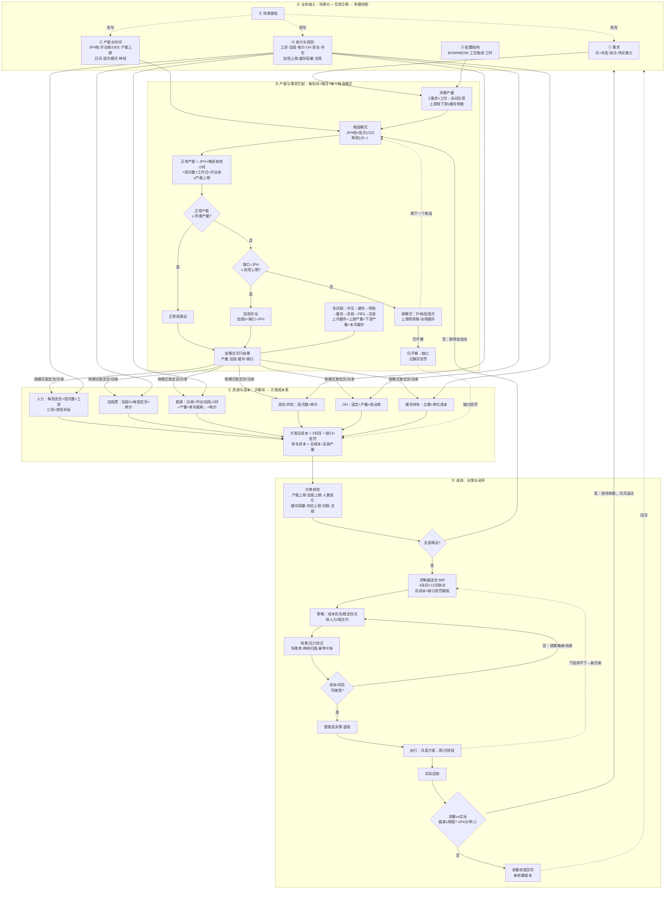

**⚠ 待确认**：两班 12 小时模式原型未支持；开动率/OEE 口径（计划停机算不算）；对账偏差阈值（±5% 是示例）；车间负荷工时表原型未建；具体法规与工会协议条款。物流阶梯已在全成本包用趟次加包车月费可选启用（`logistics.csv`，示例数据）。

---

## 1. 要素总览

| 层 | 要素 | 在模型里的角色 |
| :-- | :-- | :-- |
| 需求层 | 销量预测、订单、车型配置组合、市场（内销/出口）、交付期 | 驱动：要生产多少、生产什么 |
| 产品层 | 车型、配置、BOM/MBOM、工艺路线、标准工时、工程变更 | 决定每台车耗多少工时和物料 |
| 产能层 | 车间、产线、工位、设备、节拍、JPH、开动率、换型、缓存 | 决定能生产多少 |
| 时间层 | 工厂日历、班次方案、节假日、停线检修、加班规则 | 决定可用时间 |
| 资源层 | 直接人员、间接人员、外包、技能、能源、物料、物流 | 消耗的资源 |
| 成本层 | 工资、加班、班车、外包、能源单价、折旧、维修、制造费用分摊、物料价格、物流费、库存资金 | 资源换算成钱 |
| 约束层 | 产能上限、劳动法工时、供应商供货能力、物流能力、设备维保窗口、质量爬坡 | 方案必须满足的条件 |
| 质量与风险层 | 一次合格率、返修、爬坡曲线、设备故障率、缺料风险 | 修正有效产量和成本 |
| 场景与版本层 | 方案版本、假设参数、敏感性变量 | 支持模拟和对比 |

---

## 1A. 数据如何结合计算（关联关系详解）

> 这一节回答「各要素的数据是怎么关联、怎么一起算出来的」。数字全部是原型的**示例数据**，与原型基准解一致，不是工厂实绩。

### 1A.1 数据关联图

从左到右分四层：① 输入主数据和参数 → ② 中间计算 → ③ 成本科目 → ④ 优化。红框文字是关联键（JOIN KEY）。绿色虚线表示求解器回到输入端，换一个「JPH档 × 班次数」组合重算整条链。


（图由 `prototype/plot_linkage.py` 生成。）

mermaid 版本：

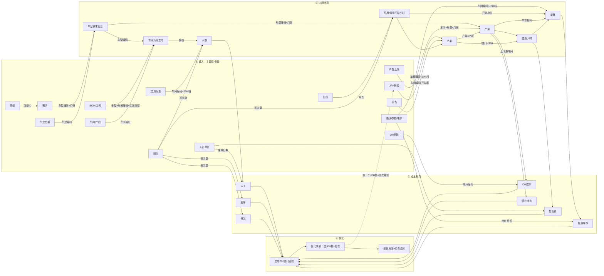

**关联键说明**
- **车型编码**：需求、车型配置、BOM、产能上限之间的关联键。
- **车间编码**：BOM 工时、JPH档、定员、能源参数、OH、缓存、产能上限之间的关联键。
- **月份**：需求、日历、产能上限、电价系数之间的关联键。
- **JPH档**：定员标准和能源功率都按「车间编码 + JPH档」取值，所以选了档位，就同时确定了产能、人数和功率。
- **班次数**：决定有效小时、人数倍数、班车、外包和夜班补贴。
- **生效日期**：BOM、工时、单价按测算月份取当时有效的版本。
- **场景ID**：整套参数的快照编号，保证一次测算用的是同一版输入。

### 1A.2 计算链路实例：总装（TCF）10 月（示例数据）

基准解里，总装 10 月选的是 **JPH 36 × 两班**，加班 35.6 小时，产量 11,000 台（见 `prototype/output/plan_基准.csv` 中 `TCF,10` 这一行）。下面一步一步说明这个结果是怎么算出来的。

**第 1 步：按关联键取数**

| 取什么 | 文件 | 关联键 | 取到的值 |
|:--|:--|:--|:--|
| 需求 | demand.csv | month=10 + model | V446K 4,620；V451 3,630；V452 2,750 |
| 工作日 | calendar.csv | month=10 | 18 天 |
| 产能上限 | capacity_limit.csv | shop=TCF + model + month=10 | 6,000 / 4,800 / 4,200 |
| JPH 档 | jph_options.csv | shop=TCF | 24 档 300 人/班、700 kW；30 档 360 人/班、850 kW；**36 档 425 人/班、1,000 kW** |
| 班次 | shift_options.csv | shifts=2 | 每班 7.5 小时，班车 6 万/班/月，外包 8 万/班/月，无夜班补贴 |
| 车间参数 | shop_params.csv | shop=TCF | 单车能耗 30 kWh，固定 OH 220 万/月，变动 OH 250 元/台，加班上限 36 小时/月 |
| 全局参数 | global_params.csv | — | 工资 9,000 元/人/月，加班 75 元/人·小时，电价 0.75 元/kWh |

**第 2 步：车型组合和上限检查**
- 10 月需求 = 4,620 + 3,630 + 2,750 = **11,000 台**（示例数据里 10 月季节系数 1.10）。
- 车型组合：V446K 42%、V451 33%、V452 25%。
- 每个车型都不超过总装上限（4,620 ≤ 6,000，3,630 ≤ 4,800，2,750 ≤ 4,200），通过。

**第 3 步：可用小时和正常产能**
- 可用小时 = 7.5 小时 × 2 班 × 18 天 = **270 小时**。
- 正常产能 = JPH 36 × 270 = **9,720 台**。

**第 4 步：加班**
- 缺口 = 11,000 − 9,720 = 1,280 台。
- 加班小时 = 1,280 ÷ 36 = **35.6 小时**，不超过上限 36 小时，可行。
- 含加班的产能 = 9,720 + 36 × 35.6 ≈ 11,000 台，利用率 100%。

**第 5 步：人数**
- 人数 = 每班定员 425 × 2 班 = **850 人**。

**第 6 步：能耗**
- 固定能耗（开动即耗）= 1,000 kW × 270 小时 = 270,000 kWh。
- 加班能耗 = 1,000 kW × 35.6 小时 ≈ 35,600 kWh。
- 变动能耗 = 11,000 台 × 30 kWh = 330,000 kWh。

**第 7 步：各成本科目**

| 科目 | 公式 | 金额（元） |
|:--|:--|--:|
| 人工 | 850 人 × 9,000 | 7,650,000 |
| 加班费 | 35.6 小时 × 425 人 × 75 | 1,133,333 |
| 班车 | 2 班 × 60,000 | 120,000 |
| 外包 | 2 班 × 80,000 | 160,000 |
| 能源（固定） | 270,000 kWh × 0.75 | 202,500 |
| 能源（加班） | 35,556 kWh × 0.75 | 26,667 |
| 能源（变动） | 330,000 kWh × 0.75 | 247,500 |
| OH 固定 | 220 万 | 2,200,000 |
| OH 变动 | 11,000 × 250 | 2,750,000 |
| **合计** | | **14,490,000** |
| **单车（总装 10 月，模型科目）** | 14,490,000 ÷ 11,000 | **约 1,317** |

注：这里只算总装一个车间一个月；全年、四个车间的总成本见基准结果（42,953 万元）。

### 1A.3 四个车间怎么通过缓存连起来

- 车间顺序：冲压 STP → 焊装 BIW → 涂装 PNT → 总装 TCF。
- 每个车型、每个月，每对相邻车间满足流平衡：

  上月缓存 + 上游本月产量 = 下游本月产量 + 本月缓存，且 0 ≤ 缓存 ≤ 缓存上限。

- 关联键：车型编码 + 月份 + 上下游车间编码。缓存持有成本 = 缓存台数 × `hold_cost_per_unit_month`。
- **10 月**：四个车间都做 11,000 台（冲压 40 档两班加 5 小时加班，焊装、涂装、总装都是 36 档两班加 35.6 小时加班），缓存没有动用。
- **11–12 月**（缓存起作用的例子）：11 月涂装做了 11,880 台，总装用了 11,000 台，多出的 880 台进入涂装后缓存（PBS）；12 月涂装降回 30 档、只做 10,120 台，总装仍做 11,000 台，差额由缓存补上。所以车间之间可以各选各的 JPH 和班次。

### 1A.4 优化器怎么在备选方案中选（总装 10 月，示例数据）

总装没有下游缓存，所以 10 月必须做 11,000 台（否则按每台 3 万元记缺口惩罚）。对总装 10 月逐个试「JPH档 × 班次数」：

| 方案 | 正常产能 | 需要加班 | 可行？ | 当月成本（元） | 单车（元） |
|:--|--:|--:|:--|--:|--:|
| 24 × 1/2/3 班 | 3,240 / 6,480 / 9,072 | 323 / 188 / 80 小时 | 否（超 36 小时上限） | — | — |
| 30 × 1 班 / 2 班 | 4,050 / 8,100 | 232 / 97 小时 | 否 | — | — |
| 36 × 1 班 | 4,860 | 171 小时 | 否 | — | — |
| **36 × 2 班（选中）** | 9,720 | 35.6 小时 | 是 | **14,490,000** | **1,317** |
| 30 × 3 班 | 11,340（每班 7 小时） | 0 | 是 | 15,956,475 | 1,451 |
| 36 × 3 班 | 13,608 | 0 | 是 | 17,806,000 | 1,619 |

为什么 36 × 2 班胜出：
- 30 × 3 班：人数从 850 涨到 1,080，工资多约 207 万，再加夜班补贴 28.8 万、多一个班的班车和外包（约 23 万）和固定能耗（约 4 万），合计约 263 万，远超 36 × 2 班的加班成本 116 万（含加班能耗），所以贵约 147 万。
- 36 × 3 班：产能过剩 2,600 多台，三个班的人工全要付，贵约 332 万。
- 不可行的方案如果硬选，每缺一台就记 3 万元惩罚，远高于加班成本。

实际求解时，四个车间、十二个月是一起算的（还要考虑缓存和上游方案），上表只是把总装 10 月单独拿出来，说明求解器比较的是什么。

### 1A.5 中间量一览

| 中间量 | 公式 | 输入（表.字段） | 关联键 |
|:--|:--|:--|:--|
| 车型需求组合 | 各车型需求；比例 = 车型需求 ÷ 月总需求 | demand.demand | 场景ID、月份、车型编码 |
| 车间负荷工时 | Σ 车型需求 × 单车工时（车间） | 需求、BOM/工时表（原型未建 ⚠） | 车型编码、车间编码、生效日期 |
| 可用小时（开动小时） | 每班有效小时 × 班次数 × 工作日 | shift_options.eff_hours_per_shift、calendar.workdays | 班次数、月份 |
| 正常产能 | JPH × 可用小时（真实系统还要 × 开动率） | jph_options.jph | 车间编码、JPH档、班次数、月份 |
| 产量 | ≤ 产能 + JPH × 加班小时；≤ 产能上限；总装产量 + 缺口 ≥ 需求 | capacity_limit.cap、demand.demand | 车间编码、车型编码、月份 |
| 加班小时 | (产量 − 正常产能) ÷ JPH，≤ 上限 | shop_params.ot_max_hours_month | 车间编码、JPH档、月份 |
| 人数 | 每班定员 × 班次数 | jph_options.heads_per_shift | 车间编码、JPH档、班次数 |
| 能耗 | 功率 × (开动小时 + 加班小时) + 产量 × 单车能耗 | jph_options.run_kw、shop_params.kwh_per_unit | 车间编码、JPH档、月份 |
| 人工 | 人数 × 工资（+ 三班夜班补贴 × 每班定员） | global_params.wage_per_head_month、shift_options.night_allowance_per_head | 生效日期、班次数 |
| 加班费 | 加班小时 × 每班定员 × 加班单价 | global_params.ot_rate_per_head_hour | 车间编码、JPH档 |
| 班车 | 班次数 × 每班月单价 | shift_options.bus_cost_per_shift_month | 班次数 |
| 外包 | 班次数 × 每班月单价 | shift_options.outsourcing_per_shift_month | 班次数 |
| 能源成本 | 能耗 × 电价 × 月度系数 | global_params.elec_price、elec_month_factor | 月份 |
| OH 成本 | 固定 OH + 产量 × 变动 OH 率 | shop_params.oh_fixed_month、oh_var_per_unit | 车间编码 |
| 缓存 | 上月缓存 + 上游产量 − 下游产量，≤ 缓存上限 | shop_params.buffer_cap | 车型编码、月份、上下游车间编码 |
| 缓存持有 | 缓存台数 × 单位持有成本 | shop_params.hold_cost_per_unit_month | 车间编码 |
| 缺口 | 需求 − 总装产量（≥ 0） | global_params.shortage_penalty | 车型编码、月份 |
| 总成本 / 单车成本 | Σ 各科目 + 缺口惩罚；÷ 总装产量 | 以上全部 | 场景ID |

---

## 2. 逐项拆解

### 2.1 需求与销量

- **输入**：月度/周度销量预测、确认订单、车型和配置比例、内销与出口比例、交付期和季节性波动。
- **为什么重要**：需求是驱动变量，决定总量和车型组合；车型组合又会改变瓶颈。
- **建模要点**：
  - 需求分「确定订单」和「预测」两部分，模拟时预测部分可上下浮动（比如 ±10%）。
  - 出口车可能有专属配置和发运节奏，会影响排产平顺性。
- **数据来源**：销售计划（S&OP）、订单系统。
- **关联**：需求 × 车型组合 → 各车间的负荷。

### 2.2 车型与配置

- **输入**：车型（如 V446K、V451、V452）、平台、配置选项（动力、天窗、内饰等）、组合比例。
- **作用**：
  - 不同配置在各工位的工时不同，复杂配置会拉长瓶颈工位的节拍。
  - 决定 BOM，进而决定物料成本和物流。
  - 混线生产时，车型切换会带来换型时间和排序约束。
- **建模要点**：
  - 用「配置 → 工时增量」的方式建模：基础车型工时 + 选装件工时。
  - 定义车型组合系数：组合越复杂，有效 JPH 越低。
  - 排序约束：比如同一种高工时配置不能连续超过 N 台（间隔规则）。
- **数据来源**：产品配置库、PLM、订单。

### 2.3 BOM / MBOM 与工艺路线

- **输入**：零件清单、用量、工艺路线（经过哪些车间和工位）、每道工序的标准工时、工程变更（失效/生效日期）。
- **作用**：
  - 标准工时决定人力需求和节拍。
  - 物料清单决定物料成本，以及对供应商和物流的需求。
  - 工程变更会改变工时和成本，要按生效日期切换。
- **建模要点**：
  - 单车标准工时 = Σ(工序工时)，按车间汇总。
  - 用生效日期管理版本，模拟某个月时用当月有效的 BOM。（和你做过的 MBOM 变更核对是同一个问题。）
- **数据来源**：PLM、MES、工艺部门。

### 2.4 车间、产线与设备

- **输入**：
  - 车间：冲压、焊装、涂装、总装（截图里是 Stamping、BIW、Paint、TCF）。
  - 设备：设计节拍、产能上限、开动率（或 OEE，设备综合效率）、故障率、换型时间、维保计划、可兼容车型。
  - 缓存：车间之间的缓冲区容量（比如涂装前后的车身缓存）。
- **作用**：决定每个车间最多能做多少，以及哪个车间是瓶颈。
- **建模要点**：
  - 车间有效产能 = 设计 JPH × OEE × 可用时间。
  - 冲压是批量生产，看批次和换模时间；焊装、涂装、总装是流水线，看节拍。
  - 不同车型能否在同一条线生产，要用「车型 × 产线」兼容矩阵表示。
  - 截图里的「产能限制配置」就是各车间、各车型组合每月的产能上限表。
- **数据来源**：MES、设备管理系统、工艺规划。

### 2.5 JPH（每小时产量）

- **定义**：一条线每小时下线的车数。
- **原理**：
  $$JPH_{设计} = \frac{3600}{节拍(秒)}$$
  $$JPH_{有效} = JPH_{设计} \times OEE \times 车型组合系数$$
- **决定因素**：瓶颈工位节拍、设备能力、人员配置、车型组合、质量（返修占用的能力）。
- **建模要点**：
  - JPH 是决策变量，不是固定值。通常有几档可选（比如 20、25、30），每一档对应一套人员和设备配置。
  - 全厂 JPH 由最慢的车间决定，车间之间的差异靠缓存吸收。
  - 新车型导入时有爬坡曲线，JPH 逐步提高。
- **关联**：JPH × 有效工作小时 = 产量；JPH 决定每班定员。

### 2.6 时间：日历与班次

- **输入**：工作日、节假日、班次方案（一班、两班、三班）、每班时长、休息时间、计划停线（检修、盘点）、加班规则。
- **作用**：决定可用时间；班次方案是成本的主要杠杆。
- **建模要点**：
  $$月产量 = JPH_{有效} \times 每班有效小时 \times 班次数 \times 工作天数 + 加班产量$$
  - 加班有上限：劳动法规定每月加班不超过 36 小时 ⚠（以当地执行口径为准）。
  - 周末加班和平日加班的单价不同。
- **数据来源**：生产计划、人事。

### 2.7 人力

- **分类**：
  - 直接人员：线上操作工，和 JPH、班次直接相关。
  - 间接人员：班组长、质量、维修、物流、计划，部分和班次相关。
  - 外包或劳务派遣：弹性部分。
- **输入**：定员标准、技能矩阵（谁能上哪些工位）、出勤率、工资、加班单价、夜班补贴、招聘和培训周期。
- **原理**：
  $$直接人数 \approx \frac{单车标准工时 \times JPH}{人员效率} \times 班次数 \div 出勤率$$
- **成本**：
  - 工资 = 人数 × 月薪
  - 加班费 = 加班小时 × 加班单价
  - 班车 = 班次数 × 线路数 × 单价（截图里单独有一个「班车测算」）
  - 外包 = 外包人数或工作量 × 合同单价
- **建模要点**：
  - 人员调整有提前期：招人和培训要 1–3 个月 ⚠，不能当月说加就加。
  - 人员不是完全可变的，短期内正式员工成本基本固定。
- **数据来源**：人事、财务、工业工程（IE）。

### 2.8 能源

- **类型**：电、天然气（涂装烘房）、压缩空气、水、蒸汽。
- **原理**：
  $$能耗 = Σ(设备开动小时 \times 待机/基础功率) + 产量 \times 单车变动能耗$$
  - 固定部分：设备开着就耗能，比如涂装烘房、空调、照明。班次越多，固定能耗越高。
  - 变动部分：和产量成正比，比如焊接、喷涂。
- **输入**：设备功率、单车能耗、峰谷电价、天然气单价、开停机能耗（烘房升温）。
- **建模要点**：
  - 峰谷电价会影响班次选择：夜班电价便宜，但人工贵。
  - 停线再开有升温能耗，所以「连续生产」比「开开停停」省。
- **数据来源**：能源计量系统、财务。

### 2.9 制造费用（OH）与固定成本

- **内容**：设备折旧、维修备件、辅料、厂房、管理人员、IT 等。
- **作用**：固定成本被产量摊薄，产量越高单车越低。
- **建模要点**：区分固定和变动部分；维修费可以和设备开动小时挂钩。
- **数据来源**：财务、成本中心。

### 2.10 物料、供应与物流

- **输入**：零件价格、供应商产能和交期、入厂物流方式（JIT、JIS、仓储）、整车发运能力、库存水平。
- **作用**：
  - 物料成本占单车成本最大（约 80%），一般不随排产方案变化，但缺料会限制排产。
  - 排产波动会推高物流成本（加急运输）和库存。
- **建模要点**：供应商能力作为约束；JIT 零件要求排产稳定；成品库存和发运能力（车位、承运商运力）也是约束。
- **数据来源**：采购、物流、WMS、TMS。

### 2.11 质量与爬坡

- **输入**：一次合格率（FTT）、返修率、返修工时、新车型爬坡曲线、报废率。
- **作用**：返修占用产能和人力；爬坡期有效 JPH 低。
- **建模要点**：有效产量 = 计划产量 × 一次合格率 + 返修后合格数；新车型导入期间 JPH 按曲线递增。

### 2.12 约束汇总

| 约束 | 例子 |
| :-- | :-- |
| 需求满足 | 产量 ≥ 订单需求（或允许一定缺口） |
| 车间产能上限 | 各车间、车型组合的月度上限（截图的产能限制表） |
| 工时法规 | 加班小时上限、连续工作天数 |
| 人员 | 可用人数、技能覆盖、招聘提前期 |
| 设备 | 维保窗口、车型兼容性 |
| 供应 | 关键零件供货上限 |
| 物流 | 发运能力、成品车位 |
| 平顺性 | 每周或每天产量波动不超过 X% |

### 2.13 财务参数

工资和加班单价、电价（峰谷）、天然气价、外包单价、班车单价、折旧、汇率（出口和进口件）、通胀或年度调价。所有单价都要按版本和生效日期管理。

---

## 3. 容易忽略的输入（补充清单）

- 车型切换和排序规则：颜色批量（涂装换色有清洗成本）、高工时配置间隔规则。
- 缓存容量：车间之间的缓存决定能否「各车间不同 JPH」。
- 设备老化和故障率变化。
- 人员出勤率的季节性，比如春节前后。
- 新车型导入时间表和旧车型退出时间表。
- 工程变更的生效时间（影响工时和物料）。
- 出口订单的船期，会造成生产的集中和波峰。
- 政策：环保限产、限电。
- 跨工厂调配：同一车型能否在 3 个工厂之间转移产量。
- 碳排放：能源结构和排放成本。
- 库存资金占用成本：提前生产会积压库存。

---

## 4. 要素之间怎么联系

### 4.1 实体关系（实体框架）

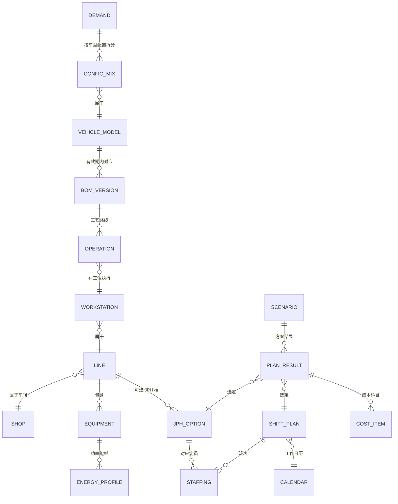

### 4.2 计算链路（一次测算怎么跑）

1. **定场景**：输入需求、车型组合、月份、参数版本。
2. **取有效数据**：按月份取当月有效的 BOM、工时、单价、产能上限。
3. **算负荷**：需求 × 单车标准工时 → 各车间所需工时。
4. **选 JPH 和班次**：对每个候选 JPH 档和班次方案，计算可用产能，检查是否满足需求和约束；不够就加班，再不够就标记缺口。
5. **算资源**：人数、加班小时、设备开动小时、能耗、班车线路。
6. **算成本**：资源 × 单价，再加分摊的固定成本，得到总成本和单车成本。
7. **比方案**：对比所有可行方案，选成本最低的；或者交给优化求解器。
8. **解释**：输出成本差异来自哪里（人工、能源、加班），以及卡在哪个约束上。

### 4.3 关键权衡（模型要回答的问题）

| 权衡 | 一边 | 另一边 |
| :-- | :-- | :-- |
| 高 JPH 少班次 vs 低 JPH 多班次 | 多配人和设备，固定能耗低 | 夜班补贴、班车、固定能耗高 |
| 加班 vs 加班次 | 短期灵活，单价高，有法规上限 | 需要招人，长期单价低 |
| 平顺生产 vs 跟随需求 | 库存和资金占用增加 | 人员和设备调整频繁 |
| 车型集中排产 vs 混线 | 换型少、效率高 | 需求响应慢、库存高 |
| 用外包 vs 正式员工 | 弹性大 | 质量和技能风险 |

### 4.4 数学模型骨架（优化版）

- **决策变量**（JPH 按车间设定）：每个车间、每月的 JPH 档 \( j \)、班次数 \( s \)、加班小时 \( o \)、各车型产量 \( x_m \)。
- **目标**：
  $$\min \; Σ(人工 + 加班 + 班车 + 外包 + 能源 + 变动制造费用) + 缺口惩罚 + 库存成本$$
- **约束**：
  - \( Σ_m x_m \le JPH_j \times 小时 \times s + JPH_j \times o \)（产能）
  - \( x_m \ge 需求_m \)，或允许带惩罚的缺口
  - \( x_m \le 产能上限_{车间,m} \)
  - \( o \le 加班上限 \)
  - 人数 ≤ 可用人数（含招聘提前期）
  - 车间串联、车间之间有缓存：上月缓存 + 上游本月产出 = 下游本月消耗 + 本月缓存；缓存 ≤ 缓存上限（冲压件库、白车身库 WBS、涂装车身库 PBS），缓存有持有成本
- **方法**：混合整数规划（JPH 档和班次是离散选择）；各车间各自选 JPH 档和班次，通过缓存约束联动。已确认：系统使用优化求解。

---

## 5. 数据与技术实现

### 5.1 数据分层

| 层 | 内容 |
| :-- | :-- |
| 主数据 | 车型、配置、车间、产线、工位、设备、成本中心 |
| 参数（带版本和生效日期） | 标准工时、JPH 档、定员标准、单价、产能上限、日历 |
| 事务数据 | 订单、预测、实际产量、实际工时、实际能耗、实际加班 |
| 场景与结果 | 场景输入、方案结果、成本明细 |

### 5.2 系统结构

1. **数据层**：华为云数仓，接入 PLM、MES、人事、能源、财务的数据，统一成主数据和参数表。
2. **计算层**：规则测算引擎（截图里的能源、OH、班车、工资、外包、加班费六个模块），加上方案枚举或优化求解。
3. **应用层**：Web 系统负责参数维护和测算，报表负责总览、趋势和方案对比。
4. **AI 层**：LLM 沿实体关系解释结果（比如「为什么 3 月单车成本高」），也可以用自然语言改输入、发起模拟。

### 5.3 治理要点

- 每个参数要有负责人：工时归 IE，产能上限归计划，单价归财务。
- 参数变更走版本管理，保留历史，方便回溯「当时为什么这么算」。
- 模型要和实际对账：用实际产量、工时、能耗、加班校准参数，偏差超阈值时告警。
- 场景假设要统一：各部门用同一套参数，避免各算各的。

---

## 6. 模拟场景示例

| 场景 | 改什么输入 | 看什么输出 |
| :-- | :-- | :-- |
| 销量 ±10% | 需求 | 最优 JPH 和班次是否切换，单车成本变化 |
| 新车型导入 | 车型组合、爬坡曲线 | 瓶颈车间、需要加多少人 |
| 电价上涨 | 能源单价 | 是否值得调整班次避开峰电 |
| 某车间设备故障 | 开动率 | 产量缺口、加班成本 |
| 出口集中发运 | 需求时间分布 | 是否提前生产、库存成本 |
| 跨工厂调产 | 3 厂产能分配 | 整体成本最优的分配 |

---

## 7. 已确认与待确认

**已确认**
- 系统使用优化求解，不只是方案对比。
- JPH 按车间分别设定，车间之间靠缓存衔接。
- 本人角色：**总体筹划**。

**我的角色怎么讲（总体筹划）**
- **架构**：定数据层、参数层、计算引擎、求解器和应用层的总体结构。
- **实体框架**：定车型、配置、BOM、车间、JPH档、班次、人员、能源、成本科目这些对象和关系。
- **模块划分**：拆成下文 12 个分块，明确各块的输入、输出和负责方。
- **数据标准**：参数口径、负责人、版本和生效日期。
- **集成验收**：端到端测试，用实际产量、工时、能耗、加班校准模型。

面试一句话：「我负责总体筹划：先定实体框架和模块划分，再定数据标准，各业务部门按分块提供参数，最后由我牵头做集成和实际对账验收。」

**仍待确认（⚠）**
- ⚠ 人力测算按定员标准还是按工时？
- ⚠ 能源是否区分固定和变动、是否考虑峰谷电价？
- ⚠ 用的是哪个求解器（商用还是开源），一次求解多长时间？
- ⚠ 优化周期是按月还是按周，是否做车型排序？
- ⚠ 上线后的真实效果（测算时长、成本节省），用真实数字。

---

## 8. 分块构建方案

总体思路：先打底（块1–3：实体、参数、需求），再建产能与时间（块4–6），再建成本（块7–9），最后建求解、模拟和报表（块10–12）。每块单独可测，再集成。

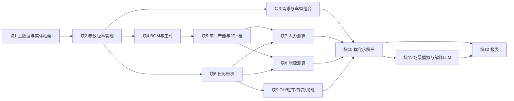

### 块1 主数据与实体框架
- **目标**：统一对象和关系，各部门用同一套编码。
- **输入**：车型表(车型代码、平台、生命周期)、配置表(配置代码、车型、选项)、车间表(车间代码、名称、工序顺序)、产线/工位/设备表、成本中心表、成本科目表。
- **逻辑**：定义实体、属性、关系（车型—配置—BOM—工序—车间—设备—成本中心）；编码规则、唯一键。
- **输出**：主数据表 + 实体关系图（第 4.1 节）。
- **依赖**：无（起点）。
- **验收**：编码唯一、无孤儿记录；每个车型都能追到车间和成本中心；业务方签字确认。
- **负责方**：数据团队主导（本人总体筹划），工艺、计划、财务确认。

### 块2 参数版本管理
- **目标**：所有参数带版本、生效日期和负责人，能回溯。
- **输入**：参数表通用字段：参数键、值、单位、生效日、失效日、版本号、负责人、来源系统。
- **逻辑**：按测算日期取有效版本；变更走审批；完整性和范围校验（缺值、负数、超范围）。
- **输出**：按场景冻结的参数快照。
- **依赖**：块1。
- **验收**：任一历史测算可用当时的参数快照重算出相同结果；校验规则覆盖全部必填参数。
- **负责方**：数据团队；各参数的业务负责人（工时归 IE，产能归计划，单价归财务）。

### 块3 需求与车型组合
- **目标**：给出按月、按车型（必要时按配置）的需求。
- **输入**：销售预测/订单表(月份、车型、配置、数量、市场)、出口船期、安全库存要求。
- **逻辑**：预测 → 车型组合比例；配置比例拆分（如天窗率）；场景系数（±10%）。
- **输出**：需求表 demand(月, 车型, 数量)。
- **依赖**：块1、块2。
- **验收**：与 S&OP 会议确认的数字一致；各车型合计 = 总量。
- **负责方**：销售与计划。

### 块4 BOM / 工时
- **目标**：把车型配置换算成各车间的单车标准工时和单车能耗。
- **输入**：MBOM(车型、配置、零件、工序、生效/失效日)、工序工时表(工序、车间、标准工时)、单车能耗表。
- **逻辑**：单车工时_车间 = Σ 配置比例 × 工序工时；BOM 按生效日期取版本。
- **输出**：单车工时和单车能耗（车间 × 车型）。
- **依赖**：块1、块2、块3（配置比例）。
- **验收**：与 IE 标准工时一致；BOM 无断档、无重叠（同 MBOM 变更核对规则）。
- **负责方**：工艺/IE。

### 块5 车间产能与 JPH 档
- **目标**：每个车间可选的 JPH 档，以及对应定员、运行功率和产能上限。
- **输入**：JPH 档表(车间、JPH、每班定员、运行功率 kW、开动率)、产能上限表(车间、车型组合、月份、上限，即截图里的产能限制配置)、缓存上限表。
- **逻辑**：JPH ≈ 3600 / 瓶颈节拍 × 开动率；每档定员 ≈ 单车工时 × JPH / 人员效率。
- **输出**：JPH 档候选集（车间级）。
- **依赖**：块4。
- **验收**：每档 JPH 能被历史实际产量验证；定员与人事定编一致。
- **负责方**：计划、工艺、设备。

### 块6 日历与班次
- **目标**：每月可用工作时间。
- **输入**：日历表(日期、是否工作日、节假日)、班次方案表(班次数、每班有效小时、夜班补贴)、加班规则(月上限、单价)。
- **逻辑**：月开动小时 = 每班有效小时 × 班次 × 工作日；加班上限按法规和工会协议。
- **输出**：月 × 班次方案的可用小时。
- **依赖**：块2。
- **验收**：工作日与生产日历一致；加班上限合规。
- **负责方**：生产计划、人事。

### 块7 人力测算
- **目标**：给定 JPH 档和班次，算人数和人工成本。
- **输入**：定员、工资、夜班补贴、出勤率、外包比例。
- **逻辑**：人数 = 每班定员 × 班次 ÷ 出勤率；人工 = 人数 × 工资 + 夜班补贴。
- **输出**：人数、人工成本（车间 × 月 × 方案）。
- **依赖**：块5、块6。
- **验收**：用历史月份回算，与实际人工成本偏差在约定阈值内 ⚠。
- **负责方**：人事、财务。

### 块8 能源测算
- **目标**：区分固定能耗和变动能耗。
- **输入**：运行功率（开动即耗，如涂装烘房）、单车能耗、电/气单价（可分峰谷）。
- **逻辑**：能源 = 运行功率 × 开动小时 × 电价 + 产量 × 单车能耗 × 电价。
- **输出**：能源成本（车间 × 月 × 方案）。
- **依赖**：块4、块5、块6。
- **验收**：回算与能源计量偏差在阈值内 ⚠。
- **负责方**：能源/设备、财务。

### 块9 其他成本：OH、班车、外包、加班
- **目标**：补齐截图里的其余测算模块。
- **输入**：OH 固定/变动分摊、班车合同（每班每月）、外包合同（每班每月）、加班单价。
- **逻辑**：班车 = 班次 × 单价；外包 = 班次 × 单价；加班 = 加班小时 × 定员 × 加班单价 + 加班能耗；OH = 固定 + 产量 × 变动率。
- **输出**：各科目成本。
- **依赖**：块6。
- **验收**：科目与财务成本中心口径一致。
- **负责方**：财务、行政（班车）、采购（外包）。

### 块10 优化求解器
- **目标**：在约束下选出总成本最低的方案。
- **输入**：块3 需求、块5 JPH档与产能上限、块6 班次、块7–9 成本系数。
- **逻辑**：混合整数规划（第 4.4 节）：每车间每月选一个 JPH档×班次；加班、产量、缓存为连续变量；车间之间做缓存流平衡；缺口加惩罚。
- **输出**：每车间每月的 JPH、班次、人数、加班、产量、缓存；总成本和单车成本。
- **依赖**：块3、5–9。
- **验收**：能求出最优解；小规模问题与枚举结果一致；求解时间满足使用要求。
- **负责方**：数据/算法团队。

### 块11 场景模拟与解释（LLM）
- **目标**：改输入看结果，并解释原因。
- **输入**：场景定义表(场景名、修改的参数、系数)。
- **逻辑**：复制参数快照 → 覆盖参数 → 重新求解 → 与基准比较；LLM 沿实体关系解释差异（如「10 月单车成本高：工作日少 → 焊装升档 → 加班增加」）。
- **输出**：场景对比表和解释文字。
- **依赖**：块10、块1（实体关系）。
- **验收**：解释能追溯到具体参数和约束；业务方认可。
- **负责方**：数据团队、计划。

### 块12 报表
- **目标**：总览、趋势和方案对比（截图里的「假设 JPH 进行测算」总览）。
- **输入**：求解结果、场景结果、实际数据。
- **逻辑**：成本按科目、车间、月份汇总；计划 vs 实际偏差。
- **输出**：总览页、车间明细、场景对比、偏差监控。
- **依赖**：块10、块11。
- **验收**：报表数字与求解结果一致；管理层按月使用。
- **负责方**：数据团队。

---

## 9. 最终集成构建

### 9.1 集成架构

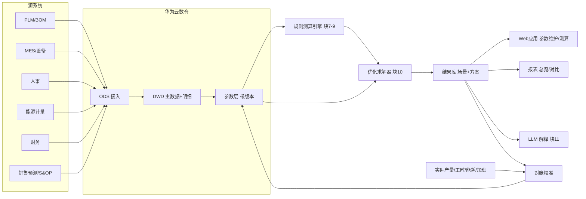

### 9.2 端到端数据流（一次测算）
1. 用户在 Web 应用选场景，系统冻结一份参数快照。
2. 读取需求、车型组合、BOM 工时、JPH 档、班次、单价。
3. 规则引擎为每个「车间 × 月 × JPH档 × 班次」算成本系数。
4. 求解器求最优方案。
5. 结果写入结果库（带场景号和参数版本）。
6. 报表展示，LLM 生成解释。
7. 月末用实际数据对账，偏差回写参数校准。

### 9.3 构建路线

| 阶段 | 内容 | 验收 |
| :-- | :-- | :-- |
| 0 准备 | 实体框架、模块划分、数据标准、负责人 | 业务签字 |
| 1 MVP | 块1–3、5、6 + 人力和能源测算 + 方案枚举，单车间 | 回算一个历史月，偏差可接受 |
| 2 全成本 | 四车间 + 块9 全部科目 + 报表 | 六个测算模块与财务口径一致 |
| 3 优化 | 块10 求解器 + 缓存约束 + 场景模拟 | 结果与枚举一致，业务采纳 |
| 4 智能化 | LLM 解释、自然语言发起模拟、偏差告警 | 管理层月度使用 |

### 9.4 集成测试与校准
- **单块测试**：每块按验收标准单测。
- **一致性测试**：小规模问题，求解器结果 = 枚举结果。
- **回算测试**：用过去 3–6 个月的实际参数输入，比较测算成本与实际成本，按科目看偏差 ⚠ 阈值待定。
- **压力测试**：极端场景（需求 +30%、某车间停线），看模型是否给出合理结果或明确缺口。
- **持续校准**：每月对账，偏差超阈值时告警，追到具体参数（工时、开动率、单价）并修正。

### 9.5 治理
- 参数负责人制度、版本和审批（块2）。
- 场景命名和冻结规则，避免各部门各算各的。
- 模型变更（新约束、新科目）走评审，保留变更记录。
- 结果使用规范：决策用的方案必须注明场景号和参数版本。

---

## 10. 原型（示例）

路径：`/workspace/jph-cost-model/prototype/`（说明见 README.md，详细操作见 [模拟器使用说明.md](模拟器使用说明.md)）。Python + PuLP，**全部是示例数据**。

- 规模：4 车间（冲压、焊装、涂装、总装）× 3 车型 × 12 个月；每车间 3 个 JPH 档 × 1/2/3 班；约 430 个二进制变量。
- 结果（示例数据，单车成本只含本模型覆盖的人工、能源、班车、外包、加班、OH、缓存）：

| 场景 | 状态 | 总成本(万元) | 年产量 | 缺口 | 单车成本(元) | 加班(万元) | 能源(万元) |
|:--|:--|--:|--:|--:|--:|--:|--:|
| 基准 | Optimal | 42,953 | 120,000 | 0 | 3,579 | 783 | 4054 |
| 需求+10% | Optimal | 46,004 | 132,000 | 0 | 3,485 | 784 | 4405 |
| 需求-10% | Optimal | 39,711 | 108,000 | 0 | 3,677 | 515 | 3663 |
| 电价+20% | Optimal | 43,764 | 120,000 | 0 | 3,647 | 783 | 4865 |
| 工资+5% | Optimal | 43,765 | 120,000 | 0 | 3,647 | 783 | 4054 |

- 观察（示例数据下）：
  - 基准方案以「中档 JPH + 两班」为主，旺季月份（5、10、11 月，总装还有 12 月）车间升档；冲压 JPH 高，多数月份一班就够。
  - 需求 +10%：总成本增加，但单车成本下降（固定成本被摊薄）；10 月总装开到三班。
  - 需求 −10%：部分月份降档或降为一班，单车成本上升。
  - 电价 +20% 和工资 +5%：本例中最优班次不变，只是成本上升，说明方案对这两项不敏感。
- 简化项：基准包未启用换型、爬坡和物流阶梯，这三项在 `plants/FULL_COST/` 里可选。周排序见 `weekly.py`。峰谷电价、招聘提前期仍是近似或未启用。
- 多工厂（2026-10-17 新增）：原型已改为配置驱动，`data_loader.load(data_dir)` 可读取任意工厂配置包；`plant_check.py` 检查配置包并给出就绪度，`run_plant.py plants/DEMO_B` 对虚构的示例工厂 B 求解并回测对账，见第 21.4.3 节。

---

## 11. 相关理论

每项按四点写：核心思想、关键公式、对应哪个分块、面试一句话。

### 11.1 约束理论 TOC（瓶颈，鼓-缓冲-绳 DBR）
- **核心思想**：系统产出由瓶颈决定。非瓶颈提效没有用，要先找到、用足、再提升瓶颈。DBR 的意思是：瓶颈定节奏（鼓），瓶颈前放缓冲防断料（缓冲），按瓶颈节奏投料（绳）。
- **公式**：系统产出 = min(各车间产能)。
- **对应分块**：块5（瓶颈车间 JPH）、块10（车间之间的缓存约束）。
- **一句话**：「JPH 按车间设，最后的产量由瓶颈车间决定，所以模型里用缓存约束把四个车间连起来，相当于 DBR。」

### 11.2 精益生产 / 平准化 Heijunka
- **核心思想**：把产量和车型组合尽量摊平，减少波动带来的加班、闲置和库存。
- **公式**：平准化日产量 = 月需求 ÷ 工作日。
- **对应分块**：块3（需求平滑）、块10（平顺生产和跟随需求之间的权衡）。
- **一句话**：「平准化少加班但多库存，模型把库存持有成本和加班成本放在一起比，算出最合适的平滑程度。」

### 11.3 节拍 Takt 与线平衡 Line Balancing
- **核心思想**：Takt 是客户需求的节奏；线平衡是把工序均匀分到各工位，让最慢工位的节拍接近 Takt。
- **公式**：Takt = 可用时间 ÷ 需求量；平衡率 = Σ工序时间 ÷ (工位数 × 瓶颈节拍)；JPH ≈ 3600 ÷ 瓶颈节拍。
- **对应分块**：块4（工时）、块5（JPH 档和定员）。
- **一句话**：「每个 JPH 档背后是一套线平衡方案，决定了需要多少人。」

### 11.4 OEE（设备综合效率）
- **核心思想**：衡量设备实际产出和理论产出的差距。
- **公式**：OEE = 时间开动率 × 性能开动率 × 合格率。
- **对应分块**：块5（开动率修正 JPH）、块9.4 的校准。
- **一句话**：「实际 JPH = 设计 JPH × OEE，用实际 OEE 校准模型，测算才和现场对得上。」

### 11.5 综合生产计划 APP（追逐策略 vs 平准策略）
- **核心思想**：中期（按月）决定产量、人力、加班和库存。追逐策略跟着需求调产能，平准策略保持产量稳定、用库存吸收波动。
- **公式**：min Σ(正常人工 + 加班 + 招聘/裁员 + 库存 + 缺货)。
- **对应分块**：块10。本模型本质上就是一个带离散 JPH 档和班次的 APP。
- **一句话**：「这个系统就是综合生产计划的落地，只是把 JPH 档和班次做成了离散选择。」

### 11.6 主生产计划 MPS / MRP / S&OP
- **核心思想**：S&OP 是销售和运营对齐的月度需求和产能；MPS 是按车型、按周的生产计划；MRP 再按 BOM 展开物料需求。
- **公式**：净需求 = 毛需求 − 库存 − 在途 + 安全库存。
- **对应分块**：块3（S&OP 输入）、块10 的输出给 MPS、块4 的 BOM 支撑 MRP。
- **一句话**：「模型在 S&OP 和 MPS 之间，把需求变成成本最优的产能方案。」

### 11.7 线性规划 LP / 混合整数规划 MIP，灵敏度与影子价格
- **核心思想**：LP 处理连续变量；MIP 加入整数和 0/1 变量（选哪个 JPH 档、开几个班）。灵敏度分析看参数变化多少最优解会改变；影子价格是约束放宽一个单位，目标值改善多少。
- **公式**：min cᵀx，s.t. Ax ≤ b，部分 x 取整数；影子价格 = ∂目标值 / ∂b。
- **对应分块**：块10、块11。
- **一句话**：「影子价格能告诉我们焊装多一小时产能值多少钱，从而判断是否值得投资扩产。」（注：MIP 的影子价格要在固定整数变量后的 LP 上求。）

### 11.8 混流排序 / 车辆排序问题（Car Sequencing）
- **核心思想**：混线生产时，按天或班安排车型顺序，满足「每 N 台最多 K 台带天窗」这类间隔规则，并减少涂装换色。
- **公式**：约束形式为任意连续 N 台中，具备某选项的车 ≤ K 台。
- **对应分块**：块3 和块4 的配置比例。月模型定 JPH 和班次；`weekly.py` 是下一层的周序列第一版（示例规则）⚠。
- **一句话**：「月度模型定 JPH 和班次，日排序再处理车型间隔和换色，两层配合。」

### 11.9 作业成本法 ABC
- **核心思想**：按作业和成本动因分摊间接费用，而不是简单按产量平摊。
- **公式**：单车分摊 = Σ(作业成本率 × 该车消耗的动因量)。
- **对应分块**：块9（OH 分摊）、块12（单车成本）。
- **一句话**：「复杂配置消耗的工时和换型更多，ABC 能让单车成本反映真实差异。」

### 11.10 本量利 CVP / 固定与变动成本
- **核心思想**：成本分固定和变动，产量越大，固定成本摊得越薄。
- **公式**：总成本 = 固定成本 + 单位变动成本 × 产量；单车成本 = 固定 ÷ 产量 + 单位变动；盈亏平衡量 = 固定成本 ÷ (单价 − 单位变动成本)。
- **对应分块**：块7–9、块12。原型里需求 +10% 时单车成本下降，就是这个原理。
- **一句话**：「班次是阶梯式固定成本，所以产量在开班临界点附近时，单车成本会跳。」

### 11.11 学习曲线 / 爬坡
- **核心思想**：累计产量每翻一倍，单车工时按固定比例下降；新车型导入时 JPH 和合格率逐步爬升。
- **公式**：Tₙ = T₁ × n^b，b = log₂(学习率)。
- **对应分块**：块4（工时随时间变）、块5（爬坡期 JPH 打折）。
- **一句话**：「新车型导入的前几个月要按爬坡曲线打折 JPH，否则排产会过于乐观。」

### 11.12 排队论 / 缓冲（Little 定律）
- **核心思想**：车间之间的缓冲用来吸收波动；缓冲越大越稳定，但占用资金和场地。
- **公式**：Little 定律：L = λ × W（在制数 = 产出率 × 停留时间）。
- **对应分块**：块5（缓存上限）、块10（缓存流平衡和持有成本）。
- **一句话**：「WBS、PBS 缓存的大小用 Little 定律估，再在模型里作为约束。」

### 11.13 仿真 / 数字孪生 / 蒙特卡洛
- **核心思想**：优化给出确定输入下的最优解；仿真考虑随机性（故障、出勤、需求波动），检验方案是否稳健。蒙特卡洛就是大量随机抽样，看成本分布。
- **公式**：期望成本 ≈ (1/N) Σ 成本(随机输入ᵢ)；看 P90 之类的分位数。
- **对应分块**：块11（场景模拟的延伸）。
- **一句话**：「优化回答最好是多少，仿真回答这个方案在波动下稳不稳。」

### 11.14 Ontology / 实体框架
- **核心思想**：用对象、属性、关系和规则描述业务，让数据有统一语义，人和 LLM 都能沿关系推理。
- **公式**：无，表达形式是「实体—关系—实体」三元组，加约束规则。
- **对应分块**：块1（基础）、块11（LLM 解释）。
- **一句话**：「实体框架是整个系统的地基，参数挂在对象上，结果可以沿关系追溯原因。」

---

## 12. 业务已有 demo 时，Data AI 组如何协作

> 场景：业务部门（如计划或工程）已经自己做出了一个产量成本测算 demo，Data AI 组怎么进入、怎么帮忙，而不是另起炉灶或抢功。

### 12.1 先诊断痛点

先用一到两周把 demo 摸清楚，问下面五个问题：

| 诊断问题 | 要看什么 | 常见问题 |
|:--|:--|:--|
| 数据从哪来？ | 参数是否来自人工 Excel、是手填还是系统导出 | 参数散落在多个 Excel 里，口径各异 |
| 多久更新、谁负责？ | 工时、单价、产能上限的更新频率和负责人 | 没人负责，参数半年没更新 |
| 和实际对得上吗？ | 测算的产量、人工、能耗与 MES、财务实际的偏差 | 从未对账，没人知道准不准 |
| 能扩到 3 个工厂吗？ | 编码、日历、车间结构是否通用 | 写死了一个工厂的结构 |
| 求解规模和速度够吗？ | 车间、车型、月份增加后的求解时间 | 枚举方式在规模变大后跑不动 |

诊断的产出是一页痛点清单，按「影响大、容易做」排序，和业务一起确认先做哪一个。

### 12.2 五个切入点（由易到难）

1. **数据底座**
   - 把 demo 用到的参数（工时、JPH档、定员、单价、产能上限、日历）搬进华为云数仓，建成参数表。
   - 每张参数表带版本号、生效/失效日期和负责人。
   - 对应原型：`data/*.csv` 就是参数层的简化版；真实系统用数仓表代替 CSV，`data_loader.py` 改为从数仓读取。
   - 价值：业务不用再维护 Excel，测算可以回溯。
2. **实际对账与校准**
   - 用 MES 实际产量、实际工时、能源计量和财务实际成本，与测算结果逐月对比，出偏差报告（按车间、科目）。
   - 偏差超阈值时追溯到参数（开动率、工时、单价）并修正。
   - 价值：让业务第一次知道模型准不准，这是最容易建立信任的一步。
3. **实体框架与数据标准**
   - 统一车型、配置、车间、JPH档、班次、成本科目的编码和关系（第 4.1 节）。
   - 同一套实体框架可以复用到单车成本、产能规划、物流成本等其他场景。
   - 价值：从「一个 demo」变成「一套可复用的数据资产」。
4. **工程化、平台化**
   - 部署到华为云：权限（谁能改参数、谁能看成本）、性能（求解器选型、时限）、多工厂（参数按工厂隔离）、调度（每月自动跑基准场景）。
   - 对应原型：`model_builder.py` 的求解器和时限可配置；场景用 `run.py` 的 `SCEN` 组织。
   - 价值：从个人工具变成部门系统。
5. **AI 增强（最后做）**
   - LLM 沿实体关系解释结果，自然语言发起场景，用预测模型替代固定输入（如需求预测、开动率预测）。
   - 放在最后，是因为前四步没做好时，AI 只会把错误的数据解释得更流畅。

### 12.3 协作原则

- **成果归业务**：系统是业务的，Data AI 组是支撑方。汇报时业务讲成果，我们讲数据和方法。
- **从一个具体痛点开始**：选一个 2–4 周能见效的点（例如「把产能上限和工时搬进数仓，并做一次实际对账」），做出来再扩。
- **分工（RACI）**

  | 工作 | 业务 | Data AI 组 |
  |:--|:--|:--|
  | 场景定义、业务规则、口径 | 负责（R/A） | 参与（C） |
  | 数据接入、数据标准、质量规则 | 参与（C） | 负责（R/A） |
  | 平台、求解器工程化 | 知情（I） | 负责（R/A） |
  | AI 能力（解释、预测） | 参与（C） | 负责（R） |
  | 验收 | 共同（A） | 共同（R） |

- **借用管理机制**：通过 MBO（目标管理）或数字化项目立项，把协作写进双方目标，而不是靠私人关系推动。
- **强调复用**：每做一块，都说明它还能用在哪里（同一份工时数据可以用于单车成本，同一套日历可以用于物流排程）。

### 12.4 面试说法（30 秒）

「业务已经有 demo 时，我不会推倒重来。先诊断：数据是不是手工 Excel、谁维护、和实际对不对得上、能不能扩到三个工厂。然后由易到难切入：先把参数搬进数仓、带版本和负责人；再做实际对账，让大家知道准不准；接着沉淀实体框架和数据标准，供单车成本等场景复用；再做平台化；AI 放最后。成果归业务，我们从一个 2 到 4 周能见效的痛点开始。」

---

## 13. AI 如何提速：LLM 用于数据处理、文档处理、结果校验，以及场景小模型

### 13.1 AI 在哪些环节提速

| 环节 | 怎么用 | 效果 |
|:--|:--|:--|
| 规则梳理 | 把访谈记录、工艺文件、制度文档交给 LLM，整理出规则清单和参数清单，再由业务确认 | 从零写需求变成「审稿」 |
| 代码生成 | 生成数据清洗脚本、参数校验规则、求解器约束代码、报表 SQL 的初稿 | 开发初稿时间大幅缩短，人负责审查和测试 |
| 自然语言探索场景 | 「如果 10 月需求加 25%，总装要不要开三班？」→ 转成场景参数，调用模拟器 | 业务不用懂参数表也能做模拟 |
| 调研 | 快速梳理行业做法、算法选型（如 MIP 求解器对比） | 缩短前期调研 |

### 13.2 LLM 用于数据处理

- **规范化杂乱取值**：例如车型字段里有「6.8米」「6米8」，设备名称有多种写法。LLM 生成映射建议，人确认后存成映射表，之后由映射表执行。
- **从文本中抽取字段**：从 ECN（工程变更通知）、设备维修记录、外包和班车合同中抽取关键字段（零件号、生效日期、单价、计价方式）。
- **建议质量规则**：根据字段含义和样本数据，建议空值、范围、一致性规则，例如「每班定员必须随 JPH 档位单调增加」。
- **原则**：**LLM 只提建议，确定性规则来执行，LLM 绝不直接改生产数据。** 每条映射和规则都要有人确认并留痕。

### 13.3 LLM 用于文档处理

- **把文档解析成参数**：工艺文件、BOM、工时表、班车和外包合同 → 结构化参数表的候选值，例如 `jph_options.csv` 的定员和功率、`shift_options.csv` 的班车和外包单价，再由负责人确认入库。
- **生成数据文档**：根据表结构和规则自动生成数据字典、口径说明，例如「人数 = 每班定员 × 班次数」，并标明来源字段。
- **RAG 问答**：把口径文档、参数说明、变更记录建成知识库，回答「为什么 10 月总装要加班」时附上引用出处（哪个参数、哪个版本）。

### 13.4 LLM 用于结果校验

| 层次 | 做法 | 谁来判定 |
|:--|:--|:--|
| 常识审查 | LLM 检查结果是否违反常识，例如单车成本突然翻倍、三班但利用率只有 60% | LLM 提出可疑点 |
| 解释 | 沿实体关系解释结果：「10 月工作日只有 18 天 → 总装正常产能 9,720 台 < 需求 11,000 → 加班 35.6 小时」（示例数据） | 人判断解释是否合理 |
| 硬校验 | 规则和对账：产量 ≤ 产能、加班 ≤ 上限、成本合计 = 各科目之和、测算与实际偏差在阈值内 | 确定性规则 |

原则：硬校验由规则和对账完成；LLM 的作用是更快地找出可疑点和给出解释，不做最终判定。

### 13.5 场景小模型

| 小模型 | 用途 | 常用方法 | 替换模拟器中的哪个固定参数 |
|:--|:--|:--|:--|
| 需求预测 | 按月、按车型预测需求 | LightGBM、Prophet | `demand.csv` |
| 设备开动率预测 | 预测各车间开动率或 OEE | 回归、梯度提升树 | JPH 的开动率修正 |
| 能耗回归 | 拆分固定能耗和单车能耗，考虑季节和温度 | 线性回归、分段回归 | `run_kw`、`kwh_per_unit` |
| 新配置工时估算 | 根据配置选项估算新配置的工时 | 回归、相似件匹配 | 块4 的单车工时 |
| 文本分类与抽取 | ECN、维修记录分类，合同字段抽取 | 微调的小语言模型 | 参数入库流程 |
| 求解代理模型 | 大规模场景下快速估算成本，筛选候选方案后再精确求解 | 回归或神经网络 | 场景筛选 |

**构建步骤**
1. 选场景：挑一个固定参数误差大、影响成本大的点（例如开动率）。
2. 准备数据：按实体框架取数（车间编码 + 月份 + 车型），保证训练数据和模型输入口径一致。
3. 先基线再复杂：先用历史均值或线性回归做基线，确认有提升再换复杂模型。
4. 接入模拟器：用模型输出替换固定参数，例如在 `data_loader.py` 中用预测值覆盖 `demand`。
5. 监控和重训：每月对比预测与实际，偏差变大时重训。

**小语言模型怎么做**：先用大模型给样本打标签（如 ECN 分类），人工抽检纠正，再用这些样本微调一个小模型；部署在本地或华为云上，成本低、数据不出厂。

### 13.6 面试说法（30 秒）

「AI 提速主要在四个地方：从访谈和文档里梳理规则，生成代码初稿，用自然语言发起场景模拟，以及快速调研。数据处理上，LLM 负责建议映射、抽取字段和建议质量规则，执行交给确定性规则，绝不直接改生产数据。结果校验分三层：LLM 找可疑点并解释，硬校验靠规则和实际对账。再往下是场景小模型，比如需求预测、开动率预测和能耗回归，用来替换模拟器里的固定参数，先做基线，再逐步迭代。」

---

## 14. 复杂逻辑如何统筹：分层、分模块、规则参数化、版本化

### 14.1 分层架构

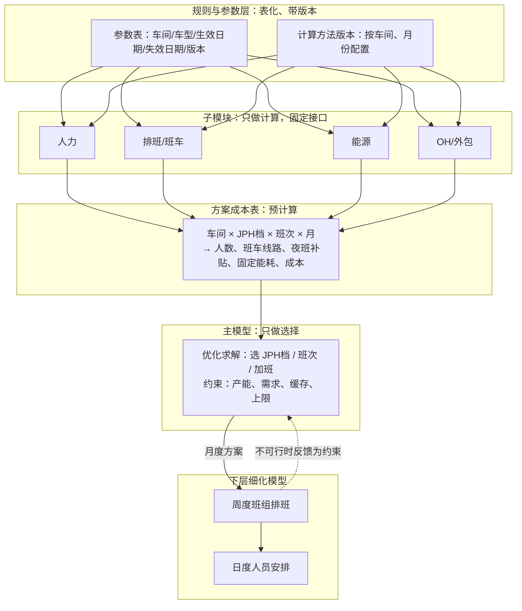

### 14.2 五条原则

1. **主模型只做选择，子模块只做计算**
   - 主模型（求解器）只决定选哪个 JPH 档、几个班、加多少班，以及满足哪些约束。
   - 子模块（人力、排班、能源、OH）负责「给定方案，算出用量和成本」，接口固定：输入（车间、JPH档、班次、月份），输出（各科目成本）。
   - 对应原型：`model_builder.py` 是主模型，`cost_functions.py` 是子模块。改人力算法只需改 `labor()`，求解器不用动。
2. **规则和参数表化**
   - 规则和参数做成表，字段包括车间、车型、生效日期、失效日期、版本号；测算时按「场景 + 月份」选出有效的那一行。
   - 这和 MBOM 用生效/失效日期管理零件变更是同一个思路。
3. **公式变更也要版本化**
   - 公式变了（例如能源从「全部按台」改成「固定 + 变动」），不直接覆盖旧公式，而是新增一个计算方法版本，按车间和月份配置使用哪个版本。
   - 新旧版本并行跑一段时间，比较差异，确认后再切换。
   - 每次测算记录用了哪个参数版本、哪个计算方法版本，保证结果可以复现。
4. **复杂分支预先算成方案成本表**
   - 对每个「车间 × JPH档 × 班次」预先算好人数、班车线路数、夜班补贴、固定能耗和成本，求解器只查表。
   - 对应原型：`fixed_breakdown()` 实际上就是在为每个组合生成一行方案成本。
   - 详细的班次和班组排班交给下层模型：月度方案 → 周度班组 → 日度人员（分层计划）。下层发现不可行（例如某技能工种不够）时，反馈给上层作为新约束。
5. **治理**
   - 用实体框架划定模块边界：哪个模块负责哪些实体和字段。
   - 参数负责人：工时归 IE，定员和工资归人事，单价和 OH 归财务，产能和日历归计划。
   - 每个模块都有单元测试（给定输入，输出必须等于手算值，例如第 1A.2 节的总装 10 月）。
   - 用历史数据回测：过去几个月的实际参数输入，看测算和实际的偏差。
   - 变更影响分析：任何参数或公式变更，先在基准场景上跑一次，看总成本和方案变化多少，再发布。

### 14.3 面试说法（30 秒）

「复杂逻辑我用分层来管：主模型只做选择，也就是选 JPH 档、班次和加班；人力、能源、OH 这些子模块只做计算，通过固定接口提供成本。规则和参数都表化，带车间、车型、生效失效日期和版本，按场景和月份取值，和 MBOM 的生效失效管理是一个思路。公式变了也要版本化，新旧并行比较。复杂的排班细节预先算成方案成本表，求解器查表；更细的排班交给下层模型，不可行再反馈成约束。」

---

## 15. 离散模式 vs 连续变量：人数、JPH、班次、物流为什么不能随便弹性调整

### 15.1 三类变量

| 类型 | 例子 | 建模方式 | 原型中 |
|:--|:--|:--|:--|
| 离散选择 | JPH 档；班次模式（1 班 8 小时、两班倒、三班倒、两班 12 小时） | 0/1 变量，每个车间每月只能选一个 | `y[(车间, 档位, 班次, 月)]`，约 430 个二进制变量 |
| 有上下限的连续量 | 加班 0–36 小时；缓存 0–容量；产量 ≤ 产能 | 连续变量 + 上下限约束 | `ot`、`inv`、`x` |
| 派生量 | 人数、能耗、物流成本 | 由所选模式和产量计算，不单独决策 | `cost_functions.py` |

### 15.2 为什么人数、JPH、班次不是连续的

- **定员是按模式设计的**：每个 JPH 档对应一套线平衡方案，每个班次模式对应固定的定员、班车线路和设备开动时间。不能「JPH 33.7、人数 791」。
- **切换有成本和提前期**：换 JPH 档要重新平衡工位、培训；开第三班要招聘、安排班车。所以现实中会加约束，例如「班次模式每季度最多调整一次」「相邻月 JPH 最多变一档」。
- **劳动法规和工会协议**：加班有法定上限，班次调整要提前通知和协商。

### 15.3 可选的模式切换约束（已在原型中实现，默认关闭）

`model_builder.build(d, jph_step=False, shift_quarter=False)`：
- `jph_step=True`：相邻月的 JPH 档位序号最多变化 1（例如不能从 50 直接跳到 30）。
- `shift_quarter=True`：每个车间的班次数在一个季度内保持不变（只能在 1、4、7、10 月调整）。
- 测试脚本：`prototype/test_mode_constraints.py`。

测试结果（示例数据）：

| 情形 | 总成本（万元） | 单车（元） | 加班（万元） | 缓存持有（万元） | 方案变化 |
|:--|--:|--:|--:|--:|:--|
| 无切换约束（基准） | 42,953 | 3,579 | 783 | 142 | — |
| JPH 相邻月最多变一档 | 42,953 | 3,579 | 783 | 142 | 无变化：基准解本来就只在相邻档位之间切换 |
| 班次按季度固定 | 42,994 | 3,583 | 741 | 129 | 冲压 4、6、12 月从 `50x1` 改成 `30x2`，与同季度的两班月份保持一致；成本多 41 万 |
| 两者都加 | 43,032 | 3,586 | 732 | 129 | 冲压 4–6 月统一为 `40x2`（从 50 跳到 30 违反一档约束），12 月仍为 `30x2`；成本多 79 万 |

解读：在这组示例数据里，焊装、涂装、总装本来就一直是两班，所以受影响的只有冲压。约束让冲压不能「一班、两班来回切」，多付了约 41–79 万。这就是灵活性的价格；反过来说，如果现实中切换真的有成本，不加这些约束，模型给出的方案就会过于乐观。

### 15.4 例子：总装 10 月（引自第 1A.4 节，示例数据）

- 30 × 2 班：正常产能 8,100 台，需要加班 97 小时，超过 36 小时上限，**不可行**。
- **36 × 2 班**：加班 35.6 小时，当月成本 **1,449 万元**，选中。
- 30 × 3 班：不用加班，但成本 **1,596 万元**，贵约 147 万元。

如果 JPH 和人数可以连续调整，模型会选一个「刚好够用」的 JPH，成本会被低估；正因为它们是离散档位，才会出现「加班补一点」和「多开一个班」之间的取舍。

### 15.5 物流也是按模式计价的

- **整车运输**：运费按车型（轿运车装载数）和线路计价，每趟车能装几台是固定的，运费按趟算。
- **入厂物流**：JIT 循环取货按趟次计价，包车按车次或按月计价。
- 所以物流成本是**阶梯成本**，不是每台车一个连续单价。

**如何加入模型**
- 新增整数变量：趟次数 `trips[线路, 运输方式, 月]`。
- 约束：运量 ≤ 趟次数 × 每趟容量（例如每趟 8 台，示例数据）。
- 成本：趟次数 × 每趟费用；包车模式用 0/1 变量表示是否包车，包车后有固定月费。
- 在原型中可以作为新的成本子模块加到 `cost_functions.py`，在 `model_builder.py` 中把运量和总装产量关联（关联键：车型编码 + 月份 + 线路）⚠ 尚未实现。

### 15.6 两班 12 小时模式（说明）

- 两班 12 小时（每班 12 小时、做四休四之类的轮班）是另一种班次模式：开动小时多、班次少，班车线路少，但每人工时长、需要更多轮换班组，加班和法规要求也不同。
- 原型目前用「班次数」1/2/3 作为 `shift_options.csv` 的主键，并且把班次数直接当作人数倍数。加入「两班 12 小时」需要把主键改为「班次模式 ID」，并为每个模式单独配置班组数、每班有效小时、人数倍数、补贴。这次**没有改动 CSV**，以免破坏现有逻辑；⚠ 作为后续扩展。

### 15.7 面试说法（30 秒）

「模型里的变量分三类：JPH 档和班次模式是离散选择，因为每个档位、每种班次对应固定的定员、班车和设备开动时间；加班、缓存是有上下限的连续量；人数、能耗、物流成本是派生量。现实中切换有成本，所以还要加『班次每季度最多调一次』这类约束。在示例数据里，加这条约束会多出约 41 万，这就是灵活性的价格。物流也一样，按车型、线路和趟次计价，是阶梯成本，要用整数趟次来建模。」

---

## 16. 实体论（Ontology）的作用与知识关联，LLM 驱动校验、集成和分析

### 16.1 实体论有什么用

| 作用 | 含义 | 在本模型中的例子 |
|:--|:--|:--|
| 统一语言 | 对象、属性、取值范围都有唯一定义 | 「JPH 档」= 车间 + 档位 JPH + 每班定员 + 运行功率；班次数只能取 1/2/3 |
| 关系即逻辑 | 计算链沿着关系走，关系定清楚，算法就清楚 | 车型 →（BOM）→ 车间工时；JPH档 →（定员标准）→ 人数；班次 →（班车合同）→ 班车成本 |
| 规则挂在对象上 | 每条规则属于某个对象，有负责人和版本 | 「加班 ≤ 36 小时/月」挂在车间上，负责人人事，依据劳动法规和工会协议 |
| 复用 | 同一套对象和关系可以用于多个场景 | 模拟器、单车成本、产能规划、物流成本都用同一套车型、车间、日历和单价 |

### 16.2 四层知识及出处

| 层 | 内容 | 例子（示例数据） |
|:--|:--|:--|
| 定义 | 对象是什么、有哪些属性、取值范围 | 车间：编码 STP/BIW/PNT/TCF，工序顺序 1–4；JPH 档：正数，按车间离散取值 |
| 关系 | 对象之间怎么连接、用什么关联键 | 总装 —[有档位]→ JPH 档（车间编码）；JPH 档 —[决定]→ 每班定员（车间编码 + JPH 档） |
| 规则 | 公式和约束 | 产能 = JPH × 每班有效小时 × 班次 × 工作日；加班 ≤ 36 小时/月 |
| 依据 | 每条关系和规则的来源 | 来源文件（工艺文件、合同、法规）、负责人、生效日期、适用范围（车间、车型、工厂） |

每条关系和规则都记录四项出处：**来源文件、负责人、生效日期、适用范围**。这样任何结论都能回答「凭什么这么算」。

**可追溯解释的例子：总装 10 月（示例数据）**
1. 需求：10 月三个车型合计 11,000 台（来源：需求表，场景「基准」）。
2. 日历：10 月工作日 18 天（来源：生产日历，负责人计划部）。
3. 产能：选 36 档两班，正常产能 = 36 × 7.5 × 2 × 18 = 9,720 台（规则：产能公式；参数：JPH 档表，负责人工艺）。
4. 加班：缺口 1,280 台 ÷ 36 = 35.6 小时，未超 36 小时上限（规则：加班上限，依据劳动法规，负责人人事）。
5. 比较：开三班不用加班，但当月成本贵约 147 万元（人数、夜班补贴、班车、外包都增加），所以选两班加班。

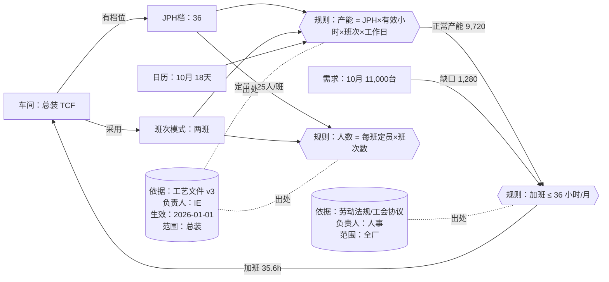

（图中的文件版本、生效日期为示例。）

### 16.3 LLM 以实体论为地图：自动校验、自动集成、自动分析

**自动校验**
- 根据对象定义和规则生成检查项：例如「每班定员必须随 JPH 档位单调递增」「班次数 ∈ {1,2,3}」「工作日 ≤ 当月日历天数」。
- 人确认后固化成确定性规则，每天自动运行。
- 结果合理性审查：LLM 对测算结果做常识检查（单车成本突增、利用率异常低），列出可疑点，由人判断。

**自动集成**
- 字段映射建议：例如把 MES 的 `line_code` 映射到实体框架里的「产线编码」，把人事系统的 `dept_id` 映射到「车间编码」。LLM 给出建议和理由，人确认后存为映射表。
- 参数抽取：从工艺文件、合同中抽取参数，写入带版本的参数表，作为候选值等待负责人确认。
- 编码统一：发现同一对象在不同系统里的不同编码，建议统一方案。

**自动分析**
- 自然语言提问：「为什么 10 月单车成本高？」→ LLM 沿实体关系拆成查询（需求、日历、产能、加班、成本科目），逐层取数，给出带出处的归因。
- 自然语言场景：「如果 10 月需求加 25%，总装要不要开三班？」→ 转成场景参数，调用求解器，返回结果和解释。
- 定期简报：每月自动生成测算与实际的偏差简报，指出主要偏差来源。

**原则**
- 实体论划定边界：LLM 只能在定义好的对象、关系和规则里推理。
- 数字由规则和求解器保证：LLM 不自己算成本。
- LLM 负责理解问题、生成检查和代码、发现可疑点、解释结果。
- 结论必须可追溯到参数和规则，并经业务确认。

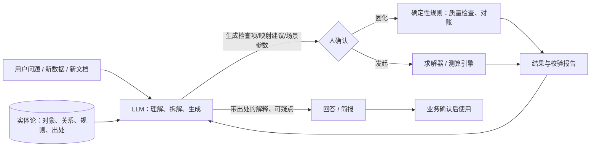

### 16.4 面试说法（30 秒）

「实体论的作用是统一语言、让关系变成计算逻辑、把规则挂在对象上并且可以复用。每条关系和规则都记录来源文件、负责人、生效日期和适用范围，所以任何结果都能追溯，比如总装 10 月为什么加班 35.6 小时。LLM 以实体论为地图做三件事：自动生成校验规则、建议字段映射和抽取参数、用自然语言拆解问题并调用求解器。原则是实体论定边界，规则和求解器保证数字，LLM 负责理解和解释，结论由业务确认。」

---

## 17. 假设与策略：如何理解模型结果

### 17.1 模型是「如果……那么……」

- 模型结果不是预言，而是在一组明确假设下的推演：**如果**需求是这样、工时是这样、单价是这样、约束是这样，**那么**成本最低的方案是这样。
- 模型的价值在于：把假设摆到桌面上，让计划、工艺、人事、财务用同一套语言讨论，争论的焦点从「谁的 Excel 对」变成「哪个假设该改」。

### 17.2 策略就是不同的目标和约束

| 策略 | 怎么表达 | 原型中的实现（默认关闭） |
|:--|:--|:--|
| 成本优先 | 只求总成本最低 | 默认设置 |
| 安全/稳定优先 | 留产能余量、少加班、少切换 | `util_cap=0.9`（正常班产能利用率 ≤ 90%）、加班上限 36→24 小时、`jph_step=True`、`shift_quarter=True` |
| 保人力 | 人数平稳，不频繁招聘或调岗 | `head_change=0.05`（各车间人数月环比变化 ≤ 5%） |
| 保交付 | 缺货代价很高 | 提高 `shortage_penalty` |

第 15.3 节已经测过：只加「JPH 每月最多变一档 + 班次按季度固定」，成本多约 79 万元。下面把完整的稳定优先策略也算出来。

### 17.3 结果是区间和取舍，不是一个数

**策略对比（`prototype/strategies.py`，示例数据）**

| 策略 | 总成本（万元） | 单车（元） | 加班（万元） | 最大人数月波动 | 平均利用率 | 缺口（台） |
|:--|--:|--:|--:|--:|--:|--:|
| 成本优先 | 42,953 | 3,579 | 783 | 61% | 98.6% | 0 |
| 稳定优先 | 45,484 | 3,790 | 540 | 50% | 88.2% | 0 |
| 保人力（≤5%） | 44,033 | 3,669 | 829 | 0% | 97.2% | 0 |
| 压力：需求 +20%，低惩罚 3 千/台 | 49,027（含惩罚 3,263） | 3,683 | 1,237 | 100% | 99.5% | 10,878 |
| 压力：需求 +20%，保交付 20 万/台 | 49,785 | 3,457 | 1,071 | 61% | 99.0% | 0 |

注：
- 「最大人数月波动」是四个车间中人数环比变化最大的一次；「平均利用率」按含加班产能计算。
- 稳定优先仍有 50% 的波动，是因为它允许在季初调整班次（例如冲压一班改两班）；要压住人数，需要用保人力策略。
- 单车成本 = 总成本（含惩罚）÷ 总装产量。


**怎么读**
- **稳定优先**比成本优先贵约 2,531 万元（约 5.9%），换来约 10% 的产能余量、更少的加班和更少的切换。这就是稳定的价格。
- **保人力**贵约 1,080 万元（约 2.5%）：人数全年不变，靠加班和缓存吸收波动。
- **需求 +20% 压力测试**：
  - 缺货惩罚低时，模型宁可缺 10,878 台，也不加更多产能。
  - 惩罚高时，模型会把产能补足、零缺口，运营成本从 45,763 万元升到 49,785 万元。也就是多花约 4,022 万元，换来多交付 10,878 台，相当于每台约 3,700 元。
  - 惩罚该设多高，取决于每台车的边际利润，这是业务决策，不是模型决策。

**蒙特卡洛压力测试（示例数据）**

把成本优先和稳定优先两个方案的「JPH档 × 班次」固定住，按月独立抽样需求 ±8%，抽 20 次。每次只重新优化加班、产量和缓存，成本统计不含惩罚。

| 方案 | 平均成本（万元） | P90 成本（万元） | 平均缺口（台） | 最大缺口（台） | 有缺口样本占比 |
|:--|--:|--:|--:|--:|--:|
| 成本优先 | 42,794 | 43,213 | 599 | 1,730 | 90% |
| 稳定优先 | 44,795 | 45,071 | 0 | 0 | 0% |

解读：成本优先方案在确定需求下最便宜，但需求一波动，20 次里有 18 次出现缺口；稳定优先每年多花约 2,000 万元，换来在 ±8% 波动下不缺货。选哪个要看缺货的真实代价。

**灵敏度**：第 6 节和使用说明里的场景（需求 ±10%、电价 +20%、工资 +5%）就是灵敏度分析，用来看哪些假设一变，方案就会变。

### 17.4 让假设可信

- **透明和留痕**：每次测算记录场景 ID、参数版本、计算方法版本，假设清单随结果一起发布。
- **对账校准**：每月用实际产量、工时、能耗和成本与测算对比，偏差大的参数要修正（第 9.4 节）。
- **滚动重算**：每月用最新需求和参数重跑，而不是一年只算一次。
- **人做决策**：模型给出方案、代价和风险，最终由管理层在策略之间选择。

### 17.5 面试说法（30 秒）

「模型结果是在明确假设下的『如果……那么……』，它的价值是把假设摆出来，让各部门用同一套语言讨论。策略就是不同的目标和约束：成本优先、稳定优先、保人力、保交付。在示例数据里，稳定优先多花约 6%，换来 10% 的产能余量；蒙特卡洛测试显示，成本最低的方案在需求 ±8% 波动下 90% 的情况会缺货。所以我给管理层的不是一个数，而是几个策略的成本、风险和取舍，假设留痕，按月对账、滚动重算，由人来做决策。」

---

## 18. 极端情况与场景模拟：参数化场景、场景库、压力测试

### 18.1 场景参数化：几个旋钮

不为每个场景写一套新逻辑，而是把场景抽象成几个「旋钮」。一个场景就是一条记录，记下各旋钮的取值。旋钮改了，下游的产能、加班、人数、能耗和成本，沿实体关系自动重算。

| 旋钮 | 作用在哪个对象上 | 下游影响 | 原型中的写法（`scenarios.py`） |
|:--|:--|:--|:--|
| 需求系数（全局 / 按月 / 按车型 / 某月某车型） | 需求 | 产量、加班、班次 | `demand_all`、`demand_month`、`demand_model`、`demand_cell` |
| 车间开动率系数 | 车间 × 月 | 产能 | `avail: {"BIW|5": 0.8, "ALL|7": 0.8}` |
| 车间停线天数 | 车间 × 月 | 可用小时、产能、固定能耗 | `down: {"BIW|6": 5}` |
| 零件供应上限 | 车型 × 月 | 总装产量上限、缺口 | `supply: {"V451|4": 0.7}`（= 0.7 × 当月该车型需求） |
| 单价系数 | 电价、工资 | 成本 | `elec`、`wage` |
| 加班上限 | 车间 | 产能弹性 | `ot: 24` |

代码位置：
- `scenarios.apply_knobs(base, knobs)` 把旋钮写入参数字典。
- `cost_functions.hours()` 扣除停线天数，`capacity()` 乘以开动率系数。
- `model_builder.build()` 加入供应上限约束 `sup_*`。
- 不设旋钮时结果与基准完全一致（42,953 万元）。

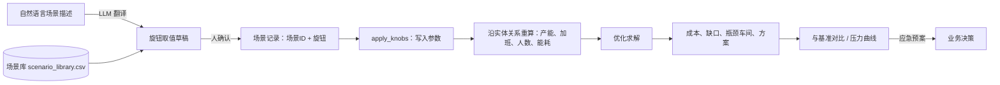

### 18.2 预置场景库

文件：`prototype/data/scenario_library.csv`，字段为 `name, category, description, knobs`，其中 `knobs` 是 JSON。

| 类别 | 场景 | 旋钮（示例数据） |
|:--|:--|:--|
| 需求 | 旺季冲量 | 9–12 月需求 ×1.15 |
| 物流 | 出口集中发运 | V446K 季末月 ×1.3、季初月 ×0.85 |
| 供应 | 缺芯 | V451 在 4–5 月供应 = 需求的 70% |
| 设备 | 焊装停线一周 | 焊装 6 月停线 5 天 |
| 人力 | 春节后出勤低 | 2–3 月所有车间开动率 ×0.9 |
| 能源政策 | 限电 | 7–8 月所有车间开动率 ×0.8 |
| 能源政策 | 电价上涨 | 电价 ×1.3 |
| 组合 | 组合冲击 | 旺季冲量 + 10–11 月 V451 缺芯 30% + 10–11 月开动率 ×0.85 |

**场景库运行结果**（`stress_test.py` 第 (a) 部分，示例数据；运营成本不含缺口惩罚）

| 场景 | 运营成本（万元） | 与基准差 | 缺口（台） | 缺口月份 | 加班（万元） | 三班车间月数 |
|:--|--:|--:|--:|:--|--:|--:|
| 基准 | 42,953 | — | 0 | — | 783 | 0 |
| 旺季冲量 | 44,818 | +1,865 | 0 | — | 923 | 1 |
| 出口集中发运 | 43,585 | +632 | 6 | 12 | 696 | 0 |
| 缺芯 | 42,430 | −523 | 2,030 | 4/5 | 770 | 0 |
| 焊装停线一周 | 43,062 | +109 | 0 | — | 821 | 0 |
| 春节后出勤低 | 43,316 | +363 | 0 | — | 685 | 0 |
| 限电 | 43,523 | +570 | 0 | — | 740 | 0 |
| 电价上涨 | 44,170 | +1,217 | 0 | — | 783 | 0 |
| 组合冲击 | 44,683 | +1,730 | 2,508 | 10/11 | 1,018 | 1 |

解读：
- **缺芯**：运营成本反而下降，因为少做了 2,030 台；真正的代价是缺口（按 3 万元/台惩罚计约 6,090 万元），这部分要用缺货损失来衡量。
- **焊装停线一周、春节后出勤低、限电**：都被加班、升档和缓存吸收，没有缺口，代价是几百万元。
- **组合冲击**：单个冲击都能吸收，叠加后在 10–11 月出现 2,508 台缺口。缺口大于缺芯本身造成的量，是因为旺季、缺芯和限电同时发生，产能已经没有余量。
- **出口集中发运**的 6 台缺口很小，可能和求解时限有关（见 18.6 局限）。

### 18.3 极端情况的三种做法

1. **压力测试**：把一个旋钮逐步拧大，找出第一次不可行（出现缺口）的点和最先到顶的车间。产出是「能吸收多少」。
2. **组合冲击**：多个冲击同时发生（如上表的组合冲击），看单项能吸收、叠加后不能吸收的情况。
3. **随机模拟**：按概率分布抽样（见第 17.3 节蒙特卡洛），看缺口和成本的分布。

价值：知道系统的极限在哪里，提前准备应急预案（例如什么情况下要启动三班、周末加班、外协或跨工厂调产）。

**压力测试 1：焊装 6 月停线天数扫描（示例数据）**

| 停线天数 | 焊装 6 月方案 | 焊装 6 月加班（小时） | 焊装 5 月产量 | 焊装 6 月产量 | 缺口 | 运营成本（万元） |
|--:|:--|--:|--:|--:|--:|--:|
| 0 | 30x2 | 10.0 | 10,800 | 10,200 | 0 | 42,953 |
| 2 | 30x2 | 36.0（到上限） | 10,920 | 10,080 | 0 | 43,003 |
| 4 | 36x2（升档） | 13.3 | 10,800 | 10,200 | 0 | 43,033 |
| 6 | 36x2 | 36.0（到上限） | 11,064 | 9,936 | 0 | 43,095 |
| 8 | 36x2 | 36.0 | 12,096 | 8,856 | 0 | 43,178 |
| 10 | 36x2 | 36.0 | 11,884 | 7,776 | 0 | 43,291 |

解读：
- 停 2 天，加班先到上限；停 4 天，焊装升到 36 档；停 6 天及以上，加班和升档都用满，靠 **5 月提前多做、存进白车身缓存** 来补。
- 在这组示例数据里，停 10 天也没有缺口，代价只多约 338 万元。这依赖缓存容量（每车型 1,500 台）和 5 月有余量；如果停线发生在旺季或缓存更小，结论会不同。
- 原型没有「周末加班」的单独模式，月加班上限 36 小时已经包含在内；要区分周末加班，需要加一个班次模式或加班档位 ⚠。

**压力测试 2：需求上限（缺口惩罚 20 万元/台，示例数据）**

| 全局需求系数 | 年需求 | 缺口（台） | 运营成本（万元） | 三班车间月数 | 缺口月份 | 判断的瓶颈车间 |
|--:|--:|--:|--:|--:|:--|:--|
| 1.00 | 120,000 | 0 | 42,953 | 0 | — | — |
| 1.10 | 132,000 | 0 | 46,003 | 1 | — | — |
| 1.20 | 144,000 | 0 | 49,785 | 6 | — | — |
| 1.30 | 156,000 | 18 | 53,800 | 14 | 10/11/12 | 涂装 |
| 1.35 | 162,000 | 1,012 | 55,682 | 21 | 10/11/12 | 焊装 |
| 1.40 | 168,000 | 2,925 | 57,272 | 24 | 5/6/9/10/11/12 | 总装 |
| 1.45 | 174,000 | 5,524 | 58,799 | 30 | 3–6、9–12 | 涂装 |
| 1.50 | 180,000 | 8,684 | 59,600 | 33 | 3–6、9–12 | 涂装 |

解读：
- 示例数据下，全年需求增加到约 **+20%~+30%** 都能靠升档、三班和缓存吸收；超过约 1.3 倍开始缺货，最先在旺季 10–12 月出现。
- 需求越大，三班的车间月数越多（1.2 倍时 6 个，1.5 倍时 33 个）。
- 「瓶颈车间」用「缺口月份里，各车间最大可能产能减实际产量的平均余量最小者」判断。由于四个车间的最大产能接近（都在 36 档三班左右），不同需求水平下判断出的瓶颈会在涂装、焊装、总装之间切换。真实工厂应该看具体车间的产能曲线 ⚠。


### 18.4 真正的新场景

| 类型 | 例子 | 怎么做 | 时间预期 |
|:--|:--|:--|:--|
| 用现有旋钮就能表达 | 「8 月需求 +20%，同时限电」 | 在场景库加一行 | 分钟级 |
| 需要新旋钮 + 改一个模块 | 「夜班电价打折」「某车型换型时间加倍」 | 加一个旋钮，改对应的子模块（如能源、产能），补测试 | 天级 |
| 新逻辑、新产线、新工厂 | 「新增一条电池包产线」「跨工厂调产」 | 扩展实体框架、新增约束和数据，回测验收 | 项目级（周） |

LLM 的作用：把自然语言描述的场景（「如果 V451 芯片在 10、11 月只供应七成，同时 10 月限电」）翻译成旋钮取值草稿，人确认后入库运行。旋钮之外的需求，LLM 应该明确说明「需要新旋钮」，而不是硬凑。

和业务的预期管理：**常规场景分钟级，新类型场景天级，结构性变化周级。**

### 18.5 面试说法（30 秒）

「我把场景参数化成几个旋钮：需求系数、车间开动率、停线天数、零件供应上限、单价系数和加班上限。一个场景就是一条旋钮记录，下游沿实体关系自动重算。我们预置了旺季、缺芯、停线、限电、组合冲击等场景库。极端情况做压力测试，比如把焊装停线天数从 0 拧到 10 天，看什么时候加班到顶、什么时候要升档、什么时候开始缺货，得出能吸收多少，再准备应急预案。新场景能用旋钮表达的分钟级，加新旋钮天级，结构性变化按项目做。LLM 负责把自然语言场景翻译成旋钮，人确认后运行。」

### 18.6 局限

- 求解时限为 30 秒/次，个别场景可能不是严格最优，出现个位数的缺口（如出口集中发运的 6 台、需求 1.3 倍的 18 台），解读时应看量级。
- 开动率系数同时代表设备、出勤和限电的影响，没有分开建模。
- 没有周末加班、外协、跨工厂调产等应急手段的单独选项 ⚠。
- 运行 `stress_test.py` 共 23 次求解，约 4–5 分钟。

---


## 19. 用 Laya 这类结构化决策模型做决策模拟

> 资料来源：[Laya AI Playground](https://laya-ai.com/zh/playground)、[AWS 中文博客：Laya 部署实践](https://aws.amazon.com/cn/blogs/china/laya-service-validation-amazon-sagemaker/)、[layaForWorkflows](https://github.com/vishalmysore/layaForWorkflows)。如果实际指的是别的工具，按工具调整。

### 19.1 Laya 是什么

开源的「结构化决策模型」（typed decision），不生成文字，而是针对一段状态（文本或 JSON）回答三类问题，每个结果都带概率：

| 问题类型 | 用途 | 输出 |
| :-- | :-- | :-- |
| choice | 从有限选项里挑一个 | 选中项和各选项概率 |
| score | 打有序等级 | 期望分数和各等级概率 |
| noul | 判断一个命题是否成立 | 成立概率 |

它擅长分流、判断、把关，**不做优化计算**。

### 19.2 分工：Laya 不替代求解器

| 角色 | 负责 | 要求 |
| :-- | :-- | :-- |
| 求解器 | 在约束下算最优 JPH、班次、排产 | 数字必须精确 |
| Laya | 识别、分类、风险判断、决定走哪条路 | 带概率，按阈值分级处理 |
| 实体框架 | 给 Laya 提供结构化状态，记录决策痕迹 | 可追溯 |

### 19.3 在本案例中的四个用法

1. **场景识别和路由（choice）**：把业务事件（如「供应商通知下月芯片减供 30%」）识别成场景库里的某一类（缺芯、需求波动、设备停线、限电），自动套用参数模板，再交给求解器（衔接第 18 节）。
2. **结果风险把关（noul）**：对求解器方案问是非题，如「是否超出人员承受能力」「缓存是否溢出」「是否违反工时法规」，概率高的拦下来交给人。
3. **策略推荐（score / choice）**：根据订单确定性、库存水平、人员紧张程度，评估更适合成本优先、稳定优先还是保人力（衔接第 17 节），由求解器算具体方案，业务拍板。
4. **异常分级（score）**：对测算与实际偏差、参数变更、数据质量问题打紧急程度分，决定自动修正、通知负责人还是升级管理层。

### 19.4 决策流程

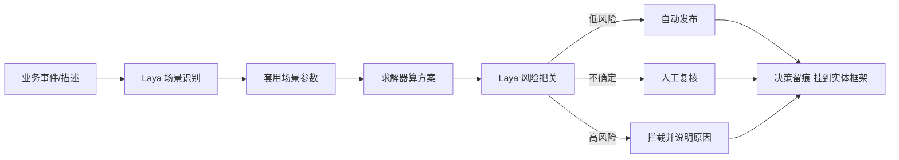

### 19.5 怎么用好

- **问题设计**：选项明确、互不重叠、数量不宜多；资料提到选项过多效果下降，score 类相对较弱。
- **阈值分级**：例如概率 ≥0.8 自动执行，0.5–0.8 人工复核，<0.5 拦截；关键决策收紧阈值。⚠ 阈值为示例，需要按验证结果定。
- **先验证再上线**：基础模型零样本能力有限，用历史场景和人工判断做测试集评估准确率，必要时微调。
- **决策留痕**：记录输入状态、选项、概率、阈值、最终路径，挂到实体框架，方便复盘。
- **数字交给求解器和规则**：Laya 只做判断、分流和把关。
- **部署**：有开放权重，可本地或私有云部署，数据不出厂。

### 19.6 面试 30 秒说法

> 决策模拟里我会分工：求解器负责在约束下算出最优方案，数字必须精确；Laya 这类结构化决策模型负责判断和分流，比如把业务事件识别成场景、对方案做风险把关、推荐策略、给异常分级。每个判断都带概率，高置信度自动执行，不确定的交给人，高风险拦截，全过程留痕并挂到实体框架上，可以追溯。

---

## 20. 业务架构与协作点（v2）

> 第 0A 节是**技术架构**（数据 → 规则 → 求解 → 应用）。这一节是**业务架构**：模拟器在业务里怎么转起来，每一步哪个部门负责、交什么、AI & Data 组交付什么、在哪里交接、多久一次、谁拍板。
> 部门分工以《AI&Data组合作建议-产量成本模拟器.md》第 5 节 RACI 为基础细化。**全部是建议结构**，⚠ 需在阶段 0 联合诊断时和各部门逐条确认。

### 20.1 业务架构图


（图由 `prototype/plot_business_arch.py` 生成。）

**怎么读**
- **横向是业务流程（7 步）**：① 需求输入 → ② 参数维护 → ③ 测算 / 模拟 → ④ 策略决策 → ⑤ 执行 → ⑥ 实际回收 → ⑦ 对账校准。⑦ 的偏差回写到 ②，形成闭环（绿色虚线）。
- **纵向是 9 个角色泳道**：管理层、计划/排产（VCS 业务 Owner）、生产/制造工程（IE）、人事/HR、能源/设施、财务/成本、物流/供应、IT/数字化、AI & Data 组。
- **红色编号是协作点**：C1–C9 落在具体流程步骤上；C10 小模型开发、C11 推广复制、C12 治理节奏跨越所有步骤，画在底部。
- 一个格子里有多个编号，说明这个动作同时属于几个协作点（例如 AI & Data 组的「参数表 · 版本 · 质量规则」同时属于 C1 和 C2）。

### 20.2 业务流程七步（每步的输入、输出、主责）

| 步骤 | 做什么 | 主要输入 | 主要输出 | 主责部门 | AI & Data 组的角色 | 频率（⚠ 建议） |
| :-- | :-- | :-- | :-- | :-- | :-- | :-- |
| ① 需求输入 | 确定要算的需求：销量预测、订单、车型组合、出口船期、供应能力 | S&OP 需求、经营目标、供应商能力 | 一版带版本号的需求数据（月 × 车型） | 计划/排产 | 需求预测小模型给参考值（C10）；需求数据入数仓 | 月度（滚动） |
| ② 参数维护 | 各部门维护自己负责的参数，变更走审批 | 工时、JPH 档、定员、工资、电价、OH、班车、外包、产能上限、日历 | 一份参数快照（版本 + 生效日期 + 负责人） | 各参数负责人（见 20.4） | 参数表、版本管理、质量规则、到期提醒（C1、C2） | 按参数：月度 / 季度 / 事件触发 |
| ③ 测算 / 模拟 | 跑基准场景和业务提出的场景 | 参数快照 + 场景旋钮 | 方案（各车间 JPH 档 × 班次、加班、缓存、产量）、成本、缺口 | 计划/排产（发起） | 求解器、场景库、旋钮、LLM 结果解释和常识审查（C3、C4、C5） | 月度基准 + 按需 |
| ④ 策略决策 | 在几种策略之间选，确认风险接受度 | 策略对比、压力测试、风险把关结果 | 选定的策略和方案、决策记录 | 管理层（拍板），计划/排产（提报） | 策略对比视图；Laya 类模型做风险把关和推荐，只提建议（C6） | 月度 / 重大事件 |
| ⑤ 执行 | 把月度方案下达，做周 / 日排产、排班、物料配合 | 选定方案 | 月度生产计划、班组排班、人员调配、物料计划 | 计划/排产、生产、HR、物流 | 提供下层排班接口；下层不可行时把问题转成新约束回到 ③（C7） | 周 / 日 |
| ⑥ 实际回收 | 收集实际发生 | MES、HR、能源计量、财务、物流系统 | 实际产量、工时、加班、能耗、成本、缺料（按车间 × 月 × 科目） | 各数据产生部门 + IT | 数据入湖、质量检查、口径对齐（C2、C8） | 月度（月结后 ⚠ 第 N 个工作日） |
| ⑦ 对账校准 | 测算 vs 实际，追溯偏差到参数，决定是否修正 | 测算结果 + 实际数据 | 偏差报告、校准建议、新参数版本 | 计划/排产（确认）、财务（签认） | 偏差报告、偏差追溯、异常分级、校准建议（C9） | 月度 |

### 20.3 协作点总表（C1–C12）

每个协作点写清楚 7 件事：**谁主责**、**谁提供什么**、**AI & Data 组交付什么**、**交接物**、**节奏**、**决策权**、**验收 / 衡量**。

#### 块 A：参数与数据（C1、C2）

| 项 | C1 参数口径与归属 | C2 数据接入与质量 |
| :-- | :-- | :-- |
| 要解决的问题 | 参数散在 Excel、口径不一、没人负责、过期没人更新 | 手工导数、数据缺失、各系统编码不一致 |
| 主责（A） | 各参数负责人（见 20.4）；口径争议由业务 Owner 定 | AI & Data 组 |
| 业务提供 | 参数取值、口径说明、来源文件、更新频率；确认参数表结构 | 源系统说明、字段含义、数据访问审批；IT 提供接口和权限 |
| AI & Data 组交付 | 参数表（带版本号、生效/失效日期、负责人）；口径字典；到期提醒；LLM 从文件抽取参数候选值 | 数据接入（ODS → DWD → 参数层）；字段映射表；质量规则库（空值、范围、一致性，如定员随 JPH 档单调递增）；质量看板 |
| 交接物 | 参数字典 + 参数表 v1；参数变更审批单 | 数据接入清单、映射表、质量规则清单、质量日报 |
| 节奏 | 参数按自身频率更新；变更随时提，月度发布 | 质量规则每日跑；接入问题周度清理 |
| 决策权 | 参数值和口径：参数负责人；变更是否发布：业务 Owner（在基准场景跑完影响分析后） | 数据标准和模型结构：AI & Data 组；数据访问：数据所有部门 + IT 安全 |
| 验收 / 衡量 | 试点参数不再依赖手工 Excel；每个参数有负责人；过期参数数为 0 | 数据可用率、质量规则通过率、手工导数次数（⚠ 目标待定） |

#### 块 B：场景、模型与结果（C3、C4、C5）

| 项 | C3 需求与场景定义 | C4 模型逻辑变更 | C5 测算发布与解释 |
| :-- | :-- | :-- | :-- |
| 要解决的问题 | 「如果……会怎样」说不清，口径各算各的 | 业务规则变了，公式直接改，历史结果无法复现 | 结果是一堆数字，管理层看不懂、不信 |
| 主责（A） | 计划/排产 | 业务 Owner（规则对不对），AI & Data 组（实现对不对） | 计划/排产（发布），AI & Data 组（解释工具） |
| 业务提供 | 场景描述（自然语言即可）、业务假设、关注指标；物流/供应提供船期、供应能力 | 新规则说明（例如能源改为固定 + 变动、新增两班 12 小时模式 ⚠）；IE 确认工艺约束 | 发布范围、汇报口径 |
| AI & Data 组交付 | 场景旋钮和场景库（第 18 节）；LLM 把自然语言场景翻译成旋钮草稿；Laya 类模型做场景识别 | 新计算方法版本（不覆盖旧公式）；单元测试；新旧并行比较报告；影响分析（基准场景总成本和方案变化） | 结果报表（注明场景号和参数版本）；LLM 带出处的解释；常识审查可疑点 |
| 交接物 | 场景定义卡（场景ID、旋钮取值、假设、提出人） | 变更申请 + 影响分析 + 测试报告 | 测算报告：方案、成本分项、缺口、瓶颈车间、假设清单 |
| 节奏 | 常规场景分钟级；新旋钮天级；结构性变化周级 | 随需求；按版本发布（⚠ 建议月度窗口） | 月度基准 + 按需 |
| 决策权 | 场景是否进入场景库：业务 Owner | 是否上线新方法：业务 Owner（有否决权）；技术实现：AI & Data 组 | 是否对管理层发布：业务 Owner |
| 验收 / 衡量 | 场景响应时间；场景库覆盖率 | 任一历史测算可复现；变更都有影响分析 | 管理层能看懂；解释能追溯到参数版本 |

#### 块 C：决策与执行（C6、C7）

| 项 | C6 策略决策与留痕 | C7 执行下达与下层反馈 |
| :-- | :-- | :-- |
| 要解决的问题 | 只给一个「最优答案」，没说代价和风险；决策过程没有记录 | 月度方案落不了地（某技能工种不够、班车排不开），信息回不到模型 |
| 主责（A） | 管理层（拍板）；计划/排产（提报） | 计划/排产；生产、HR、物流各自执行 |
| 业务提供 | 策略偏好（成本、稳定、保人力、保交付）；风险接受度；财务认可成本口径和节约额口径 | 周 / 日排产结果；不可行原因（人、设备、物料） |
| AI & Data 组交付 | 策略对比（第 17 节）、压力测试（第 18 节）；Laya 类模型做风险把关、策略推荐（带概率，按阈值分自动 / 复核 / 拦截，第 19 节）；决策留痕挂到实体框架 | 下层排班接口；把不可行反馈转成新约束（如某车间某月班次上限），重新求解 |
| 交接物 | 决策单：选定策略、方案、理由、风险、决策人、日期 | 月度计划下达单；不可行反馈单 |
| 节奏 | 月度经营会 / 重大事件 | 周度 |
| 决策权 | 管理层；AI 只提建议 | 计划/排产 |
| 验收 / 衡量 | 决策采纳率；决策留痕完整率 | 计划达成率；不可行反馈处理时长（⚠ 目标待定） |

#### 块 D：实际与校准（C8、C9）

| 项 | C8 实际数据回收 | C9 月度对账校准 |
| :-- | :-- | :-- |
| 要解决的问题 | 实际数据分散在 MES、HR、能源、财务，月结口径和测算口径不一致 | 不知道模型准不准；偏差找不到原因 |
| 主责（A） | 各数据产生部门（生产、HR、能源、财务、物流）；IT 负责抽取 | 计划/排产（确认校准）；财务（签认成本） |
| 业务提供 | 实际产量、开动率、停线、工时、加班、能耗、实际成本（按车间 × 科目） | 偏差原因解释（IE 解释工艺类，能源解释能耗，HR 解释人工） |
| AI & Data 组交付 | 实际数据入湖、口径对齐、质量检查 | 偏差报告（车间 × 科目 × 月）；偏差追溯到参数；异常分级（Laya score）；校准建议；新参数版本草稿 |
| 交接物 | 实际数据表（按统一编码） | 月度偏差报告 + 校准清单 + 新参数版本 |
| 节奏 | 月度，月结后 ⚠ 第 N 个工作日 | 月度 |
| 决策权 | 数据口径：财务（成本）、生产（产量） | 是否修正参数：参数负责人 + 业务 Owner |
| 验收 / 衡量 | 实际数据按时到位率 | 测算 vs 实际偏差率（按车间、科目）；偏差超阈值数量 ⚠ 阈值待定 |

#### 块 E：跨流程（C10、C11、C12）

| 项 | C10 小模型开发与上线 | C11 推广复制（多工厂） | C12 治理节奏 |
| :-- | :-- | :-- | :-- |
| 要解决的问题 | 固定参数（需求、开动率、能耗、新配置工时）误差大 | 示例工厂做完，其他工厂从头再来，工作量巨大 | 合作靠人情，没有固定节奏和决策机制 |
| 主责（A） | AI & Data 组（开发）；业务 Owner（是否上线） | 推广委员会；中心团队执行（第 21 节） | 联合项目组（业务 Owner 任项目 Owner） |
| 业务提供 | 要预测的问题；历史数据；判断标准 | 工厂 Owner、key user；本厂参数和数据 | 例会参会人、决策人 |
| AI & Data 组交付 | 基线 → 小模型；回测报告；接入模拟器（预测值作为参数的一个版本）；月度监控、重训 | 核心平台、配置包模板、上线手册、AI 加速工具、培训 | 例会材料、进度、对账结果、风险清单 |
| 交接物 | 模型卡（用途、数据、指标、限制、负责人） | 工厂配置包、就绪度报告、上线验收单 | 会议纪要、决策清单 |
| 节奏 | 季度迭代；月度监控 | 按波次 | 双周例会；月度管理层简报；阶段评审 ⚠ 频率待定 |
| 决策权 | 上线：业务 Owner（否决权）；方法：AI & Data 组 | 波次和验收：推广委员会 | 阶段是否继续：业务 Owner |
| 验收 / 衡量 | 回测优于基线；预测误差（MAPE 等） | 见 21.8 推广 KPI | 例会准时率、待办关闭率 |

### 20.4 参数归属（谁产生谁负责）

| 参数类 | 负责部门 | 对应原型参数表 | 更新频率（⚠ 建议） | 变更触发 |
| :-- | :-- | :-- | :-- | :-- |
| 需求、车型组合 | 计划/排产（S&OP） | `demand.csv` | 月度滚动 | 销量预测更新、订单变化 |
| 产能上限、工厂日历 | 计划/排产 | `capacity_limit.csv`、`calendar.csv` | 季度 / 事件 | 产线改造、节假日调整 |
| 工时、JPH 档、每班定员、运行功率 | 生产 / 制造工程（IE） | `jph_options.csv` | 事件（工程变更、线平衡） | ECN、新车型导入 |
| 工资、加班费率、夜班补贴、出勤、劳动规则 | 人事 / HR | `global_params.csv`、`shift_options.csv`、`shop_params.csv`（加班上限） | 年度 / 政策变化 | 调薪、政策变化 |
| 电价、单车能耗 | 能源 / 设施 | `global_params.csv`、`shop_params.csv` | 季度 / 电价调整 | 电价政策、设备改造 |
| OH、班车、外包单价、成本科目口径 | 财务 / 成本 | `shop_params.csv`、`shift_options.csv` | 年度预算 / 合同变更 | 合同续签、预算调整 |
| 缓存容量、持有成本、物流费率 | 物流 / 供应（与生产共同） | `shop_params.csv` | 事件 | 场地调整、物流合同 |
| 缺货惩罚、求解时限、策略参数 | 业务 Owner（与 AI & Data 组共同） | `global_params.csv` | 事件 | 策略调整 |

原则：**参数谁产生谁负责**；AI & Data 组负责参数表结构、版本、质量规则和提醒，**不替业务决定参数值**。

### 20.5 决策权一览

| 决策 | 谁决定 | 谁参与 | AI 的位置 |
| :-- | :-- | :-- | :-- |
| 参数值和口径 | 参数负责人 | 业务 Owner、财务 | LLM 抽取候选值、提示异常 |
| 参数变更发布 | 业务 Owner | 参数负责人、AI & Data 组（影响分析） | 无 |
| 模型逻辑 / 计算方法上线 | 业务 Owner（有否决权） | AI & Data 组、IE、财务 | 无 |
| 数据标准、实体框架、平台技术方案 | AI & Data 组 | IT、业务 | LLM 建议映射和规则 |
| 场景是否进入场景库 | 业务 Owner | 计划、物流、AI & Data 组 | LLM 翻译场景；Laya 识别场景 |
| 策略选择、方案采纳 | 管理层 | 计划/排产、财务 | Laya 推荐和风险把关，只提建议 |
| 小模型上线 | 业务 Owner（否决权） | AI & Data 组 | — |
| 推广波次和工厂验收 | 推广委员会 | 中心团队、工厂 Owner | — |

### 20.6 协作节奏（⚠ 建议，待确认）

| 节奏 | 会 / 动作 | 参加 | 输入 | 输出 |
| :-- | :-- | :-- | :-- | :-- |
| 每日 | 质量规则自动运行 | AI & Data 组（自动） | 新入数据 | 质量日报、异常通知参数负责人 |
| 每周 | 执行反馈 | 计划、生产、HR、物流 | 周排产、不可行反馈 | 新约束或调整 |
| 双周 | 联合例会（1 小时） | 业务 Owner、AI & Data 组、各接口人 | 进度、问题、对账结果 | 两周任务、决策清单 |
| 每月 | 参数发布 → 基准测算 → 对账校准 | 计划、财务、AI & Data 组 | 新参数版本、实际数据 | 基准方案、偏差报告、校准清单 |
| 每月 | 管理层简报 | 管理层、业务 Owner | 策略对比、偏差、风险 | 策略决策、留痕 |
| 每阶段 / 每季度 | 阶段评审 | 业务 Owner、管理层、AI & Data 组 | 阶段成果、KPI | 是否进入下一阶段 |

### 20.7 mermaid 版本（流程 + 协作点）

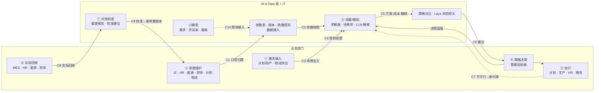

### 20.8 面试 30 秒说法

「我会把模拟器的业务架构拆成七步：需求输入、参数维护、测算模拟、策略决策、执行、实际回收、对账校准，最后一步回写参数形成闭环。每一步明确谁负责：参数谁产生谁负责，比如工时归 IE、工资归 HR、单价归财务；场景和规则由业务定，管理层拍策略。我们 AI & Data 组负责参数表、版本、数据接入和质量，求解器、场景库、解释和对账报告，AI 只提建议。我把关键交接点定成 12 个协作点，每个都写清输入、交付物、节奏和决策权，再配双周例会和月度对账，合作就不靠人情。」

---


## 21. 多工厂复制与推广机制

> 问题：示例工厂是试点，如果每个工厂都像示例工厂一样从头梳理参数、改代码、对账，工作量巨大，而且各厂越做越不一样，最后没法统一管理。
> 思路：**把示例工厂做成「核心标准 + 示例工厂配置包」**，新工厂只做自己的配置包，按固定套路上线，按波次推广，各厂的需求经评审后回流到核心。
> 说明：工期、人天、波次、就绪度口径都是**示例 ⚠**，需要在示例工厂试点结束后按实际投入校准；这里不写任何具体工厂信息。

### 21.1 机制图


（图由 `prototype/plot_rollout.py` 生成。）

**怎么读**：A 核心平台 + B 工厂配置包 = 一个工厂实例；配置包进入 D 单厂上线六步（每步一个验收门）；E 波次推广决定哪些工厂什么时候上；上线中发现的问题进入 F 需求回流，经变更评审后发布新核心版本，各厂回归测试后升级。C 是组织和 AI 加速，贯穿全过程。

### 21.2 为什么复制工作量大（先把痛点说清）

| 工作量来源 | 表现 | 机制上怎么解决 |
| :-- | :-- | :-- |
| 每厂结构不同 | 车间链、JPH 档、班次模式、成本科目都不一样，代码写死了示例工厂结构 | 结构差异放进配置包（车间链、档位、班次都是数据），核心代码不写死工厂结构（21.4） |
| 数据源不同 | 各厂 MES、HR、能源系统版本或厂商不同，字段名不同 | 每类源系统一个适配器，映射表化；LLM 自动建议字段映射（21.6） |
| 口径不同 | 「人数」「单车成本」「开动率」各厂算法不一样 | 指标口径是核心标准，各厂只能在核心允许的范围内配置（21.3） |
| 规则不同 | 当地劳动规则、加班上限、夜班补贴政策不同 | 规则表化，作为配置包里的本地规则（21.3） |
| 人员能力不同 | 新工厂没人懂模型 | 中心团队带教 + key user 培训认证 + 上线手册（21.7） |
| 越做越分叉 | 各厂各改各的，最后变成 N 套系统 | 需求回流 + 变更评审：通用的进核心，本地的只改配置（21.7.4） |

### 21.3 标准化 vs 本地化分层

#### 21.3.1 核心标准（所有工厂共用，中心团队维护）

| 核心组件 | 内容 | 示例工厂试点中对应 | 为什么必须统一 |
| :-- | :-- | :-- | :-- |
| 实体框架 / Ontology 定义 | 对象（工厂、车间、车型、配置、JPH 档、班次模式、成本科目、场景、参数版本）、关系、规则、依据四层；统一编码规则 | 第 16 节、4.1 节 | 跨厂比较和汇总的前提；LLM 解释和校验都以它为地图 |
| 参数表标准（schema） | 8 类参数表的文件 / 表名、必填字段、取值范围、版本字段（版本号、生效 / 失效日期、负责人） | `data/*.csv`；`plant_check.py` 的 `SCHEMA` | 适配器和求解器只认标准表 |
| 求解模型结构 | 决策变量（每车间每月选「JPH 档 × 班次」、加班、缓存、产量、缺口）、约束类型（产能、需求、流平衡、缓存、加班上限、供应上限）、目标函数结构 | `model_builder.py`；车间链长度由配置决定 | 保证各厂结果可比、可复现 |
| 成本子模块接口 | 输入（车间、JPH 档、班次、月）→ 输出（各科目成本）；计算方法版本化 | `cost_functions.py` | 某厂公式不同，只新增方法版本，不改求解器 |
| 策略库 / 场景库 / 旋钮 | 四种策略；通用场景（旺季、缺芯、停线、限电、组合冲击）；旋钮定义 | `strategies.py`、`scenarios.py`、`scenario_library.csv` | 管理层用同一套语言比较各厂 |
| 指标口径 | 单车成本、利用率、加班强度、偏差率、缺口等的定义和计算方法 | 第 7.1 节 KPI | 跨厂对标 |
| 质量规则库 | 结构、完整性、一致性、业务规则（如定员随 JPH 档单调递增、每日有效小时 ≤ 24） | `plant_check.py` 的规则部分 | 新厂配置包上线前自动检查 |
| 适配器框架 | 源系统适配器模板（读取 → 映射 → 标准表）、映射表格式 | 第 5、9 节 | 同类系统只开发一次 |
| 上线方法论 | 六步、清单、模板、验收标准（21.5） | 本节 | 推广可复制 |

#### 21.3.2 工厂本地配置（每厂一份配置包，工厂 key user 维护）

| 配置项 | 例子（示例） | 放在哪里 | 谁维护 |
| :-- | :-- | :-- | :-- |
| 车间链 / 工艺路线 | 示例工厂：冲压 → 焊装 → 涂装 → 总装；示例工厂 B：焊装 → 涂装 → 总装（冲压件外购，示例假设） | `plant.json` 的 `shops` | 工厂 IE |
| JPH 档 | 每车间可选档位及对应定员、运行功率 | `jph_options.csv` | 工厂 IE |
| 班次模式 | 1 / 2 / 3 班；两班 12 小时 ⚠（核心需先支持模式 ID，见 15.6） | `shift_options.csv` | 工厂计划 + HR |
| 工厂日历 | 工作日、节假日、检修窗口 | `calendar.csv` | 工厂计划 |
| 工资、加班、夜班补贴费率 | 按当地工资水平 | `global_params.csv`、`shift_options.csv` | 工厂 HR |
| 能源费率 | 当地电价、峰谷系数 | `global_params.csv` | 工厂能源 |
| OH、班车、外包单价 | 按当地合同 | `shop_params.csv`、`shift_options.csv` | 工厂财务 |
| 产能上限 | 车间 × 车型 × 月 | `capacity_limit.csv` | 工厂计划 |
| 缓存容量 | 车间之间的缓存上限 | `shop_params.csv` | 工厂生产 + 物流 |
| 法规 / 劳动规则 | 加班上限、连续工作天数等，按当地规则 ⚠ | `shop_params.csv`、`plant.json` 的 `local_rules` | 工厂 HR |
| 源系统映射 | 本厂 MES / HR / 能源字段 → 标准字段 | 映射表 | 工厂 IT + 中心团队 |
| 本地场景 | 本厂特有事件（如港口船期、本地限电） | 本厂场景库 | 工厂计划 |

#### 21.3.3 判断规则：一个需求该进核心还是放配置？

| 判断 | 放哪里 | 例子 |
| :-- | :-- | :-- |
| 只是取值不同 | 配置包 | 电价、工资、JPH 档位数 |
| 结构不同，但核心已能表达 | 配置包 | 车间链少一个车间、多一个车型 |
| 新的计算方法，可能别的厂也会用 | 核心：新方法版本，各厂按需启用 | 能源按峰谷分时计算 |
| 新的决策类型 | 核心：新版本，变更评审 | 两班 12 小时模式、跨工厂调产 ⚠ |
| 只有一个厂有、且很少变 | 配置包里的本地规则；不行再评审 | 本地特殊补贴 |

### 21.4 产品化：配置驱动，而不是改代码

#### 21.4.1 四个产品化要点

1. **配置驱动**：工厂结构（车间链、档位、班次）、费率、规则都是数据；核心代码不出现任何工厂名或车间名。
2. **工厂模板 / 参数模板包**：中心团队提供一个空白配置包模板（标准表头 + 填写说明 + 示例值），新工厂照着填；可以从「最像的已上线工厂」复制一份再改。
3. **数据接入适配器**：按源系统类型开发适配器（如 MES 适配器、HR 适配器、能源计量适配器、财务适配器），每个适配器 = 读取逻辑 + 映射表；同类系统的新工厂只填映射表。
4. **版本管理**：核心版本（core-x.y）和工厂配置版本（如 TZ-cfg-x、B-cfg-x）分开管理；每次测算记录「核心版本 + 配置版本 + 参数版本 + 场景ID」，保证可复现。

#### 21.4.2 版本规则

| 版本 | 谁发布 | 什么时候升 | 兼容规则 |
| :-- | :-- | :-- | :-- |
| 核心大版本（core-x.0） | 中心团队，经变更评审 | 求解模型结构、参数表结构不兼容变化 | 各厂配置包需迁移；提供迁移脚本和迁移说明 |
| 核心小版本（core-x.y） | 中心团队 | 新增方法版本、新规则、新旋钮（向后兼容） | 各厂可选升级；先在各厂基准场景回归 |
| 工厂配置版本 | 工厂 Owner | 本厂结构或规则变化 | 必须声明兼容的核心版本（`plant.json` 的 `core_version`） |
| 参数版本 | 参数负责人 | 参数值变化 | 带生效 / 失效日期（第 14 节） |

#### 21.4.3 原型演示（示例数据）

原型已按「配置驱动」改造，**核心代码不改，换一个配置包目录就能算另一个工厂**：

| 文件 | 作用 |
| :-- | :-- |
| `data/plant.json` | 示例配置包的工厂定义：工厂ID、车间链、核心版本、配置版本 |
| `data_loader.load(data_dir)` | 读取任意配置包；车间链来自 `plant.json`（没有就用默认四车间） |
| `model_builder.py` | 需求约束改为用车间链最后一个车间（不再写死总装 TCF） |
| `plant_check.py` | 配置包检查：结构（文件、字段）、版本兼容、完整性（车间 × 车型 × 月）、业务规则；输出就绪度 L0–L3 和 `output/readiness_<工厂>.md` |
| `make_demo_plant.py` | 生成虚构的「示例工厂 B」配置包 `plants/DEMO_B/`：只有焊装 → 涂装 → 总装、一个车型、工资 ×0.92、电价 0.68、加班上限 32 小时，附示例「实际产量」`actual.csv`（全部示例数据） |
| `run_plant.py` | 对任意配置包：检查 → 基准求解 → 若有 `actual.csv`，按车间 × 月做回测对账，偏差超 ±5%（示例阈值）标出 |

```bash
python3 plant_check.py                  # 示例配置包：L2 可测算（没有实际数据，不能回测）
python3 make_demo_plant.py              # 生成 plants/DEMO_B/
python3 run_plant.py plants/DEMO_B      # 示例工厂 B：L3 可回测 → 求解 → 回测对账
```

运行结果（示例数据）：示例工厂 B 车间链 BIW → PNT → TCF，求解 Optimal，总成本约 19,947 万元，产量 48,384 台，单车约 4,123 元，无缺口；回测 36 个「车间 × 月」，1 个超阈值（涂装 8 月 −15.5%，是生成示例实际值时故意放进去的异常，用来演示追溯）。示例配置包基准结果不变（42,953 万元），说明改造没有影响原有逻辑。

### 21.5 单厂上线六步（复制方法论）

#### 21.5.1 总览

| 步骤 | 目标 | 主要工作 | 交付物 | 验收标准（门） | 主责 | 工期（⚠ 示例，结构相近的工厂） |
| :-- | :-- | :-- | :-- | :-- | :-- | :-- |
| 1 评估与差异分析 | 搞清楚这个厂和示例工厂差在哪、能不能上、上多大范围 | 访谈；对照核心标准逐项比较车间链、档位、班次、科目、规则、源系统；就绪度评估（21.5.3） | 差异清单；就绪度评估报告；范围和计划；风险清单 | 推广委员会确认范围、计划和资源；就绪度达到「可启动」 | 中心团队 + 工厂 Owner | 1–2 周 |
| 2 数据盘点与映射 | 知道每个参数从哪来 | 数据源清单；字段映射（LLM 先给建议）；适配器复用或新开发；数据访问审批 | 数据源清单；映射表；适配器；数据缺口清单（含补救办法） | 核心必填参数都有来源或补救办法；映射表经 key user 确认 | 中心团队 + 工厂 IT / key user | 2–3 周 |
| 3 参数配置与校准 | 做出本厂配置包 | 从最像的工厂复制配置包；填本厂参数；LLM 从工艺文件、合同抽取候选值；`plant_check` 检查 | 配置包 v0.x；参数负责人清单；`plant_check` 报告 | `plant_check` 结构、完整性、规则全部通过；每个参数有负责人 | 工厂 key user（中心团队带教） | 2–3 周 |
| 4 历史回测对账 | 证明模型在这个厂算得准 | 用近 3–6 个月的实际参数输入，对比实际产量、工时、能耗、成本；追溯偏差、修正参数 | 回测偏差报告（车间 × 科目 × 月）；参数修正记录 | 偏差在约定阈值内 ⚠，或偏差原因已解释并被业务接受 | 中心团队 + 工厂财务 / 计划 | 2–4 周 |
| 5 试运行并行 | 在真实业务里用起来 | 新旧方式并行 1–2 个月；每月测算、对比、解释差异；key user 培训认证 | 并行对比报告；培训记录；问题清单 | 业务确认可替代原方式；key user 通过认证；问题清单无阻断项 | 工厂 Owner | 4–8 周 |
| 6 正式上线 | 移交运维，纳入日常 | 上线评审；移交 IT 运维；纳入月度对账和双周例会；问题回流 | 上线验收单；运维手册；纳入核心的需求清单 | 推广委员会验收；运维移交完成 | 推广委员会 | 1 周 |

合计（⚠ 示例）：结构相近工厂约 3–4 个月，其中试运行并行占一半左右。

#### 21.5.2 每步检查清单（节选，完整版放进上线手册）

**步骤 1 评估与差异分析**
- [ ] 车间链和示例工厂是否相同？多 / 少哪些车间？
- [ ] 每个车间的 JPH 档位数和取值？
- [ ] 班次模式有哪些？是否有核心尚不支持的模式（如两班 12 小时 ⚠）？
- [ ] 成本科目是否能映射到核心科目？
- [ ] 当地劳动规则（加班上限、夜班补贴）是否不同？
- [ ] 源系统（MES / HR / 能源 / 财务）是否和已有适配器同类？
- [ ] 工厂 Owner、key user 是否到位？可投入多少时间？

**步骤 2 数据盘点与映射**
- [ ] 8 类参数表每个字段都有来源（系统 / 文件 / 人工），并记录更新频率
- [ ] 字段映射表经 key user 逐条确认（LLM 建议不直接生效）
- [ ] 至少拿到近 3–6 个月实际数据（产量、工时、能耗、成本）
- [ ] 数据访问审批、权限、数据安全要求已确认

**步骤 3 参数配置与校准**
- [ ] `plant.json`：工厂ID、车间链、核心版本、配置版本、负责人
- [ ] `plant_check` 全部 PASS（WARN 项有说明）
- [ ] 每个参数有负责人和生效日期

**步骤 4 历史回测对账**
- [ ] 偏差报告按车间 × 科目 × 月
- [ ] 每个超阈值偏差都有原因（参数错、口径不同、模型未覆盖的情况）
- [ ] 模型没覆盖的情况列入需求回流清单

**步骤 5 试运行并行**
- [ ] 每月新旧两种方式结果对比，差异有解释
- [ ] key user 能独立完成：参数更新、发起场景、读结果、做对账
- [ ] 本厂场景库建立（至少常用 3–5 个，⚠ 示例）

**步骤 6 正式上线**
- [ ] 运维手册、权限、调度已移交
- [ ] 纳入月度对账和双周例会
- [ ] 推广委员会签字

#### 21.5.3 就绪度（成熟度）评估

两层评估：**配置包技术就绪度**由 `plant_check` 自动给出；**工厂整体就绪度**由评估小组按 6 个维度打分。

**配置包技术就绪度（自动，示例口径）**

| 等级 | 含义 | 判断 |
| :-- | :-- | :-- |
| L0 未就绪 | 核心参数表不齐 | 缺文件或缺必填字段 |
| L1 结构就绪 | 表齐了，但有缺口或规则不通过 | 产能上限有空格、档位定员不单调等 |
| L2 可测算 | 能跑模型，但没有实际数据 | 缺 `actual.csv`，不能回测 |
| L3 可回测 | 能跑模型并做历史回测对账 | 全部通过 + 有实际数据 |

**工厂整体就绪度（评估打分，1–5 分，⚠ 口径待定）**

| 维度 | 1 分 | 3 分 | 5 分 |
| :-- | :-- | :-- | :-- |
| 数据就绪度 | 参数主要靠人工 Excel，没有实际数据 | 主要参数有系统来源，实际数据可导出 | 参数和实际数据都能自动接入，质量规则在跑 |
| 参数治理就绪度 | 没有负责人和版本 | 主要参数有负责人 | 全部参数有负责人、版本、更新频率 |
| 系统接口就绪度 | 源系统和已有适配器都不同类 | 部分同类 | 全部同类，只填映射表 |
| 结构差异度（反向） | 车间链、班次、科目差异大，核心需要新功能 | 有差异但核心能表达 | 和示例工厂几乎相同 |
| 组织就绪度 | 没有 Owner 和 key user | 有 Owner，key user 兼职 | Owner + 专职 key user，管理层支持 |
| 业务流程就绪度 | 没有月度测算和对账流程 | 有测算，没有对账 | 有测算、有对账、有决策机制 |

用法：总分决定**进哪一波**（高分先上）和**工作量档位**（21.5.4）；某维度 1 分是**阻断项**，要先补再启动。

#### 21.5.4 工作量档位（定性，⚠ 示例）

| 档位 | 工厂特征 | 主要工作 | 工期（⚠ 示例） | 中心团队投入（相对示例工厂试点，⚠ 示例） |
| :-- | :-- | :-- | :-- | :-- |
| A 档：相近 | 车间链、班次、源系统和已上线工厂同类 | 填配置包、填映射表、回测、并行 | 约 2–3 个月 | 低（约示例工厂的 1/4–1/3） |
| B 档：有差异 | 车间链或班次不同、部分源系统不同 | 加适配器、加本地规则、可能需要核心小版本 | 约 3–5 个月 | 中（约示例工厂的 1/2） |
| C 档：差异大 | 新工艺、新决策类型、源系统全新 | 核心新功能（变更评审）+ 新适配器 + 完整上线六步 | 半年以上，按项目管理 | 高（接近示例工厂） |

越往后，核心越完整、适配器越多，同样档位的工作量会继续下降；每一波结束后用实际投入校准这张表。

### 21.6 AI / LLM 怎么加速复制

原则不变：**AI 只提建议，人确认后生效；数字由规则和求解器保证**（第 13、16 节）。

| 环节 | AI 做什么 | 人做什么 | 节省在哪里 | 对应上线步骤 |
| :-- | :-- | :-- | :-- | :-- |
| 字段映射自动建议 | LLM 读源系统字段名、注释和样本值，对照实体框架给出「源字段 → 标准字段」建议和置信度；相似工厂已确认的映射作为样例 | key user 逐条确认，低置信度重点看 | 映射从「从零写」变成「审稿」 | 2 |
| 文档 / 参数抽取 | 从工艺文件、工时表、班车 / 外包合同、电价通知中抽取参数候选值，附出处页码 | 参数负责人确认后入库 | 减少手工录入和抄错 | 3 |
| 质量规则生成 | 根据字段含义和样本，建议空值、范围、一致性规则；继承示例工厂规则库后补本厂规则 | 中心团队审核 | 规则库快速覆盖新厂 | 2–3 |
| 差异分析 | 对比新厂配置包和示例工厂（或最像的工厂）配置包，生成差异清单：多 / 少车间、档位差异、费率差异、规则差异，并标出「需要核心支持」的项 | 评估小组确认 | 步骤 1 的差异清单初稿 | 1 |
| 回测对比解释 | 沿实体关系解释偏差：「涂装 8 月实际比测算少 15.5% → 查停线记录 / 开动率 → 可能是计划外检修」（示例） | 业务判断是否接受解释，决定改参数还是记为模型未覆盖 | 偏差追溯更快 | 4–5 |
| 上线手册问答（RAG） | 把上线手册、口径字典、各厂问题记录建成知识库，key user 提问时附出处 | 中心团队维护知识库 | 减少重复答疑 | 全程 |
| 小模型迁移 | 示例工厂训练的需求 / 开动率 / 能耗模型，在新厂用少量数据微调或只校准参数；先和新厂基线比 | 业务确认上线 | 新厂不用从零训练 | 5 之后 |
| 异常分级 | Laya 类模型对回测偏差、参数变更、数据质量问题打紧急程度分 | 按阈值决定自动处理 / 通知 / 升级 | 问题分流 | 4–6 |

### 21.7 组织与治理

#### 21.7.1 组织结构

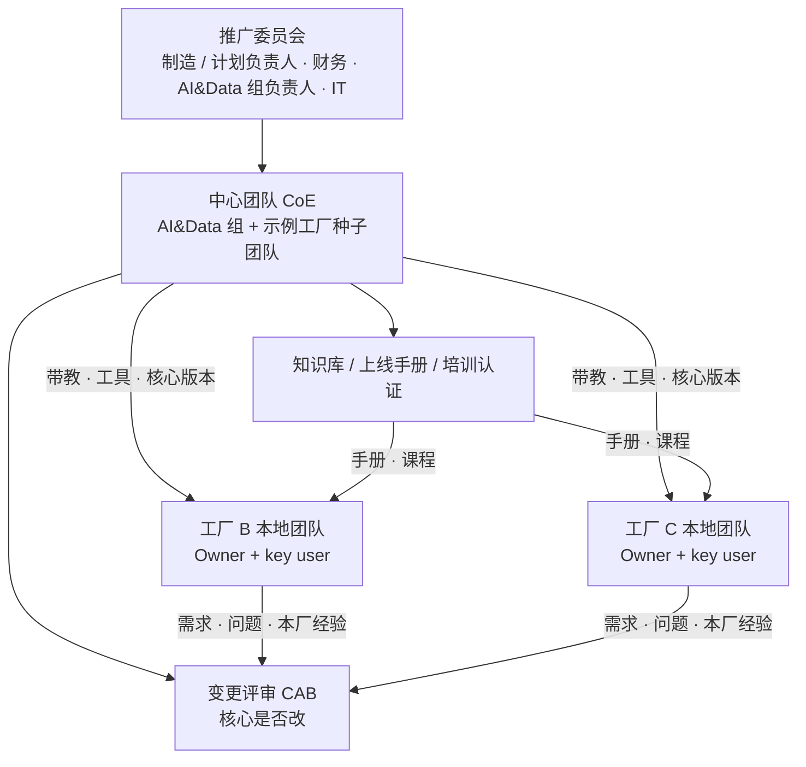

| 角色 | 组成（⚠ 建议） | 职责 |
| :-- | :-- | :-- |
| 推广委员会 | 制造 / 计划负责人（主席）、财务、AI & Data 组负责人、IT | 定推广策略和波次；批准每厂范围和资源；每厂上线验收；协调跨厂问题 |
| 中心团队（CoE） | AI & Data 组（核心平台、数据、AI）+ 示例工厂种子团队（业务方法、试点经验） | 维护核心标准和平台；维护上线方法论和手册；带教新工厂；运营变更评审；培训认证 |
| 变更评审（CAB） | 中心团队牵头，各厂 Owner 代表参加 | 判断需求进核心还是放配置；排核心版本计划 |
| 工厂 Owner | 新工厂计划 / 排产负责人 | 本厂上线的业务负责人；决定本厂参数和场景 |
| 工厂 key user | IE、HR、能源、财务、物流、IT 各一名（可兼职） | 维护本厂参数；发起测算；做对账；提需求；带本厂其他用户 |
| 示例工厂种子团队 | 示例工厂 VCS 业务核心成员 | 输出经验和案例；参与新厂评估和带教；作为「最像的工厂」样板 |

#### 21.7.2 知识库与手册

| 内容 | 用途 |
| :-- | :-- |
| 上线手册 | 六步、清单、模板、验收标准、常见问题 |
| 口径字典 | 每个参数和指标的定义、单位、来源、负责人 |
| 配置包模板 | 空白模板 + 填写说明 + 示例值 |
| 适配器目录 | 已有适配器、适用的源系统、映射表样例 |
| 场景库目录 | 通用场景 + 各厂本地场景 |
| 问题记录 | 各厂遇到的问题、原因、处理办法（RAG 知识库来源） |
| 案例 | 示例工厂及已上线工厂的回测、对账、决策案例（数字脱敏 / 示例化） |

#### 21.7.3 培训与认证（⚠ 建议）

| 等级 | 对象 | 能做什么 | 认证方式 |
| :-- | :-- | :-- | :-- |
| 使用者 | 计划、财务、管理层助理 | 看结果、发起常用场景、读策略对比 | 课程 + 操作考核 |
| key user | 各部门接口人 | 维护参数、配置本地场景、做月度对账、解释偏差 | 课程 + 在本厂完成一次完整月度循环 |
| 配置专家 | 中心团队、种子团队 | 做配置包、映射表、回测、带教新厂 | 至少带过一个工厂上线 |

#### 21.7.4 需求回流（变更评审）

1. **提出**：各厂 key user 把需求或问题提到需求池（模板：现象、影响、期望、本厂临时办法）。
2. **分类**：中心团队按 21.3.3 判断：取值问题 → 配置包；方法问题 → 核心新方法版本；新决策类型 → 核心新版本。
3. **评审**：CAB 定期评审（⚠ 建议月度）：是否通用、优先级、影响哪些工厂。
4. **实现与测试**：核心修改后，在**所有已上线工厂的基准场景**上回归，看总成本和方案变化。
5. **发布**：核心小版本按月 / 季发布 ⚠；各厂按自己节奏升级，升级前在本厂基准场景回归。
6. **反馈**：在知识库里记录结论，告知提出方。

规则：**本厂特有的只改配置；改公式 = 新增方法版本，不覆盖旧的；不允许绕过评审在某厂单独改核心代码。**

#### 21.7.5 推进节奏：波次推广（wave plan，⚠ 示例）

| 波次 | 范围 | 目标 | 进入条件 | 退出条件 |
| :-- | :-- | :-- | :-- | :-- |
| W0 示例工厂试点 | 示例工厂 | 跑通全链路；把示例工厂拆成「核心 + 示例工厂配置包」；沉淀手册 | 已在进行 | 示例工厂完成首次对账；核心 v1 和配置包模板发布 |
| W1 灯塔复制 | 1 个与示例工厂结构最相近、就绪度最高的工厂 | 验证复制方法；测出真实工作量 | W0 退出 | 灯塔工厂完成上线六步；工作量档位表按实际校准 |
| W2 小批推广 | 2–3 个工厂并行 | 本地团队主导、中心团队支持；验证并行推广能力 | W1 退出；手册更新 | 各厂上线；回流需求处理完；KPI 达标 |
| W3 全面推广 | 其余工厂 | 规模化；中心团队只做支持和核心维护 | W2 退出 | 全部上线；进入常态运营 |

每波结束开一次评审：KPI 达标、回流问题处理完，才开下一波。波次顺序按就绪度总分和业务价值排序，**先易后难**。

### 21.8 推广 KPI（⚠ 目标待定）

| KPI | 衡量什么 | 用途 |
| :-- | :-- | :-- |
| 单厂上线周期 | 从步骤 1 到步骤 6 的天数 | 看复制是否越来越快 |
| 单厂中心团队投入 | 中心团队在每个厂投入的人天 | 看复用效果（应逐波下降） |
| 配置化率 | 新厂需求中「只改配置」的比例 vs「改核心」的比例 | 看核心是否足够通用 |
| 适配器复用率 | 新厂复用已有适配器的比例 | 看数据接入成本 |
| AI 建议采纳率 | 字段映射、参数抽取、规则建议被采纳的比例 | 看 AI 加速是否有效 |
| 回测偏差 | 各厂测算 vs 实际偏差率（按车间、科目） | 看各厂模型质量 |
| key user 认证数 | 每厂通过认证的 key user 人数 | 看本地能否自运转 |
| 月度使用率 | 各厂每月是否完成测算、对账、决策循环 | 看是否真的在用 |
| 回流需求关闭周期 | 需求从提出到关闭的天数 | 看治理效率 |
| 核心版本一致性 | 各厂使用的核心版本落后最新版的程度 | 防止分叉 |

### 21.9 风险与应对

| 风险 | 表现 | 应对 |
| :-- | :-- | :-- |
| 示例工厂做得太定制 | 示例工厂结构写死在代码里，复制时要大改 | W0 就把示例工厂拆成「核心 + 配置包」（原型已演示）；核心代码禁止出现工厂名、车间名 |
| 核心分叉 | 各厂各改各的 | 变更评审；核心代码只有一份；各厂只改配置 |
| 新厂数据就绪度低 | 参数靠手工 Excel，没有实际数据 | 就绪度评估先行；阻断项先补；先上 L2「可测算」，回测随数据补齐 |
| 本地团队能力不足 | key user 不会用，上线后没人维护 | 培训认证；带教；上线手册和 RAG 问答；种子团队支持 |
| 中心团队成为瓶颈 | 多厂同时推进，中心团队排不过来 | 波次控制并行数；W2 起本地团队主导；工具化（模板、`plant_check`、AI 映射） |
| 口径争议 | 各厂对「人数」「单车成本」算法不同 | 指标口径是核心标准，由财务和推广委员会定 |
| 期望过高 | 以为复制就是「拷一份」 | 讲清工作量档位和六步；W1 用实际数据校准预期 |
| 数据安全 | 各厂成本、工资数据跨厂可见 | 按工厂和角色隔离权限；跨厂对标只用汇总指标；数据不出厂 |

### 21.10 面试 30 秒说法

「示例工厂是试点，我不会让每个厂从头再做一遍。做法是把示例工厂拆成核心标准加示例工厂配置包：实体框架、参数表结构、求解模型、成本接口、策略场景库和指标口径是核心，各厂只配车间链、JPH 档、班次、费率、产能上限和本地规则。新厂按六步上线：评估差异、数据映射、参数配置、历史回测、并行试运行、正式上线，每步有清单和验收门，先做就绪度评估决定进哪一波。LLM 用来自动建议字段映射、抽参数、生成质量规则、做差异分析和解释回测偏差。组织上是中心团队加工厂 key user，推广委员会定波次，需求经变更评审回流到核心，防止越做越分叉。」

---


## 更新记录

| 日期 | 内容 |
| :-- | :-- |
| 2026-10-17 | 新增 0B 业务逻辑图：业务逻辑图.png（`prototype/plot_business_logic.py` 生成），从需求到成本结论的判断与推导链（Ⓐ 输入 → Ⓑ 产能匹配判断 → Ⓒ 资源与成本 → Ⓓ 约束校验、求解选优、策略与场景、决策、执行、对账校准闭环），逐步说明表、总装 10 月示例走查、四张图分工、mermaid 版本；图表汇编 Word 加入该图 |
| 2026-10-17 | 新增 20 业务架构与协作点（业务架构图.png，七步流程 × 九个角色泳道，协作点 C1–C12 明细表、参数归属、决策权、协作节奏）；新增 21 多工厂复制与推广机制（多工厂复制机制图.png，核心标准 vs 工厂配置、产品化与版本、上线六步与检查清单、就绪度评估、工作量档位、AI 加速、组织治理、波次推广、推广 KPI、风险）；原型改为配置驱动：data/plant.json、data_loader.load(data_dir)、model_builder 不再写死总装，新增 plant_check.py、make_demo_plant.py、run_plant.py、plants/DEMO_B 示例配置包、plot_business_arch.py、plot_rollout.py |
| 2026-10-17 | 新增 0A 总体架构图：架构图.png（`prototype/plot_architecture.py` 生成）+ mermaid 版本 + 各层说明（应用/决策、求解/计算、模型/规则、数据，右侧 AI 增强） |
| 2026-10-16 | 新增 18 极端情况与场景模拟；原型新增旋钮层 scenarios.py、场景库 data/scenario_library.csv、stress_test.py、压力测试.png；cost_functions 支持停线天数和开动率系数，model_builder 支持零件供应上限 |
| 2026-10-16 | 新增 16 实体论与 LLM 校验/集成/分析、17 假设与策略；原型新增 util_cap、head_change、fix_y 可选参数，strategies.py（策略对比 + 蒙特卡洛）和 策略对比.png |
| 2026-10-16 | 新增 12 Data AI 协作、13 AI 提速与小模型、14 复杂逻辑统筹、15 离散模式 vs 连续变量；原型新增可选模式切换约束（jph_step、shift_quarter）和 test_mode_constraints.py |
| 2026-10-16 | 新增 1A「数据如何结合计算」：数据关联图（mermaid + 数据关联图.png）、总装 10 月逐步计算实例、缓存联动、备选方案比较、中间量一览 |
| 2026-10-16 | 新增配套文件 要素详解.md、模拟器使用说明.md；原型增加练习脚本、示例图脚本、按月电价系数 |
| 2026-10-16 | 确认优化求解、JPH按车间、本人总体筹划；新增分块构建、最终集成、原型、相关理论 |
| 2026-10-16 | 新建：要素总览、逐项拆解、补充输入清单、关联关系、计算链路、优化模型骨架、数据与技术实现、模拟场景 |
| 2026-10-16 | 新增第 19 节：用 Laya 这类结构化决策模型做决策模拟（分工、四个用法、流程、使用要点） |
