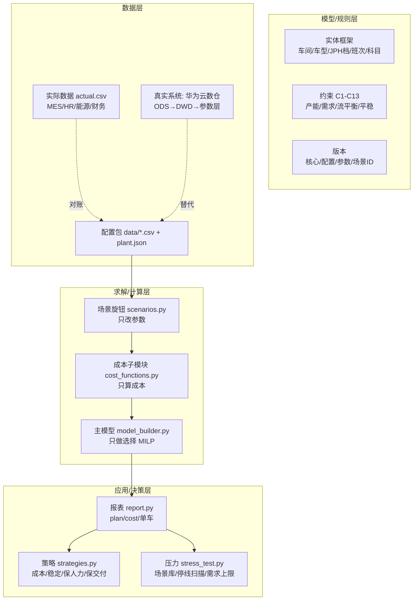
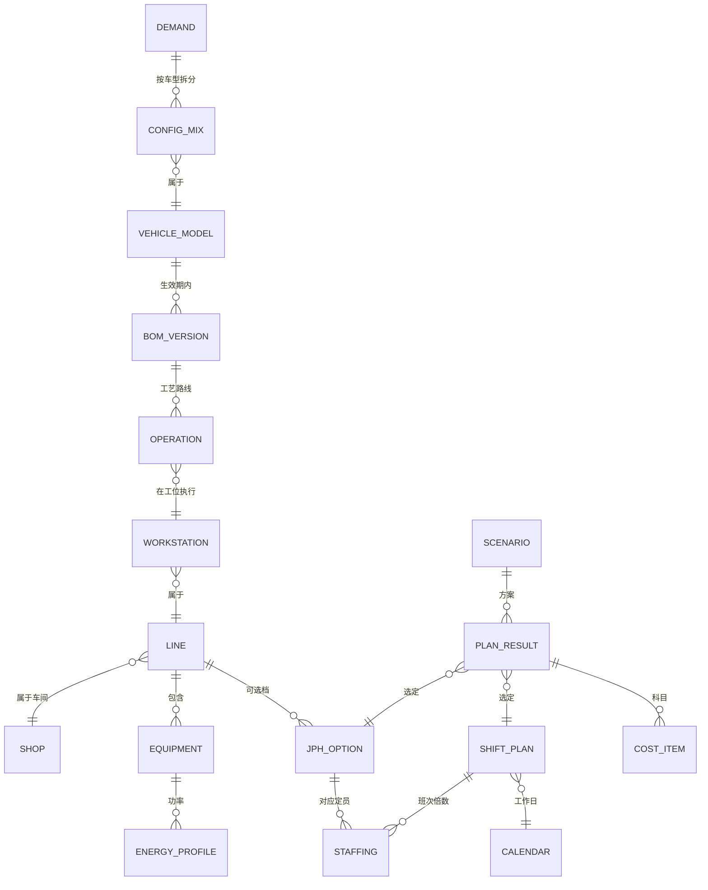

# 计算模型与模块设计：概念·定义·数据·系统·业务·逻辑（深入解析版）

> 改工厂的基数、策略或计算公式时，按 [工厂改数与重算指南.md](../工厂改数与重算指南.md)。公式以 `v5.2/` 的代码为准。本文对照的是 2026-10-17 的 `prototype 2/`，该目录已归档到 `archive/prototype/`。
>
> 日期：2026-10-17 ｜ 工作区：`/Users/jeremylv/my_projects/volume_cost_simulation`
> 基准：以 `prototype 2/` 现行代码为准（`data_loader.py / cost_functions.py / scenarios.py / model_builder.py / strategies.py / stress_test.py / report.py / plant_check.py / run_plant.py / make_demo_plant.py` + `data/*.csv` + `plants/DEMO_B/`）。
> 数据声明：本文全部数字为原型**示例数据**，非工厂实绩，仅说明口径与逻辑。标 `⚠` 为待与业务联合确认项。

---

## 0. 总览：一句话模型与分层

### 0.1 一句话

> 每个车间每月选一个「JPH档 × 班次数」离散组合 `y`，再定加班 `ot`、产量 `x`、缓存 `inv`、缺口 `short`，使 **固定成本 + 加班 + 变动 + 缓存持有 + 缺口惩罚** 最小。车间之间用 **流平衡 + 缓存上限** 串起来。

### 0.2 分层架构



### 0.3 分工铁律

| 层 | 只做什么 | 不做什么 | 改动影响 |
|---|---|---|---|
| `cost_functions` | 给定 `(车间,JPH档,班次,月)` 算成本系数 | 不选方案、不读场景 | 改能源口径只改这里 |
| `model_builder` | 查成本表 + 满足约束选 `y/ot/x/inv/short` | 不算单价、不解释 | 加约束只改这里 |
| `scenarios` | 深拷贝参数并覆盖旋钮 | 不求解 | 加新场景类型加旋钮 |
| `report` | 反算分项、拼 plan/cost | 不改决策 | 改口径只改这里 |
| `data_loader` | 读配置包成字典 `d` + 校验 | 不含业务公式 | 换工厂只换目录 |

### 0.4 集合、变量、目标、约束速览

集合：`S` 车间有序链（TZ 为 STP→BIW→PNT→TCF，DEMO_B 为 BIW→PNT→TCF）；`M` 车型（V446K/V451/V452）；`T` 月（1–12）；`I_s` 每车间 3 档（i=0,1,2）；`K` 班次（1/2/3，⚠ 现主键=班次数）。

变量：`y[s,i,k,t]∈{0,1}` 每格恰选 1（约 430 个）；`ot[s,i,t]≥0` 加班；`x[s,m,t]≥0` 产量；`short[m,t]≥0` 缺口；`inv[a,m,t]≥0` 发出缓存（仅 S[:-1]）。

目标：`min Σfixed·y + Σot单价·ot + Σ变动单价·x + Σ持有·inv + 惩罚·short + OH固定常数`。

约束 C1–C13：C1 唯一选择；C2 加班挂靠所选档；C3 产能（含加班）；C4 车型上限（产能限制配置）；C5 链尾+缺口≥需求；C6 供应上限；C7 流平衡；C8 缓存上限；C9 利用率上限（稳定）；C10 人数平稳（保人力）；C11 JPH 渐变；C12 班次按季；C13 方案锁定（蒙特卡洛）。

---

## 1. 块1 主数据与实体框架：系统的地基

### 1.1 相关概念

- **主数据（Master Data）**：长期稳定、跨流程共享的基准对象，如车间、车型、产线、成本科目。特点是“一次定义、处处引用”。
- **实体框架 / Ontology**：对象 + 属性 + 关系 + 规则 + 依据的四层知识。关系即计算路径，规则挂在对象上。
- **编码（Code）**：对象的唯一键，如 `STP/BIW/PNT/TCF`、`V446K`。跨系统对齐靠编码映射表。

### 1.2 定义

| 实体 | 定义 | 主键 | 属性（原型） |
|---|---|---|---|
| 工厂 Plant | 独立测算单元，拥有一条车间链 | `plant_id` | shops、core_version、config_version、owner |
| 车间 Shop | 工艺阶段，JPH 决策单元 | `shop` | 工序顺序、kwh_per_unit、oh、ot上限、buffer_cap、hold_cost |
| 车型 Model | 可交付产品 | `model` | demand、cap、supply |
| JPH档 JPH_Option | 车间可选的一档线速+定员+功率绑定 | `(shop,i)` | jph、heads_per_shift、run_kw |
| 班次 Shift | 一月开班模式 | `k` | eff_hours、night、bus、outsourcing |
| 成本科目 Cost_Item | 归集口径 | 科目名 | 人工/加班/班车/外包/能源固定变动/OH/持有/惩罚 |
| 场景 Scenario | 一套旋钮取值 + 参数快照 ID | 场景ID | knobs JSON |
| 方案 Plan_Result | 选定的 y/ot/x/inv/short + 成本 | (场景ID,s,t) | jph/shifts/heads/ot/capacity/volume/util |

### 1.3 数据

`plant.json`：`plant_id TZ`、`shops [STP,BIW,PNT,TCF]`、`core_version core-1.0`、`config_version TZ-cfg-2026.10-示例`。DEMO_B 复用同 schema，仅 shops 缩为 3、单车型。真实系统主数据存数仓主数据域，编码规则由数据团队 + 工艺/计划/财务会签。

### 1.4 系统实现

`data_loader.load(data_dir)`：读 `plant.json` 定车间链 → 派生 `models/months` → 组 `d`。无 `plant.json` 回退默认四车间。`validate()` 断言日历/上限/JPH 齐全。`plant_check.py` 做 L0–L3 就绪度门。

### 1.5 业务介绍

主数据是各部门的“普通话”。IE 认车间/产线/工位，计划认车间链与日历，HR 认车间编码（定员挂靠），财务认成本中心/科目，物流认缓存/线路。没有统一编码，四个部门的 Excel 永远对不上。块 1 的业务动作就是**编码统一 + 关系确认 + 出处登记**（来源文件、负责人、生效日期、适用范围）。

### 1.6 相关逻辑与协作

- 上游：无（起点）。
- 下游：块 2（参数挂靠）、块 5（JPH 档挂车间）、块 6（班次挂日历）、块 10（约束按车间建）、块 12（报表按车间/科目汇总）。
- ER 见 §19。LLM 以此为地图做映射建议、抽取、解释（只建议、人确认）。

---

## 2. 块2 参数版本管理：让每次测算可复现

### 2.1 概念

- **参数（Parameter）**：随时间变化的取值，如工资、电价、定员、JPH、工作日、上限。与主数据的区别是“带生效日期”。
- **版本（Version）**：`版本号 + 生效日 + 失效日 + 负责人 + 来源` 五件套。测算冻结快照，历史可重算。
- **快照（Snapshot）**：`场景ID = 基准参数 + 旋钮覆盖` 后的完整 `d` 字典。

### 2.2 数据

8 CSV 即参数层简化版：`demand/calendar/capacity_limit/jph_options/shift_options/shop_params/global_params` + `plant.json`。通用字段：键（车间/车型/月/档）、值、单位、生效/失效、版本、负责人、来源（真实系统；原型用文件版本代替）。

### 2.3 系统实现

`data_loader.scenario(demand/elec/wage)` 快捷系数；`scenarios.apply_knobs` 全量旋钮（四级需求连乘、avail/down/supply/单价/ot）。`report` 落库文件名带场景名。`plant_check` 查缺文件/缺字段/缺 `(s,m,t)` 上限。版本规则：核心大版本不兼容需迁移脚本，小版本向后兼容；工厂配置版本声明兼容核心；参数版本带日期。

### 2.4 业务介绍

痛点是“参数散在 Excel、无人负责、过期不更新”。块 2 的业务动作：**认领（谁产生谁负责）→ 入表（搬进数仓）→ 定频（月/季/事件）→ 审批（变更走影响分析）**。归属见 §16 表：工时/JPH 归 IE，工资/加班归 HR，电价归能源，OH/班车/外包归财务，上限/日历/需求归计划。

### 2.5 逻辑

测算时按 `场景 + 月份` 取有效行；公式变更发新方法版本并行跑；每次结果记 `核心+配置+参数+场景ID+方法版本`。验收：任一历史可重算出同值（原型：无旋钮 = 基准 42953 万）。

---

## 3. 块3 需求与车型组合：驱动变量

### 3.1 概念

- **需求（Demand）**：t 月 m 车型要交付的台数。分确定订单 + 预测，预测可浮动。
- **车型组合（Mix）**：各车型占比。组合越复杂（高工时配置多），瓶颈越紧。
- **交付期/船期**：出口集中发运造成季末峰、季初谷。

### 3.2 数据

`demand.csv`：淡 8500（2 月 3360+2640+2000）→ 旺 11000（10–12 月 4620+3630+2750），季节约 1.1，比例约 42:33:25。`capacity_limit.csv` 按 `(s,m,t)` 设上限（如 TCF/V446K 6000、V451 4800、V452 4200），即截图“产能限制配置”。

### 3.3 系统实现

`d["demand"][(t,m)]`。四级旋钮连乘：`demand_all × demand_month × demand_model × demand_cell`。`supply[(m,t)] = 系数 × 当月需求`（需求旋钮之后算，注意顺序）。场景库例：旺季 9–12 月 ×1.15；出口 V446K 季末 ×1.3 季初 ×0.85；缺芯 V451 4–5 月 ×0.7。

### 3.4 业务介绍

需求来自 S&OP（销售+运营对齐）。计划要总量，工艺要组合（定瓶颈），物流要节奏（船期），财务要预测支撑预算。块 3 的业务动作是**月度滚动确认**：S&OP 会定稿 → 参数快照 → 测算 → 偏差回写（预测准不准）。

### 3.5 逻辑与协作

需求只考核链尾（C5：`x[S[-1]]+short≥demand`），上游产量由流平衡反推。组合漂移改瓶颈（⚠ 当前 JPH 不随组合打折，待建 `combo_factor`）。下游：负荷（需求×工时）→ 产能缺口 → 加班/升档/缺口。敏感性：±10% 需求是标准灵敏度（单车 3485↔3677，固定摊薄效应）。

---

## 4. 块4 BOM / MBOM 与工时：车型→车间的翻译器

### 4.1 概念

- **BOM**：单车零件清单；**MBOM**：按制造装配关系组织的 BOM（含工艺路线）。
- **工艺路线**：零件经过的车间/产线/工位序列。
- **标准工时**：某工序造一台车的净作业时间。**单车工时（车间）= Σ配置比例×工序工时**。
- **ECN**：工程变更通知，带生效日期，切换 BOM 版本。

### 4.2 定义与公式

```
单车工时[s,m] = Σ_配置c 比例[c] × Σ_工序p∈(s,m,c) 工时[p]   （生效日期内版本）
负荷工时[s,t] = Σ_m demand[t,m] × 单车工时[s,m]
人数校核 = 负荷 / (hours × 人员效率 × 出勤)  ↔  定员表人数
```

### 4.3 数据与系统现状

⚠ **原型未建 BOM 表**，用 `heads_per_shift` 代替工时换算（预固化）。真实系统补四表：`MBOM(车型,配置,零件,工序,生效/失效)`、`工序工时(工序,车间,工时)`、`配置比例(车型,配置,月)`、`单车能耗(车间,车型)`。`data_loader` 加一载入函数，`capacity` 加 `combo_factor`，`validate` 加“无断档无重叠”（同 MBOM 核对规则）。

### 4.4 业务介绍

工艺/IE 拥有工时，计划用工时算负荷，HR 用工时核定员，采购用 BOM 展物料。ECN 生效时间错一天，排产和成本全错。块 4 的业务动作是**版本切换**：测算月取当月有效 BOM，变更先并行比较再发布。

### 4.5 逻辑与协作

上游块 3（配置比例），下游块 5（瓶颈→JPH）、块 7（人数校核）、块 8（单车能耗）。反推校验：TCF36 档 425/36≈11.8 人时/台，PNT 122/36≈3.4，可与 IE 工时对账。新配置工时用回归/相似件估（小模型，见 §18）。

---

## 5. 块5 车间产能与 JPH 档：瓶颈在哪里

### 5.1 概念

- **节拍（Takt）= 可用时间 / 需求量**：客户要的节奏。
- **瓶颈节拍**：最慢工位时间。**JPH_设计 = 3600 / 瓶颈节拍**。
- **OEE = 时间开动率 × 性能开动率 × 合格率**。**JPH_有效 = JPH_设计 × OEE × 组合系数 × 爬坡系数**。
- **线平衡**：工序均摊到工位，使瓶颈贴近 Takt。每个 JPH 档背后是一套线平衡 + 定员 + 功率。
- **TOC/DBR**：系统产出 = min(各车间产能)；瓶颈定节奏（鼓）、瓶前放缓冲、按瓶颈投料（绳）。本模型的 C7/C8 即 DBR。

### 5.2 数据：`jph_options.csv` 全表（示例）

| 车间 | i0 | i1 | i2 |
|---|---|---|---|
| STP | 30/40人/900kW | 40/50人/1150kW | 50/62人/1400kW |
| BIW | 24/180人/1500kW | 30/215人/1800kW | 36/255人/2100kW |
| PNT | 24/90人/3500kW | 30/105人/3900kW | 36/122人/4300kW |
| TCF | 24/300人/700kW | 30/360人/850kW | 36/425人/1000kW |

`jph` 定产能，`heads` 定人数，`kw` 定固定能耗。**定员随 JPH 单调递增**为硬规则。

### 5.3 系统实现

`d["jph"][s][i]={jph,heads,kw}`。`capacity=jph×hours×avail`。`model_builder` 按 `(s,i)` 建 `ot` 变量、`otl` 挂靠。`plant_check` 查单调性。

### 5.4 业务介绍

四车间形态：STP 批量+换模（JPH 最高，一班常够）；BIW 机器人+人工（人最多）；PNT 烘房连续（功率最大，不能停）；TCF 纯人工（定员最陡，人工占比最高）。IE 定档取值，计划定上限与链，设备定 OEE/窗口。车间差异放配置包，核心代码无工厂名。

### 5.5 逻辑：选档定三数

```
y → capacity（产能）→ ot=缺口/jph
y → heads×k（人数）→ 人工
y → kw×hours（固定能耗）
```

离散无中间值 → 跳变（TCF10 月 36×2 对 30×3 差 147 万）。瓶颈判定：缺口月各车间最大产能余量最小者（示例在涂装/焊装/总装间切换，⚠ 真实看产能曲线）。

### 5.6 拓展

组合折损、爬坡打折、OEE 三分、兼容矩阵、换型损失、影子价格（固定 y 后 LP 对偶）。

---

## 6. 块6 日历与班次：可用时间

### 6.1 概念

- **工厂日历**：工作日/节假日/检修窗口。**班次模式**：1/2/3 班 + 每班有效小时（扣休息）+ 夜班规则。
- **开动小时 hours = 每班有效小时 × k × (workdays − down)**。`down` 为停线天数旋钮。

### 6.2 数据

`calendar.csv`：1 月 20、2 月 16（春节）、7 月 23、10 月 18（国庆示例）。`shift_options.csv`：1/2 班 7.5h、班车 6 万、外包 8 万、无补贴；3 班 7.0h、班车 7.5 万、外包 9.5 万、补贴 800/人。⚠ 两班 12h 需模式 ID 化（配班组数/小时/倍数/补贴），现 `人数=定员×班次数` 会错。

### 6.3 系统实现

`hours(d,k,t,s)` 扣 `down`；`capacity` 乘 `avail`。`shift_quarter` 冻结非季初班次。`plant_check` 查有效小时 ≤24、工作日 ≤31。

### 6.4 业务介绍

计划定日历，HR 定班次与劳动规则，工会审加班上限。10 月“旺季需求 + 少天数”双杀是典型。停线（焊装 6 月 5 天）hours 330→255，−22.7%。

### 6.5 逻辑与协作

小时 → 产能（块 5）→ 人数倍数/班车外包/固定能耗（块 7–9）。加班上限 36h/月（⚠ 法规口径）是弹性天花板。周末异价、节假日三倍均未建（见 §8.6）。

---

## 7. 块7 人力测算：到底需要多少人、多少钱

### 7.1 概念

- **直接人员**：线上操作工，随 JPH×班次走。**间接人员**：班组长/质量/维修/物流/计划，随班次阶梯（⚠ 原型未拆）。
- **定员（Heads per shift）**：某 JPH 档单班线平衡人数。**人数 = 定员 × 班次数**（原型；理论再 ÷出勤）。
- **出勤率**：实到/应到。原型折进 `avail`（⚠ 未单列）。

### 7.2 定义与公式

```
heads(s,i,k) = heads_per_shift × k
labor = heads×wage + (k=3 ? heads_per_shift×night : 0)
ot1h全成本 = heads_per_shift×ot_rate + kw×price   （人工+能耗）
```

理论对照：`直接人数 ≈ 单车工时×JPH/效率×班次/出勤`。原型预固化，IE 改平衡即改表走版本。

### 7.3 数据：人数全表（人数=定员×班次，示例）

| 车间×档 | 1 班 | 2 班 | 3 班 |
|---|---|---|---|
| STP 30/40/50 | 40/50/62 | 80/100/124 | 120/150/186 |
| BIW 24/30/36 | 180/215/255 | 360/430/510 | 540/645/765 |
| PNT 24/30/36 | 90/105/122 | 180/210/244 | 270/315/366 |
| TCF 24/30/36 | 300/360/425 | 600/720/850 | 900/1080/1275 |

单价：工资 9000/人月，加班 75/人时，夜班 800/人月（3 班，基数为**单班定员**）。基准解多 2 班，全厂月约 1500–1600 人。

### 7.4 系统实现

`cost_functions.labor()` 两行：`heads=o[heads]×k`；三班加补贴。`ot_cost_per_hour()` 供目标函数。`report.extract`：工资→人工，加班费→加班，补贴并入人工。`model_builder` C10 `head_change` 约人数环比，`hd=Σheads·k·y`。

### 7.5 业务介绍

IE 给定员表，HR 给单价/上限/补贴，计划给班次，财务认口径。对账三问：人数差→表版本/出勤/借调；加班差→漏停线；人工差→工资版本/补贴。招聘提前 1–3 月（⚠）意味着当月不能随意加人，需提前期约束。

### 7.6 相关逻辑：三实例

- TCF10 月 36×2：850 人，765 万 + 加班 35.6×425×75=113.3 万。若 30×3：1080 人 972 万 + 28.8 万补贴 = 1000.8 万，贵 235.8 万。
- BIW6 月 30×2+10h：430 人 387 万 + 16.1 万 ≈ 403 万。
- 加班 1h 全成本：TCF36 32625 元/h，BIW30 17475，PNT30 10800，STP50 5700。36h 封顶补 `36×jph` 台，超则升档/三班/认缺口。

### 7.7 拓展（7 项）

直接/间接拆分、出勤单列、技能矩阵、招聘提前非对称界、加班异价三档、两班 12h 模式 ID、外包阶梯价。详见原 §8.6。

---

## 8. 块8 能源测算：固定与变动要分开

### 8.1 概念

- **固定能耗**：开动即耗（烘房保温、空调照明待机），随 `hours` 走，与产量无关。
- **变动能耗**：随产量走（焊接喷涂装配），`产量×kwh_per_unit`。
- **峰谷电价**：夜班谷电便宜但人工贵（⚠ 原型未分时）。

### 8.2 公式与实例

```
固定 = kw×hours×price ｜ 加班 = kw×ot×price ｜ 变动 = 产量×kwh_per_unit×price
price = 0.75 × elec_month_factor[t]
```

TCF10 月：20.3 万 + 2.7 万 + 24.8 万。PNT30 档 7 月固定 ≈ 3900×345×0.75 ≈ 100 万/月。全年能源 4054 万（基准），电价 +20% → 4865 万且不换档（不敏感）。

### 8.3 数据与系统

`run_kw` 来自功率清单（额定×同时率），`kwh_per_unit` 来自计量/产量回归（截距=固定、斜率=变动）。`energy_fixed()` / `var_cost_per_unit()` 供目标。`plant_check` 不查能源单调（可加：kw 随档单调）。

### 8.4 业务介绍

能源/设施管功率与电价，设备管开停机，财务认分摊。停线再升温、换色清洗、连续生产省能均未单列（⚠）。对账：计量 vs `固定+变动`，偏差追功率/单耗/电价。

---

## 9. 块9 OH / 班车 / 外包 / 加班规则：补齐六模块

### 9.1 概念

- **OH（制造费用）**：折旧/维修/辅料/厂房/管理/IT。分固定（摊薄）与变动（随产）。**ABC 作业成本**：复杂配置多耗工时换型，应多摊（⚠ 原型按台均摊）。
- **班车/外包**：按班次阶梯付费的固定支出，开班即付。
- **CVP 本量利**：`单车 = 固定/产量 + 变动`，开班临界点单车跳变。

### 9.2 数据与公式

```
OH = oh_fixed + 产量×oh_var   （STP 120万+120, BIW 200万+200, PNT 250万+350, TCF 220万+250）
bus = k×6万(3班7.5万) ｜ out = k×8万(3班9.5万)
ot ≤ 36h/月（可旋钮 24/60）
```

三班年固定多约 144 万（班车外包部分）+ 人工能耗大头。`oh_fixed×12` 为目标常数，不影响选档但影响单车。

### 9.3 系统与业务

`bus()/outsourcing()` 纯查表；`report` 合 OH 固定+变动。业务：OH 口径归财务，班车归行政，外包归采购，加班规则归 HR+工会。维修费挂开动小时（⚠ 可加）。

---

## 10. 块10 优化求解器：只做选择（MILP）

### 10.1 概念

- **MILP**：部分变量整数（y 二进制选档），其余连续。**灵敏度/影子价格**：约束放宽 1 单位目标改善多少（MIP 需固定整数后求 LP 对偶 ⚠）。
- **APP 综合生产计划**：本模型即离散 JPH×班次版 APP（追逐 vs 平准：加班/招聘/库存/缺货权衡）。

### 10.2 系统实现

`build(d, jph_step, shift_quarter, util_cap, head_change, fix_y)`：变量 y/ot/x/short/inv → 目标查 `cost_functions` → 约束 C1–C13 → `solve()` 优先 HiGHS 否则 CBC，按 `solver_time_limit`（60/30s）截断。规模：二进制 ~430，连续 ~700，约束 ~1500。

### 10.3 业务介绍

求解器回答“约束下最便宜怎么做”，不回答“惩罚该多高”（边际利润定）、不回答“余量留多少”（风险偏好定）。小规模验收：枚举 9 组合手算 = 求解。时限截断致个别个位数缺口看量级。

### 10.4 逻辑

C1–C8 必选，C9–C12 策略包，C13 评估锁。链尾考核需求，上游由流平衡反推。车间可各选各档，差额进缓存。

---

## 11. 块11 场景模拟与策略决策：给管理层的取舍

### 11.1 概念

- **场景**：一条旋钮记录。**压力测试**：单旋钮拧大找击穿点。**组合冲击**：多冲击叠加（单项可吸、叠加击穿）。**蒙特卡洛**：随机抽样看分布（均值/P90/缺口率）。
- **策略**：不同的目标+约束包（成本/稳定/保人力/保交付）。

### 11.2 数据与系统

旋钮 6 类：`demand_*(四级连乘)/avail(ALL展开)/down/supply(需求后算)/elec wage/ot`。库 8 条：旺季/出口/缺芯/停线/春节/限电/涨价/组合。`stress_test.py` 三式：横比、停线 0–10 天扫、需求 1.0–1.5 扫。`exercises.py` 教学 0–4。`strategies.py`：四策略包 + `metrics()` + `monte_carlo(fix_y锁档, ±8%×20次, seed7)`。

### 11.3 业务介绍

常规场景分钟级、新旋钮天级、结构变化周级（预期管理）。产出“能吸多少、先顶车间、预案触发线”。稳定 +5.9% 换 10% 余量；保人力 +2.5% 换零波动；+20% 需求低惩罚缺 10878 台、高惩罚多花 4022 万补齐（约 3700/台）。蒙特卡洛：成本 18/20 缺 vs 稳定 0 缺。

### 11.4 LLM 解释逻辑

沿实体追溯（需求→日历→产能→加班→成本），附参数版本出处；常识审查列可疑（单车翻倍、三班低利用）；硬校验靠规则。自然语言→旋钮草稿→人确认；旋钮外报需新旋钮。

---

## 12. 块12 报表：方案、成本、单车

`report.extract(d,v)`：扫 `y>0.5` → `fixed_breakdown` + `ot人工/ot能耗+变动` + `OH固定变动` → `plan{shop,month,jph,shifts,heads,ot_hours,capacity,volume,util}`；累 `cost{人工,能源固定/变动,班车,外包,加班,OH,持有,惩罚}`；`out` = 链尾年产。`write_csv(utf-8-sig)`。基准 42953 万/12 万台/单车 3579。`results_summary.md / scenario_summary / strategy_summary / montecarlo_summary / stress_*.csv` 为决策输入。报表数字=求解值，管理层按月用，注明场景号+参数版本。

---

## 13. 数据层与系统集成：从 CSV 到数仓

源系统 PLM/BOM、MES/设备、人事、能源计量、财务、S&OP → 华为云 `ODS→DWD→参数层` → 规则引擎（块 7–9）→ 求解器（块 10）→ 结果库（场景+方案）→ Web（参数维护/测算）/报表/LLM → 月末对账回写。原型 CSV 即参数层简化，`data_loader` 换数仓读取即可。构建路线：0 准备（实体/标准/负责人）→ 1 MVP（单车间枚举回算）→ 2 全成本（四车间六模块）→ 3 优化（求解+缓存+场景）→ 4 智能（LLM+对账）。

---

## 14. 校验、对账与版本治理

结构（缺表/字段/上限/档即错）→ 业务规则（定员单调、k∈{1,2,3}、天数≤31、小时≤24、ot≤上限、Σx≤产能、合计=分项）→ 常识（LLM）→ 对账（`run_plant` 按车间×月，超 ±5% 示例阈值追开动/工时/单价）→ 版本（核心+配置+参数+场景+方法可重算）。DEMO_B 涂装 8 月 −15.5% 为故意埋点。治理：负责人制、场景冻结、变更评审、结果注明版本。

---

## 15. 业务架构：七步闭环 × 九角色 × C1–C12

```
①需求输入 → ②参数维护 → ③测算/模拟 → ④策略决策 → ⑤执行 → ⑥实际回收 → ⑦对账校准 ─→ 回写②
```

九泳道：管理层、计划/排产（Owner）、IE、人事、能源、财务、物流/供应、IT/数字化、AI&Data。C1 口径归属、C2 接入质量、C3 场景定义、C4 模型变更、C5 发布解释、C6 决策留痕、C7 执行反馈、C8 实际回收、C9 对账校准、C10 小模型、C11 推广、C12 治理节奏。每点定主责/输入/交付/交接/节奏/决策/验收。参数谁产生谁负责；AI 管表结构版本质量，不定值；参数/模型/场景归业务 Owner（否决权），策略归管理层。节奏：日质量、周执行、双周例会、月发布测算对账简报、阶段评审。

---

## 16. 多工厂复制：核心 + 配置包

核心（实体/表结构/求解结构/接口/策略场景/口径/规则/适配器框架/方法论）+ 配置包（车间链/JPH/班次/日历/费率/上限/本地规则/映射/本地场景）= 工厂实例。`plant_check` L0–L3，`run_plant` 检查→求解→回测。六步：评估→映射→配置→回测→并行→上线，每步清单+验收门。就绪度六维（数据/治理/接口/差异/组织/流程）。档位 A 相近（2–3 月）/B 有异（3–5 月）/C 大异（半年+）。波次 W0 示例工厂→W1 灯塔→W2 小批→W3 全面。需求回流经 CAB（通用进核心、特有进配置），禁私改核心。

---

## 17. AI 增强：LLM + 小模型 + Laya

LLM：规则梳理、代码初稿、自然语言→旋钮、RAG 问答、映射/抽取/规则建议、常识审查+带出处解释。原则：只建议、人确认、不算数、不改数。小模型：需求（LightGBM/Prophet/Chronos ⚠）、开动率、能耗回归、新配置工时、文本抽取（Qwen 微调 ⚠）、代理模型。步骤：选点→按实体取数→基线→接入（预测值作参数版本）→监控重训。Laya：场景识别 choice、风险把关 noul、策略推荐 score/choice、异常分级 score；阈值 0.8/0.5 示例待验证；数字归求解器。

---

## 18. 一次求解全链实例（TCF 10 月，示例数据）

需求 11000（4620/3630/2750），上限 6000/4800/4200 通过，日历 18 天。三档×三班 9 组合。`36×2`：270h→9720→缺 1280→ot 35.6→850 人→人工 765 万+加班 113.3 万+班车 12 万+外包 16 万+能耗 47.8 万+OH 495 万 = 1449 万。`24×*`/`30×2`(97h)/`36×1` 不可行；`30×3` 1596 万（+147 万：人工 +207 万+补贴 28.8 万+班车外包 23 万+能耗 4 万 vs 加班 116 万）；`36×3` 1781 万。四车间×12 月联解，10 月无缓存动作，11–12 月涂装 11880→10120 走 PBS 880。落库 42953 万/单车 3579。

---

## 19. 数据关系（ER + 关联键）



关联键：车型（需求—配置—BOM—上限）；车间（BOM—JPH—定员—能源—OH—缓存—上限）；月份（需求—日历—上限—电价）；JPH 档（定员+功率）；班次（小时+人数+班车外包补贴）；生效日期（版本切换）；场景 ID（快照复现）。

---

## 20. 简化清单与扩展路线（⚠）

| 简化 | 扩展 | 动哪里 |
|---|---|---|
| 无排序/换型/间隔 | 日排 Car Sequencing 下层，不可行回新约束 | model_builder+下层 |
| 无爬坡 | JPH/合格率月打折 | jph+avail |
| 无峰谷 | price[t,h]+用电结构，新方法版本 | cost_functions |
| 无招聘提前/技能 | hd 非对称界 + 技能矩阵 | C10 扩展 |
| 无间接 | 定员拆直接/间接阶梯 | jph+labor |
| 无两班 12h | 模式 ID 化 | shift 重构（大版本） |
| 无物流阶梯 | trips 整数+容量+趟费 | 新子模块 |
| 开动率混装 | OEE/出勤/限电三分 | scenarios |
| 无跨厂 | 工厂下标+转移+运费 | 大版本 |
| 时限 30–60s | 商用求解选型+规模测试 | solve+运维 |

---

## 附：文件→章节速查

| 文件 | 章节 | 说明 |
|---|---|---|
| `data/*.csv + plant.json` | §2–§9 | 8 表 + 工厂定义 |
| `data_loader.py` | §1–§2, §13 | load/validate/scenario |
| `cost_functions.py` | §7–§9 | 九纯函数 |
| `scenarios.py + library` | §11 | 旋钮与 8 场景 |
| `model_builder.py` | §10 | MILP |
| `report.py` | §12 | plan/cost |
| `strategies.py` | §11 | 策略+蒙特卡洛 |
| `stress/exercises` | §11 | 压力+教学 |
| `plant_check/run_plant/make_demo` | §14, §16 | 检查/回测/示例厂 |
| `plot_*.py` | §0, §19 | 六图 |
