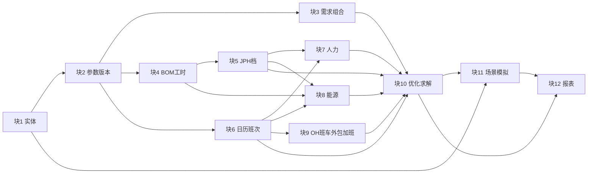
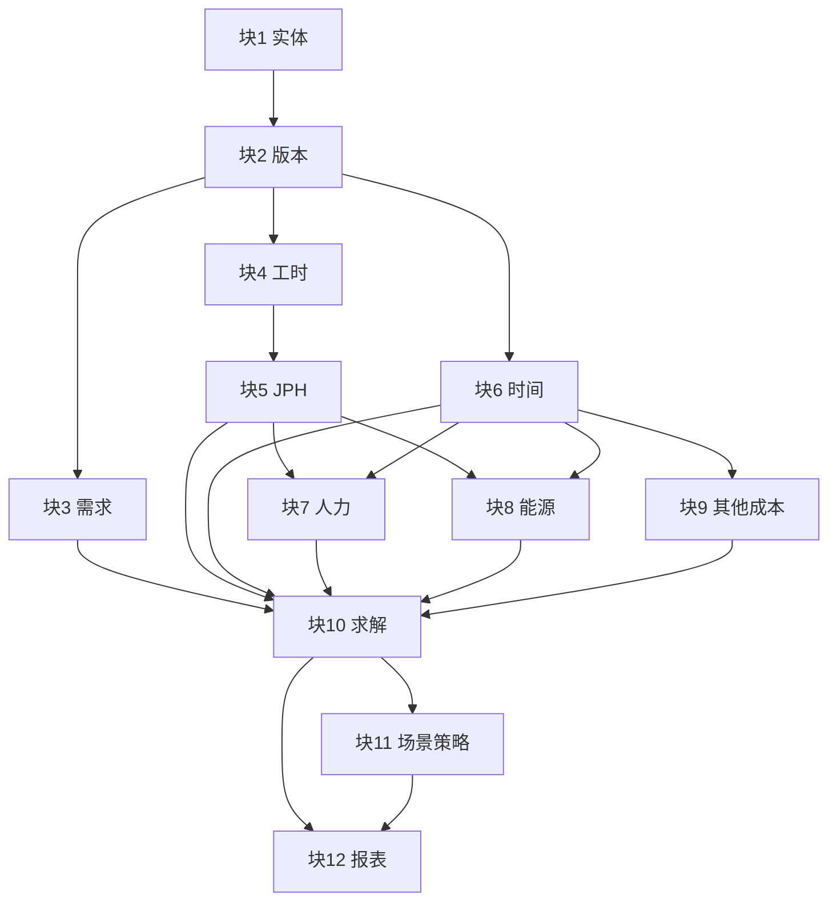
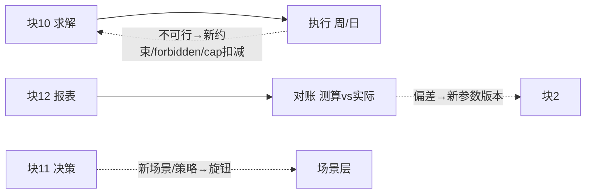

# 项目拓展详案（二）：十二分块深挖与相互关系图谱

> 分块和代码的现行对应在 `v5.2/README.md`。改某一块的输入按 [工厂改数与重算指南.md](../工厂改数与重算指南.md)。本文写作时的入口 `prototype 2/` 已归档。
>
> 日期：2026-10-17 ｜ 工作区：`/Users/jeremylv/my_projects/volume_cost_simulation`
> 前置阅读：`项目拓展详案.md`（10 方向八段式）、`产量成本模型-要素拆解 (1).md`（§8 分块构建、§14 统筹、§15 离散变量）、`计算模型与模块设计.md`（公式与代码对照）、`prototype 2/README.md`（文件—分块对照）。
> 数据声明：本文数字均为原型**示例数据**，非工厂实绩，仅说明口径与量级。标 `⚠` 为待与业务联合确认项。

---

## 0. 阅读地图：12 块是什么、谁依赖谁

12 块按"先打底 → 建产能时间 → 建成本 → 求解模拟报表"四组推进（要素拆解 §8）：

```
组A 打底：      块1 实体 → 块2 参数版本 → 块3 需求组合
组B 产能时间：  块4 BOM工时 → 块5 JPH档 ↘
                块2 → 块6 日历班次 → 块7 人力（需块5+块6）
                                ↘ 块8 能源（需块4+块5+块6）
                                ↘ 块9 OH/班车/外包/加班（需块6）
组C 求解：      块10 优化（需块3+块5~块9）
组D 应用：      块11 场景模拟（需块10+块1）→ 块12 报表（需块10+块11）
```

依赖 DAG（mermaid）：



原型文件对照（README）：`data/*.csv`＝块1–6 的数据载体；`data_loader.py`＝块2＋块11 参数覆盖；`cost_functions.py`＝块7/8/9；`model_builder.py`＝块10；`run.py/scenarios.py/stress_test.py/strategies.py`＝块11；`report.py`＝块12；`plant_check/run_plant`＝跨块治理与对账。

---

## 第一部分：十二分块逐块深挖

> 统一体例：①定位一句话 ②核心概念 ③数据（表/字段/示例值） ④公式与代码 ⑤业务动作与负责人 ⑥输入/输出/验收 ⑦与其它块的关系（详见第二部分矩阵） ⑧拓展接口。

### 块1 主数据与实体框架——地基

- **定位**：统一对象、编码与关系，各部门同一套语言；LLM 推理的地图。
- **概念**：主数据（长期稳定、处处引用）；实体四层知识（定义/关系/规则/依据）；编码唯一键。
- **数据**：`plant.json{plant_id, shops, core_version, config_version, owner}`；车间 `STP/BIW/PNT/TCF`；车型 `V446K/V451/V452`；科目 8 项。DEMO_B 复用同 schema，链缩为 3 车间单车型。
- **代码**：`data_loader.load()` 读链；`plant_check` 查"JPH 车间在链里"；ER 见计算模型 §19。
- **业务**：IE/计划/财务会签编码；出处四件套（来源文件、负责人、生效日、适用范围）。
- **输入/输出/验收**：输入各部门台账 → 输出主数据表＋ER 图 → 编码唯一、无孤儿、车型可追到车间与成本中心。
- **拓展接口**：新车间/车型/科目只加行不改码；跨厂复用同一套 Ontology（拓展 9）。

### 块2 参数版本管理——可复现的承诺

- **定位**：所有参数带版本与生效期，任一历史可重算。
- **概念**：参数 vs 主数据（参数随时间变）；快照（场景 ID＝基准＋旋钮覆盖）；方法版本（公式变更发新版并行）。
- **数据**：8 CSV＋5 版本字段（版本号/生效/失效/负责人/来源）。`global_params{solver_time_limit 60}` 等。
- **代码**：`load/validate/scenario/apply_knobs`；`plant_check` 27 项；结果文件名带场景名。
- **业务**：认领（谁产生谁负责）→入表→定频→审批（含影响分析：基准跑一遍看总成本变化）。
- **输入/输出/验收**：输入散 Excel → 输出数仓参数层＋快照 → 历史重算一致（无旋钮＝42953 万）。
- **拓展接口**：`load(source="db")` 数仓分支；`--months N` 回测窗口（拓展 1/8）。

### 块3 需求与车型组合——驱动源

- **定位**：回答"造多少、造什么"，一切计算的源头。
- **概念**：确定订单＋预测（±10% 浮动）；组合（42:33:25 示例）；船期（季末峰）。
- **数据**：`demand.csv` 淡 8500（2 月）→旺 11000（10–12 月）；四级旋钮连乘 `all×month×model×cell`；`supply＝系数×当月需求`（需求之后算）。
- **代码**：`d["demand"][(t,m)]`；C5 链尾考核 `x[S[-1]]+short≥demand`；场景库旺季/出口/缺芯行。
- **业务**：S&OP 月度滚动确认；销售给预测、计划给节奏、财务给预算口径。
- **输入/输出/验收**：输入 S&OP → 输出 `demand(月,车型,量)` → 合计＝总量，与会议数一致。
- **关系**：下游块 4（比例拆工时）、块 10（C5/C6）、块 11（需求场景）；上游无。
- **拓展接口**：P50/P90 区间（拓展 5）、`margin` 优先级（拓展 4）、周船期（拓展 2）。

### 块4 BOM/MBOM 与工时——翻译器

- **定位**：把"车型配置"翻译成"各车间工时与单耗"。
- **概念**：BOM/MBOM/工艺路线/标准工时/ECN 生效切换；`单车工时＝Σ比例×工序工时`；`负荷＝Σ需求×单车工时`。
- **数据**：⚠ 原型未建表（用定员代替）。真实四表：MBOM、工序工时、配置比例、单车能耗。反推校验：TCF36 档 425/36≈11.8 人时/台，PNT≈3.4。
- **代码**：待加 `load_bom()`；`capacity()` 加 `combo_factor`；`validate` 加无断档无重叠。
- **业务**：IE 拥有工时；ECN 切换先并行后发布；新配置回归估。
- **输入/输出/验收**：输入 MBOM＋比例 → 输出单车工时/单耗（车间×车型）→ 与 IE 工时一致、两路人数对上。
- **关系**：上游块 3；下游块 5（瓶颈→JPH）、块 7（人数校核）、块 8（单耗）。
- **拓展接口**：`combo_factor/ramp`（拓展 3）、物料 BOM（拓展 6）。

### 块5 车间产能与 JPH 档——瓶颈所在

- **定位**：定义"每个车间能跑多快"，离散档是全部取舍的来源。
- **概念**：Takt/瓶颈/`JPH＝3600/节拍`/OEE/线平衡/TOC-DBR（产出＝min 产能；C7/C8 即 DBR）。
- **数据**：`jph_options.csv` 全表示例——STP 30/40/50（40/50/62 人；900/1150/1400kW）；BIW 24/30/36（180/215/255；1500/1800/2100）；PNT 24/30/36（90/105/122；3500/3900/4300）；TCF 24/30/36（300/360/425；700/850/1000）。定员/功率随档单调为硬规则。
- **代码**：`d["jph"][s][i]`；`capacity＝jph×hours×avail`；`otl` 挂靠；`plant_check` 查单调。
- **业务**：IE 定档、计划定上限与链、设备定 OEE。四形态：STP 批量高 JPH、BIW 人最多、PNT 功率最大、TCF 人工最陡。
- **输入/输出/验收**：输入瓶颈实测 → 输出档候选集 → 历史产量可验证、定员与定编一致。
- **关系**：上游块 4；下游块 7/8（定员/功率）、块 10（C3/C11）；横向块 6（小时）。
- **拓展接口**：增档（＋48 二进制/档先压测）、兼容矩阵、换型损失、影子价格（拓展 3）。

### 块6 日历与班次——可用时间

- **定位**：定义"一个月有多少小时可开"。
- **概念**：工厂日历/班次模式/`hours＝有效小时×k×(工作日−down)`；加班上限 36h ⚠。
- **数据**：`calendar` 1 月 20/2 月 16/7 月 23/10 月 18；`shift` 1/2 班 7.5h＋6 万/8 万、3 班 7.0h＋7.5 万/9.5 万＋800 补贴。⚠ 两班 12h 需模式 ID 化。
- **代码**：`hours()` 扣 down；`shift_quarter` 冻季内班次；`plant_check` 查小时≤24、天数≤31。
- **业务**：计划定日历、HR 定班次与劳动规则、工会审上限。10 月双杀（旺季＋18 天）、焊装 6 月停 5 天（330→255h）为典型。
- **输入/输出/验收**：输入假日/检修/协议 → 输出月×班次可用小时 → 与生产日历一致、加班合规。
- **关系**：下游块 7/8/9（倍数/能耗/班车外包）、块 10（C2/C12）；上游块 2。
- **拓展接口**：12h 模式、周末异价、招聘提前（拓展 2/7）。

### 块7 人力测算——多少人多少钱（最常被问）

- **定位**：给定档与班，算人数与人工四笔钱。
- **概念**：直接/间接（⚠ 未拆）/定员/出勤（⚠ 折 avail）/加班/补贴。
- **数据**：人数全表（定员×班次）：TCF36 425/850/1275；BIW30 215/430/645；PNT30 105/210/315；STP50 62/124/186。单价 9000/75/800（三班基数＝单班定员）。
- **公式与代码**：`heads＝定员×k`；`labor＝heads×wage＋(k＝3?定员×night:0)`；`ot1h＝定员×75＋kw×0.75`。`labor()/ot_cost_per_hour()`；C10 `head_change`；`report` 工资→人工、加班费→加班、补贴并人工、加班能耗→能源变动。
- **实例**：TCF10 月 36×2：850 人 765 万＋113.3 万；30×3：1080 人 972 万＋28.8 万，贵 235.8 万。BIW6 月 30×2＋10h：430 人 403 万。1h 全成本 TCF36 32625/BIW30 17475/PNT30 10800/STP50 5700 元；36h 封顶补 `36×jph` 台。
- **业务**：IE 给表、HR 给价、计划给班、财务认口径；对账三问（人数→表/出勤、加班→停线、人工→工资/补贴）。
- **输入/输出/验收**：输入档/班/单价 → 输出人数与人工（车间×月×方案）→ 回算偏差达阈 ⚠。
- **关系**：上游块 5＋块 6；横向块 9（同乘 k）；下游块 10（系数＋C10/C11/C12）、块 12。
- **拓展接口**：直接/间接拆分、出勤单列、技能矩阵、提前期、异价、12h、外包阶梯（拓展 2/7 详案）。

### 块8 能源测算——固定与变动分家

- **定位**：区分"开着就耗"与"造一台耗一台"。
- **概念**：固定/变动/峰谷（⚠ 未分时）/升温（⚠ 未列）。
- **数据与公式**：`固定＝kw×hours×price`；`加班＝kw×ot×price`；`变动＝产量×kwh_per_unit×price`；`price＝0.75×月系数`。TCF10 月 20.3＋2.7＋24.8 万；PNT30 档 7 月固定≈100 万/月；全年 4054 万，＋20% 电价→4865 万且不换档。
- **代码**：`energy_fixed()/var_cost_per_unit()/price()`；`plant_check` 可加 kw 单调。
- **业务**：能源管功率电价、设备管开停、财务认分摊；计量回归 `电量＝a×小时＋b×产量＋c` 标 `a→kw,b→单耗`。
- **输入/输出/验收**：输入功率/单耗/电价 → 输出能源成本 → 与计量偏差达阈 ⚠。
- **关系**：上游块 4（单耗）＋块 5（kw）＋块 6（小时）；下游块 10；横向块 7（班次联动固定能耗）。
- **拓展接口**：分时 `price[t,h]`、升温项、分车间电表（拓展 1/6）。

### 块9 OH/班车/外包/加班规则——补齐六模块

- **定位**：把截图六模块中人力能源之外的全部补齐。
- **概念**：OH 固定/变动、ABC（⚠ 按台均摊）、CVP（`单车＝固定/产量＋变动`，开班临界跳变）、阶梯成本（开班即付）。
- **数据与公式**：`OH＝固定＋产量×变动`（STP 120 万＋120/BIW 200 万＋200/PNT 250 万＋350/TCF 220 万＋250）；`bus＝k×6 万（3 班 7.5 万）`；`out＝k×8 万（3 班 9.5 万）`；`ot≤36`。三班年固定多约 144 万（班车外包部分）。
- **代码**：`bus()/outsourcing()` 查表；`oh_fixed×12` 为目标常数。
- **业务**：OH/口径归财务、班车归行政、外包归采购、加班归 HR＋工会；维修挂小时 ⚠ 可加。
- **输入/输出/验收**：输入合同/预算 → 输出四科目 → 与财务口径一致。
- **关系**：上游块 6（k）；下游块 10；横向块 7/8（同乘班次）。
- **拓展接口**：ABC 分摊、维修挂小时、资金成本（拓展 6）。

### 块10 优化求解器——只做选择

- **定位**：约束下选总成本最低的档×班组合。MILP（PuLP＋HiGHS/CBC），二进制约 430、连续约 700、约束约 1500，30–60s。
- **概念**：MILP/影子价格（固定 y 后 LP 对偶 ⚠）/APP（本模型即离散版综合生产计划）。
- **代码**：`build(jph_step, shift_quarter, util_cap, head_change, fix_y)`→C1–C13；`solve()` 截断记状态。枚举 9 组合手算＝求解为验收门。
- **业务**：回答"最便宜怎么做"，不回答"惩罚多高/余量多少"（业务定）。时限截断致个位数缺口看量级。
- **输入/输出/验收**：输入块 3＋块 5–9 → 输出月 JPH/班/人数/加班/产量/缓存与总/单车 → 小规模与枚举一致、时长达标。
- **关系**：汇聚上游全部；下游块 11/12；反馈块 2（C7 不可行回新约束）。
- **拓展接口**：`forbidden` 禁用集、切换罚、商用求解、随机规划二期（拓展 2/5/8）。

### 块11 场景模拟与策略决策——取舍给管理层

- **定位**：把"如果…会怎样"变成可比的成本/风险/取舍。
- **概念**：场景（旋钮记录）/压力（单旋钮拧大）/组合（多冲击叠加）/蒙特卡洛（分布）/策略（约束包）。
- **数据与代码**：旋钮 6 类（需求四级/avail-ALL/down/supply-需求后/elec·wage/ot）；库 8 行；`stress_test` 三式；`strategies` 四包＋`metrics()＋monte_carlo(fix_y,±8%×20,seed7)`；`exercises` 教学 0–4。
- **证据**（示例）：策略表——成本 42953 万/98.6%/波动 61%；稳定 45484 万（＋5.9%）/88.2%；保人力 44033 万（＋2.5%）/波动 0%；压力低惩罚缺 10878 台（含罚 49027 万）vs 保交付 49785 万零缺口（补齐约 3700/台）。蒙特卡洛——成本均 42794/P90 43213/均缺 599/最大 1730/90% 有缺；稳定均 44795/P90 45071/0 缺。场景——基准 42953；旺季类推高 1000–1800 万；缺芯运营成本反降但缺口 2030 台（真代价＝惩罚）；组合冲击缺 2508 台（单项可吸叠加击穿）。需求上限约 1.3 倍后旺季缺货。
- **业务**：常规分钟级/新旋钮天级/结构周级；产出"能吸多少/先顶车间/预案线"；惩罚与余量由边际利润与风险偏好定。
- **输入/输出/验收**：输入自然语言/事件 → 输出对比表＋图＋解释 → 解释可追溯、业务认可。
- **关系**：上游块 10＋块 1（实体链解释）；下游块 12；横向 Laya（判断）与 LLM（翻译/润色）。
- **拓展接口**：`explain.py`、`health_check.py`、NL→旋钮、Laya 四用（拓展 5/7）。

### 块12 报表——落子无悔的账本

- **定位**：方案、成本、单车、缺口的唯一出口，注明版本可追溯。
- **代码**：`extract()` 扫 `y>0.5` 反算 `plan{heads/ot/capacity/volume/util}`＋`cost{8 科目}`；`out`＝链尾年产；`write_csv(utf-8-sig)`。产物：`plan_*.csv/cost_*.csv/scenario_strategy_montecarlo_stress_*.csv/results_summary.md`。
- **业务**：总览（单车/缺口/瓶颈）＋车间明细＋场景对比＋偏差监控；管理层按月用。
- **输入/输出/验收**：输入求解值 → 输出四报表 → 数字＝求解值、版本齐全。
- **关系**：汇聚块 10＋块 11；回供给块 2（对账）与 LLM（解释源）。
- **拓展接口**：体检表、口径对照表（模型 vs 财务全成本）、决策留痕单（拓展 5/6/10）。

---

## 第二部分：相互关系——六类关系详解

### R1 层级依赖（谁没好谁等谁）



- 硬依赖：块 10 缺任一块上游即不可解（`validate` 断言就是依赖检查）。
- 软依赖：块 4 缺失时块 5 可用定员表代工时跑（原型现状），但失去校核能力——这是"能跑"与"可信"的区别。
- 实施含义：阶段 1 先保硬依赖（拓展 1），阶段 2 再补软依赖（拓展 3/6）。

### R2 数据血缘（一个数从哪来、到哪去）

以"TCF 10 月人数 850"为例的血缘链：

```
IE线平衡表.定员425[jph_options] ─┐
计划.班次2[求解y] ───────────────┼→ heads=425×2=850[report.plan]
HR.工资9000[global_params] ──────┼→ 人工765万[cost_人工]
```

全量血缘（表→中间→科目→决策）：

| 血缘起点（表/版本） | 中间量 | 科目 | 决策影响 |
|---|---|---|---|
| demand＋calendar | 所需/小时/产能 | — | 够否→加班/升档/缺口 |
| jph(heads/kw)＋shift(k) | 人数/功率/小时 | 人工/固定能耗/班车外包 | 档×班取舍（147 万差） |
| shop(kwh/oh/ot/buffer)＋g(单价) | 加班单价/变动单价/持有 | 加班/变动/OH/持有 | 加班 vs 三班分界 |
| cap/supply | 可行域边界 | 缺口惩罚 | 缺多少、杀哪车型 |
| inv 流平衡 | 跨月调剂 | 持有成本 | 11→12 月 880 台 |

血缘即解释链（`explain.py` 规则链），每步挂出处（表名/版本/数值）。

### R3 约束耦合（改一个约束牵动全局）

| 约束 | 所在块 | 牵动 |
|---|---|---|
| C3 产能 | 块5＋块6 | ot（缺口/jph）、y（升档/加班次）、inv（吃缓存）、short |
| C7/C8 流平衡/缓存 | 块5 | 四车间联动：11 月涂装＋880→12 月−880，下游不动 |
| C10 人数平稳 | 块7 | ot↑＋inv↑（人冻住靠加班缓存吸波，＋1080 万） |
| C12 班次按季 | 块6 | 冲压 50×1→30×2（＋41 万灵活性价） |
| C9 利用率 | 块10 | 加班↓243 万、余量 10%（＋2531 万稳定价） |
| C5/C6 需求/供应 | 块3 | short 结构（缺芯 2030 台 vs 组合 2508 台） |

耦合含义：没有"只改人力"的优化——人数约束一收紧，加班、缓存、档位、成本全动。这就是必须联解（MIP）而不能分车间各自最优的原因。

### R4 成本联动（一笔钱三处响）

班次 `k` 是最大联动器（乘 5 处）：

```
k↑ → 人数↑→人工↑ ｜ 小时↑→固定能耗↑ ｜ 班车↑ ｜ 外包↑ ｜（k=3)补贴↑
```

JPH 档 `i` 联动 3 处：`jph↑→产能↑（ot↓）｜heads↑→人工↑｜kw↑→固定能耗↑`。TCF 10 月 36×2 vs 30×3 的 147 万差＝人工 207 万＋补贴 28.8 万＋班车外包 23 万＋能耗 4 万 − 加班 116 万，五处联动的净值。看单科目会误判，必须看总账——这是"子模块分算、主模型总选"的设计理由。

### R5 时间节拍（月/周/日的三层钟）

```
月（块10 y）：定档×班×产量×缓存收发（冻结边界）
周（拓展2 weekly）：班组×排序×周产量和＝月（MPS对齐，每周四滚）
日（daily/HR）：点名实到vs需求（分技能），缺口→调借包→反馈单
```

节拍规则：月 25 日锁下月 ⚠；周四定下周；日班前点名。节拍错位（周私改月计划）算违规。当前 `shift_quarter` 是月钟对日钟的粗保护（少切换＝少扰动）。

### R6 反馈闭环（三条绿色虚线）



- 内环（决策→求解）：分钟级，场景/策略旋钮重解。
- 中环（执行→求解）：周级，反馈单转约束（对照表见详案拓展 2.4.4）。
- 外环（对账→参数）：月级，偏差追因修参数发新版。
- 三环周期不同、载体不同（旋钮/约束/版本），但都回同一模型——这就是 0A 图"绿色虚线向下反馈"的落地。

---

## 第三部分：关系矩阵（查表用）

### M1 12×12 影响矩阵（行→列：行变了列要动；●强 ○弱 —无）

| → ↓ | 1 | 2 | 3 | 4 | 5 | 6 | 7 | 8 | 9 | 10 | 11 | 12 |
|---|---|---|---|---|---|---|---|---|---|---|---|---|
| 1 实体 | — | ● | ● | ● | ● | ● | ○ | ○ | ○ | ● | ● | ○ |
| 2 版本 | — | — | ● | ● | ● | ● | ● | ● | ● | ● | ● | ● |
| 3 需求 | — | — | — | ● | ○ | — | ○ | ○ | — | ● | ● | ● |
| 4 工时 | — | — | — | — | ● | — | ● | ● | — | ● | ○ | ○ |
| 5 JPH | — | — | — | — | — | — | ● | ● | — | ● | ● | ● |
| 6 时间 | — | — | — | — | — | — | ● | ● | ● | ● | ● | ● |
| 7 人力 | — | — | — | ○ | ○ | — | — | ○ | ○ | ● | ● | ● |
| 8 能源 | — | — | — | ○ | ○ | — | ○ | — | — | ● | ● | ● |
| 9 其他 | — | — | — | — | — | — | ○ | — | — | ● | ○ | ● |
| 10 求解 | — | ○ | — | — | — | ○ | — | — | — | — | ● | ● |
| 11 场景 | — | ○ | ○ | — | — | — | — | — | — | ○ | — | ● |
| 12 报表 | — | ● | — | — | — | — | — | — | — | — | ○ | — |

读法示例：第 6 行：日历班次一变，人力/能源/其他/求解/场景/报表全动（●），JPH 取值不动（—，档是 IE 定的）。第 10 行：求解逻辑变（如换求解器）只影响场景与报表，不动上游参数。对角线下半区非空的是反馈（10→2 版本回写、11→2/3、12→2）。

### M2 接口契约表（块间交接物）

| 从→到 | 交接物 | 格式 | 坏了的表现 |
|---|---|---|---|
| 1→2 | 编码表 | 主数据表 | 映射对不上、孤儿记录 |
| 2→3/4/5/6 | 参数快照 | `d` 字典＋场景 ID | 口径各算各、历史不可重算 |
| 3→10 | demand | `(t,m)→量` | C5 无解/大缺口 |
| 4→5 | 单车工时 | `(s,m)→小时` | JPH 档无依据 |
| 4→7 | 负荷/人数校核 | 小时数 vs 定员 | 两路人数对不上 |
| 5＋6→7/8 | 定员/功率/小时 | `(s,i,k,t)→系数` | 人工/能耗错 |
| 6→9 | 班次数 | k | 班车外包错 |
| 7/8/9→10 | 成本系数表 | fixed/ot单价/变动单价 | 选档系统性偏 |
| 10→11 | 最优 y/ot/x/inv | plan | 策略对比失真 |
| 10/11→12 | plan/cost/out/sh | CSV＋版本 | 报表与求解不一致 |
| 12→2 | 偏差报告 | 车间×科目×月 | 参数永远不准 |
| 11→10 | 新旋钮/约束 | knobs JSON | 场景跑不出 |

### M3 部门×分块 RACI 浓缩（Owner 一览）

| 块 | A（拍板） | R（执行） | 配合 |
|---|---|---|---|
| 1/2 | 业务 Owner | AI&Data（表结构/版本/质量） | IE/计划/财务（口径） |
| 3/6 | 计划 | 计划 | 销售/IT |
| 4/5 | IE（工艺） | IE | 计划/设备 |
| 7 | HR（单价/规则）＋IE（定员） | HR/IE | 财务 |
| 8 | 能源 | 能源/设备 | 财务 |
| 9 | 财务 | 财务/行政/采购 | HR |
| 10/11 | 业务 Owner（模型上线/场景入库否决权） | AI&Data | 计划/IE/财务 |
| 12 | 计划（发布） | AI&Data（工具） | 管理层 |

---

## 第四部分：一条链串全块（TCF 10 月 36×2，示例数据）

| 步骤 | 块 | 数 | 关系体现 |
|---|---|---|---|
| 需求 11000、上限通过 | 块3＋块1 | 4620/3630/2750≤6000/4800/4200 | R2 血缘起点 |
| 日历 18 天、候选 9 组合 | 块6＋块5 | 7.5×2×18＝270h | R1 块5＋块6→块7/8 |
| 正常 9720、缺 1280、加班 35.6h | 块5＋块6＋块10-C3/C2 | 1280÷36＝35.6≤36 | R3 C3 牵动 ot |
| 人数 850、人工 765 万＋加班 113.3 万 | 块7 | 425×2；35.6×425×75 | R4 档联动 3 处 |
| 能耗 47.8 万、OH 495 万、班车外包 28 万 | 块8＋块9 | 20.3＋2.7＋24.8；220＋275；12＋16 | R4 k 联动 5 处 |
| 合计 1449 万 vs 30×3 的 1596 万 | 块10＋块12 | 差 147 万＝207＋28.8＋23＋4−116 | R4 总账思维 |
| 四车间联解、11→12 月 PBS 880 | 块10-C7/C8 | 11880→10120，下游 11000 | R3 流平衡耦合 |
| 策略：稳定＋2531 万换 10% 余量 | 块11 | 45484/88.2% vs 42953/98.6% | R6 内环 |
| 体检：成本 90% 有缺 vs 稳定 0 缺 | 块11 | 均缺 599/最大 1730 vs 0 | R6 内环＋拓展 5 |
| 对账：涂装 8 月 −15.5% 埋点 | 块12→块2 | 追停线/开动率 | R6 外环 |

---

## 附：与 10 拓展方向的挂接（块→拓展）

| 块 | 主挂接拓展 | 说明 |
|---|---|---|
| 块1/2 | 拓展1、8、9 | 认领入表、数仓分支、配置包复制 |
| 块3 | 拓展4、5 | margin 优先级、P50/P90 区间 |
| 块4 | 拓展3、6 | combo/ramp、物料 BOM |
| 块5 | 拓展3 | 组合折损、爬坡、OEE 三分、增档 |
| 块6 | 拓展2 | 周/日节拍、12h 模式 |
| 块7 | 拓展2、7 | 技能矩阵、解释口径 |
| 块8 | 拓展1、6 | 电表拆分、分时电价 |
| 块9 | 拓展6 | ABC、资金成本 |
| 块10 | 拓展5、8 | 体检、求解器选型 |
| 块11 | 拓展5、7 | 健康检查、解释器＋Laya |
| 块12 | 拓展5、10 | 体检表、留痕单、KPI |

依赖总序见详案附 A：拓1 为总前置；拓2 需拓1＋拓8 过渡态；余见总纲三条线。
