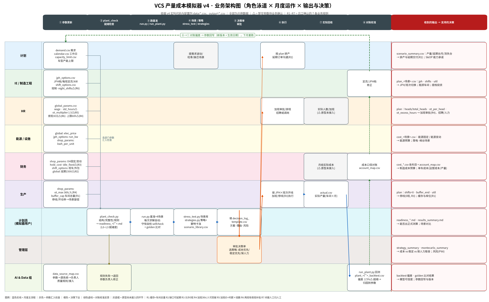
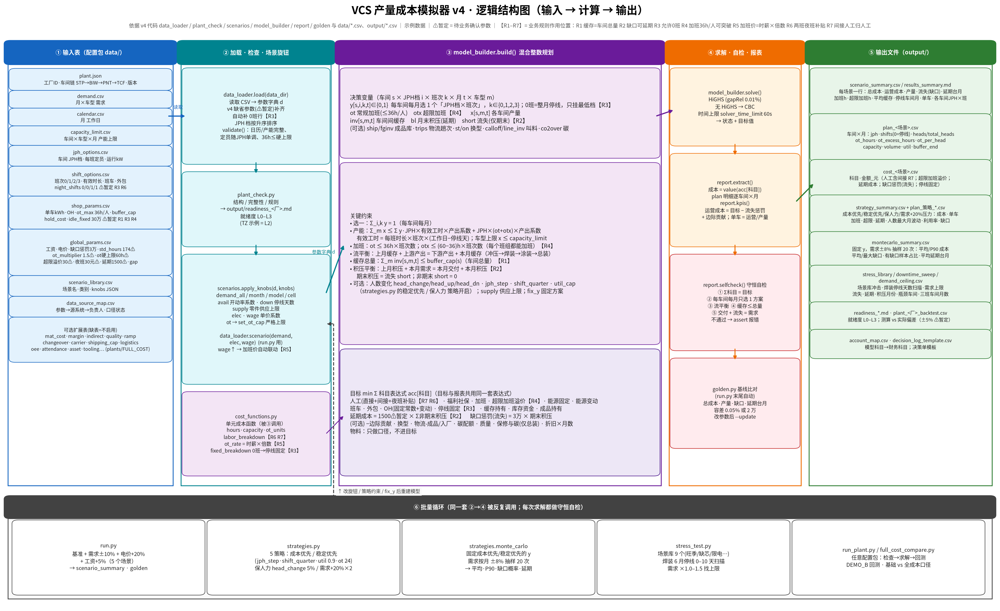

# 模拟器 v4 运作与输出说明

> 现行改数、改策略、改公式的步骤在 [工厂改数与重算指南](../工厂改数与重算指南.md)（代码在 `v5.2/`）。本文是 v4 当时的角色和输出对照，路径 `/workspace/review/v4/` 已归档到 `archive/v4/`。
>
> 依据：v4 的实际代码、`data/*.csv` 配置和 `output/*.csv` 运行结果。全部为**示例数据**，不是工厂实绩。⚠暂定 = 待业务确认的参数。
> 两张图的绘图脚本：`v4/diagrams/plot_v4_business.py`、`v4/diagrams/plot_v4_logic.py`（matplotlib + Noto Sans CJK）。

## 1. 业务架构图：谁提供什么、每月怎么转、输出给谁

**怎么读这张图**
- 横向是每月的 8 个步骤，纵向是 9 个角色泳道，最右一列写每个角色收到什么输出、用来做什么决策。
- **① 参数更新**：各部门分别维护自己的 CSV。
  - 计划：`demand.csv`、`calendar.csv`、`capacity_limit.csv`。
  - IE：`jph_options.csv`（JPH 档、每班定员、运行功率）、`shift_options.csv`（班制、夜班个数 night_shifts ⚠暂定）。
  - HR：`global_params.csv` 里的工资、标准月工时 174 ⚠、加班倍数 1.5 ⚠、夜班补贴 30 元 ⚠、加班绝对上限 60h ⚠。
  - 能源：电价、运行 kW、单车 kWh。
  - 财务：OH、班车、外包、缓存持有成本、停线固定成本 30 万 ⚠、延期成本 1,500 元/台·月 ⚠。
  - 生产：加班常规上限 36h/人、缓存上限（车间总量）、停线和开动率（通过场景旋钮输入）。
- **② plant_check**：检查结构、完整性和规则，输出 `readiness_<厂>.md`（就绪度 L0–L3，示例配置包是 L2）。不通过就退回给参数负责人修改。
- **③ 跑基准**：`run.py` 或 `run_plant.py`。每次求解都会自动做守恒自检，`run.py` 最后还会和 golden 基线比对。
- **④ 场景和策略**：`stress_test.py` 跑场景库，`strategies.py` 跑策略对比和蒙特卡洛。
- **⑤ 决策单**：计划员填 `decision_log_template.csv`，管理层审批并选定策略（成本优先、稳定优先或保人力）。
- **⑥ 执行**：计划按方案排产，并处理延期订单的沟通；生产按方案开线、加班或停线；HR 处理加班审批、排班和招聘。
- **⑦ 实际回收**：原型目前只接了实际产量 `actual.csv`。实际成本、实际人数和加班还没有接入，图中用灰底框标出。
- **⑧ 对账校准**：`run_plant.py` 输出 `plant_<厂>_backtest.csv`，偏差超过 ±5% ⚠ 就标红，并归因到具体参数。财务按 `account_map.csv` 对口径。偏差通过绿色虚线回写到 ①，形成新的参数版本。

**哪些输出支持哪些决策**
| 决策 | 依据的输出 | 规则 |
|:--|:--|:--|
| 加班审批 | plan 的 `ot_hours`、`ot_per_head`、`ot_excess_hours`；cost 的 `加班`、`超限加班溢价` | R4、R5 |
| JPH 和班次 | plan 的 `jph`、`shifts`、`util`；scenario_summary 的各车间 JPH×班次 | — |
| 停线 | plan 中 `shifts=0` 的车间月；cost 的 `停线固定` | R3 |
| 延期交付 | scenario_summary 的 `延期台月`、`流失台`；stress 的积压月份 | R2 |
| 招聘和人力 | plan 的 `heads`、`total_heads`；strategy_summary 的人数最大月波动 | R6、R7 |
| 预算 | cost 的各科目、account_map、单车成本 | R7 |

## 2. 逻辑结构图：输入 → 计算 → 输出

**怎么读这张图**（从左到右五列，底部一条循环带）
1. **输入表**：`plant.json` 定义车间链 STP→BIW→PNT→TCF，另有 8 张必选 CSV、场景库、数据来源表和可选扩展表。可选表缺了就不启用，`plants/FULL_COST` 是一个启用了全部扩展的示例。
2. **加载、检查和场景旋钮**：
   - `data_loader.load()` 读入参数，补齐 v4 新增参数的缺省值，自动补 0 班行（R3），把 JPH 档按升序排好，再做校验。
   - `plant_check.py` 评定就绪度。
   - `scenarios.apply_knobs()` 按旋钮改需求、开动率、停线天数、供应上限、单价和加班上限。工资上调后，加班单价会自动跟着变（R5）。
   - `cost_functions.py` 提供单元成本函数，供第 3 列调用。
3. **model_builder（混合整数规划）**：
   - **决策变量**：每个车间每月从「JPH 档 × 班次（0/1/2/3）」里选一个（R3）；常规加班 ot 和超限加班 otx（R4）；各车间产量 x；车间间缓存 inv；月末积压 bl 和流失 short（R2）。
   - **约束**：每车间每月只选一个方案；产量不超过产能；加班上限随班次数放大（R4）；车间之间流量平衡；缓存不超过车间总量（R1）；积压平衡，期末积压记为流失（R2）。人数变化、JPH 每月最多变一档、班次按季度固定等约束是可选的，由策略开启。
   - **目标**：所有科目表达式之和最小。科目包括人工（含间接人工和夜班补贴，R6、R7）、加班、超限加班溢价、能源、班车、外包、OH、停线固定、缓存持有、延期成本、流失惩罚等。物料只做口径统计，不进目标。
4. **求解、自检和报表**：
   - 求解器用 HiGHS，相对 gap 0.01%；没有 HiGHS 时用 CBC，时间上限 60 秒。
   - `report.extract()` 直接取各科目表达式的值，所以分项之和一定等于目标值。
   - `selfcheck()` 检查 5 项守恒：科目合计等于目标、每车间每月只选一个方案、流平衡、缓存不超总量、交付加流失等于需求。
   - `golden.py` 把结果和基线比对。
5. **输出文件**：见第 3 节。
6. **循环**：`run.py`（5 个场景）、`strategies.py`（5 个策略，外加 20 次蒙特卡洛）、`stress_test.py`（场景库、停线扫描、需求上限）、`run_plant.py` 和 `full_cost_compare.py`。它们都是改完旋钮或约束后，重复调用第 2 到第 4 列。

## 3. 输出文件指南

| 文件 | 内容 | 怎么看 | 给谁 | 支持什么决策 |
|:--|:--|:--|:--|:--|
| `scenario_summary.csv` / `results_summary.md` | 每个场景一行：总成本、运营成本、产量、缺口（流失）、延期台月、加班小时、超限加班小时、平均缓存、停线车间月数、单车成本、各车间每月的 JPH×班次 | 先和基准比总成本和单车成本，再看延期和流失有多少 | 计划、管理层 | 月度能力承诺、场景对比 |
| `plan_<场景>.csv` | 每车间每月：jph、shifts（0 表示停线）、heads、total_heads、ot_hours、ot_excess_hours、ot_per_head、capacity、volume、util、buffer_end | util 等于 1 的车间是瓶颈；ot_per_head 超过 36 就是超限；shifts 来回切换说明不稳定 | 生产、IE、HR | JPH 和班次、加班审批、停线 |
| `cost_<场景>.csv` | 各科目金额（元），人工已含间接人工 | 看哪些科目是大头，以及和基准相比哪项变了 | 财务 | 预算、成本差分析 |
| `strategy_summary.csv` + `plan_策略_*.csv` | 每个策略的成本、单车成本、加班、超限加班、延期、人数最大月波动、利用率、缺口 | 看「多花多少钱，换来多少稳定」 | 管理层 | 策略选择 |
| `montecarlo_summary.csv` | 方案固定后，需求按月随机 ±8%、抽样 20 次：平均成本、P90 成本、缺口和延期 | P90 比平均高多少，反映抗风险能力 | 管理层 | 选稳健方案 |
| `stress_library.csv` / `stress_downtime_sweep.csv` / `stress_demand_ceiling.csv` | 冲击场景、停线天数扫描、需求上限 | 看出现积压的月份、瓶颈车间、需求到多少开始流失 | 计划、生产 | 应急预案、产能投资 |
| `readiness_*.md` | 就绪度 L0–L3 | L2 以上才能出测算 | 计划员、AI&Data | 能否出正式测算 |
| `plant_<厂>_backtest.csv` | 测算和实际的偏差，超过 ±5% ⚠ 标红 | 偏差集中在哪个车间、哪个月 | AI&Data、参数负责人 | 参数校准 |
| `account_map.csv` | 模型科目到财务科目的对照 | 「人工」一行包含间接人工和夜班补贴 | 财务 | 口径对齐 |
| `decision_log_template.csv` | 决策单模板 | 记录选了哪个方案、理由、谁批准 | 计划员、管理层 | 决策留痕 |
| `golden.csv` | 基线：总成本、产量、缺口、延期台月 | 改代码后自动比对 | AI&Data | 回归保护 |

## 4. 基准结果走读（v4，示例数据）

- **总账**（`scenario_summary.csv` 的「基准」行）：
  - 总成本 43,433 万元，运营成本也是 43,433 万元（没有流失），产量 120,000 台，单车成本 3,619 元。
  - 延期 900 台·月，流失 0。全年加班 805 小时，其中超限 59 小时。平均缓存 268 台，没有停线的车间月。
- **成本结构**（`cost_基准.csv`）：
  - OH 20,520 万元，最大，是固定常数。
  - 人工 16,462 万元，已含夜班补贴。
  - 能源固定 2,094 万、能源变动 1,943 万。
  - 加班 962 万、超限加班溢价 11 万。
  - 班车 510 万、外包 680 万、缓存持有 116 万、延期成本 135 万（900 × 1,500）。停线固定 0。
- **排产方案**（`plan_基准.csv`）：
  - 总装 TCF 大多数月份是 30×2；5 月、10 月是 36×2。10 月正常产能 9,720 台（36×7.5×2×18），再加班 35.6 小时（人均 17.8 小时，因为两个班组分担），补到 11,000 台。
  - 冲压 STP 全年基本是 50×1，只有 10 月是 40×2。
  - 超限加班全部出在冲压：5 月和 11 月人均都到了 60 小时的绝对上限，4、9、12 月是 37–43 小时。模型的判断是，单班加超限加班比开第二班便宜。⚠ 人均每月 60 小时是否被允许、实际是否可行，需要 HR 确认；如果不行，就把 `ot_hard_cap_per_head_month` 调低。
- **延期**：900 台·月来自模型主动把少量需求推迟到下月。原因是延期成本 1,500 元/台·月 ⚠ 比加班或多开一个班的边际成本低。如果业务不希望常态延期，就调高这个参数。
- **策略对比**（`strategy_summary.csv`）：
  - 稳定优先 45,361 万元，比成本优先贵 1,928 万，换来人数最大月波动从 61% 降到 25%，并且没有超限加班。
  - 保人力 43,636 万元，比成本优先多 203 万，人数波动 0%，代价是加班升到 1,374 小时（其中超限 167 小时）。
- **蒙特卡洛**（`montecarlo_summary.csv`）：成本优先平均 43,424 万、P90 43,837 万；稳定优先平均 44,177 万、P90 44,493 万。两者都没有流失，分别平均延期 562 和 738 台·月。

## 5. R7 核查结论（间接人工）

- `v4/report.py:69` 的 `ACCOUNT_MAP` 中「人工」一行写的是「直接人工（含间接人工、夜班补贴）」，已经**没有单独的「间接人工」科目**。重新生成的 `output/account_map.csv` 也只有「人工」这一行。
- `cost_functions.fixed_breakdown`（`v4/cost_functions.py:120`）：人工 = 直接 + 间接 + 夜班补贴，不再单列。
- 全成本对比 `output/full_cost_compare.csv` 里也没有「间接人工」行，间接人工已计入人工（全成本口径下人工 21,545 万元）。
- `labor_breakdown()` 内部仍然会算出直接和间接两个中间值，但只用来求和，不会作为科目输出。
- 结论：**R7 已落实，不需要修改**。测试仍是 36/36 通过。
