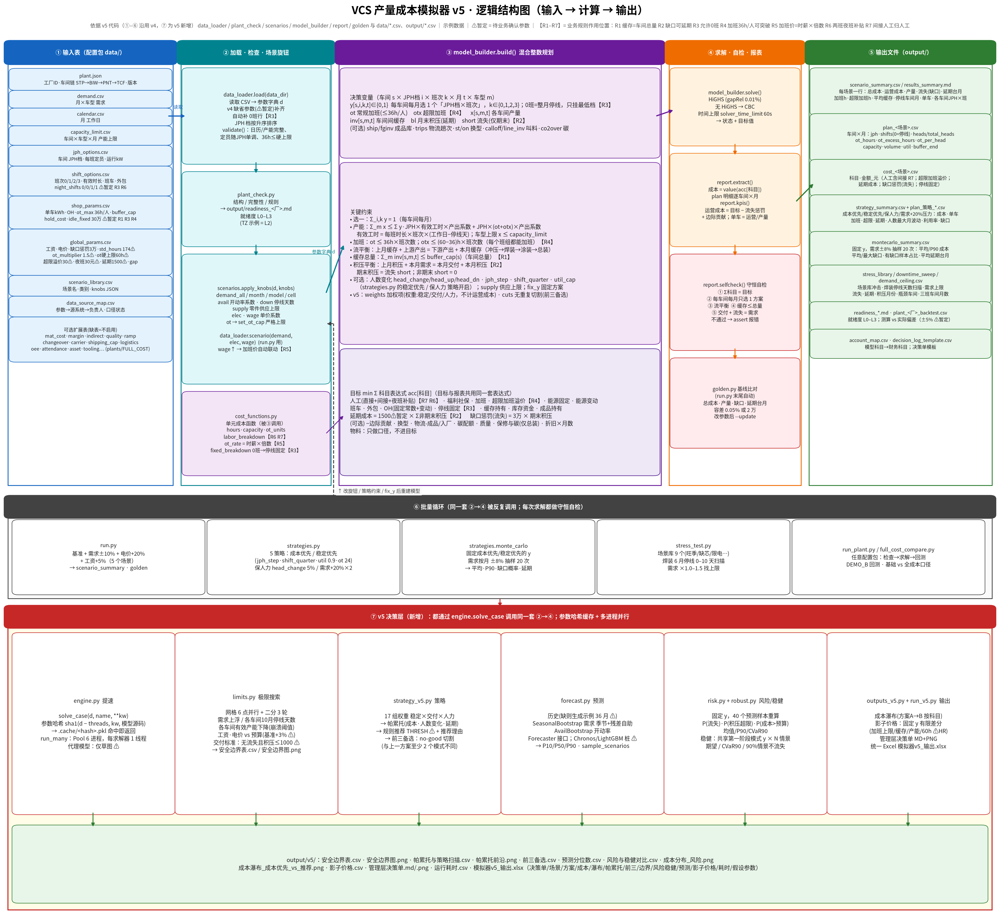

# VCS 产量成本模拟器 v5 升级说明

> 本文所有数字都来自示例数据（台州试点配置 TZ-cfg-2026.10-示例），不是实际经营数据。⚠ 表示暂定参数，需要业务方确认。现行代码在 `v5.2/`，改数按 [工厂改数与重算指南](../工厂改数与重算指南.md)。本文记录 v5 决策层当时的做法，文中的 `v5/` 目录不在当前工作区根上单独运行。

## 0. 一句话总结

v4 能回答"给定条件下最省钱的排产/人力方案是什么"。v5 在 v4 上面加了一层决策功能，能进一步回答：

- **极限在哪里**：需求、停线、产能、工资和电价分别能承受多大的冲击；
- **可选方案有哪些、该推荐哪一个**：生成帕累托前沿，给出带理由的推荐，并列出前三备选；
- **不确定条件下的风险有多大**：基于预测分布计算缺货概率和超预算概率；
- **有没有更稳健的方案**：用多情景共享模式的方法求稳健解；
- **算得快不快**：多进程并行加参数缓存；
- **怎么给管理层看**：成本瀑布、影子价格、一页决策单和统一 Excel。



## 1. 运行方法

```bash
cd v5
pip install --break-system-packages pulp highspy matplotlib openpyxl python-docx
python3 run.py                         # v4 原有流程（5 场景 + golden 基线），不变
python3 run_v5.py                      # v5 全流程：提速基准 → 极限 → 策略 → 预测风险 → 稳健 → 瀑布/影子价格 → 决策单 + Excel
python3 limits.py                      # 只跑极限搜索
python3 -m pytest -q tests             # 46 个测试（v4 原有 36 + v5 新增 10）
python3 diagrams/plot_v5_logic.py      # 重画逻辑结构图
```

全部输出都写到 `output/v5/`。重复运行时，参数相同的求解直接读取 `.cache/` 里的缓存结果。改了模型代码（model_builder / cost_functions）会使缓存自动失效；删除 `.cache/` 则强制全部重算。

## 2. 各功能说明

### 2.1 极限搜索 `limits.py`

- **方法**：每个维度先取 6 个网格点并行求解，找到"通过→不通过"的区间，再用二分法细化 3 轮。所有维度一起并行。
- **扫描维度**：全年需求上浮、各车间 10 月（旺季）停线天数、各车间全年有效产能下降（崩溃阈值）、工资上涨、电价上涨。
- **判定标准**：
  - 交付类维度：无流失，且最大月末积压不超过 `limit_max_backlog` 1000 台 ⚠（基准本身为 600 台）；
  - 成本类维度：运营成本不超过预算，预算 = 基准 × (1 + `limit_budget_margin` 3%) ⚠。
- **输出**：`安全边界表.csv`、`安全边界图.png`。

示例结果：

| 维度 | 临界值 |
|:--|--:|
| 全年需求上浮 | +28.5% |
| 10 月停线天数 STP / BIW / PNT / TCF | ≥18（全月）/ 13.9 / 14.4 / 13.1 天 |
| 全年有效产能下降 STP / BIW / PNT / TCF | −65.9% / −53.1% / −51.0% / −48.9% |
| 工资上涨（超预算） | +7.5% |
| 电价上涨（超预算） | +30.0% |

**怎么读**：在成本方面，工资是最敏感的因素，工资只要上涨 7.5%，成本就会超出预算。在产能方面，总装（TCF）最脆弱。整体的需求余量约为 28%。

### 2.2 策略生成与推荐 `strategy_v5.py`

**加权目标**：在 v4 的成本目标上增加三类权重项，权重项单独记为 `权重:*` 科目，不计入运营成本。

| 权重 | 含义 | 换算 |
|:--|:--|:--|
| stab | 人数月变化 | × 3000 元/人 ⚠ |
| deliv | 积压 | × 5000 元/台·月 ⚠ |
| labor | 总人月 | × 1000 元/人·月 ⚠ |

**扫描**：共 17 组权重，包括 stab ∈ {0, 0.5, 1, 2, 4} 与 deliv ∈ {0, 1, 3} 的组合，另加"人力"组和"综合"组。

**帕累托前沿**：在无流失的方案中，按（运营成本、人数变化合计、延期台月）三个指标判断是否被支配，筛出前沿。

**规则推荐**：阈值 THRESH 为示例值 ⚠，条件是人数最大月波动 ≤ 30%、延期 ≤ 800 台·月、无流失、成本 ≤ 成本优先方案 + 5%。在满足条件的前沿方案中选成本最低的一个，并自动生成推荐理由。如果没有方案满足全部阈值，就推荐违反程度最小的方案。

**前三备选**：在推荐权重下依次求解。每得到一个解，就加一条 no-good 切割，要求下一个解至少有 2 个车间×月的模式与之前不同。

示例结果：

- 推荐方案为「稳定0.5」：运营成本 43,549 万元，比扫描中的成本优先方案多 58 万元，比精确求解的成本优先方案多 116 万元；人数最大月波动从 61% 降到 19%；延期 610 台·月；无流失。
- 17 个候选中，13 个在帕累托前沿上，8 个满足阈值。
- 前三备选的成本分别为 43,549 / 43,540 / 43,556 万元，延期分别为 610 / 880 / 1480 台·月。备选 2 与备选 1 的差别是 BIW 11 月、PNT 5 月由 30×2 改为 36×2。

> 说明：扫描为了提速，使用了 0.2% 的求解间隙。因此扫描里的"成本优先"（43,491 万元，延期 0）和精确求解（43,433 万元，延期 900）略有不同，个别加权方案的成本甚至低于扫描版的成本优先，这属于间隙内的正常现象。正式定稿前，应对选中的方案用 1e-4 间隙复算。

### 2.3 预测输入 `forecast.py`

- **历史数据**：如果没有历史数据，会自动生成 36 个月的示例历史 ⚠，写入 `data/history_demand.csv` 和 `history_avail.csv`。示例历史的需求每年增长 4%，波动 ±6%；开动率为 0.97 ± 0.03。
- **预测模型**：
  - `SeasonalBootstrap`：先计算各月的季节系数和趋势，再对残差做自助抽样（bootstrap）；
  - `AvailBootstrap`：对各月的经验分布做抽样。
- **可插拔接口**：`Forecaster.fit/sample/quantiles`。`ChronosForecaster` 只是接口桩 ⚠，未实现；接入 Chronos 或 LightGBM 只需实现这三个方法。
- **输出**：`预测分位数.csv`，给出各车型需求和各车间开动率在每个月的 P10 / P50 / P90，并附计划值对照。

### 2.4 风险评估与稳健方案 `risk.py` / `robust.py`

**风险评估（蒙特卡洛）**：

- 固定方案的模式选择 y（即 JPH 档×班次），从预测分布中抽取 40 个样本（seed=7），逐个样本重新优化加班、产量、缓存和积压。
- 统计指标：平均成本、P10 / P50 / P90、CVaR90、P(流失)、P(积压超限)、P(成本超预算)。

**稳健优化**：

- 方法：从预测分布抽取 8 个训练情景，所有情景共享同一套第一阶段模式 y，每个情景有各自的追索变量（加班、产量等）。
- 三种模式：
  - `mean`：最小化期望成本；
  - `cvar`：0.5 × 期望 + 0.5 × CVaR90；
  - `chance`：引入二元变量 z，要求至少 90% 的情景不流失。
- 评估方式：用 40 个样本做样本外检验，训练情景（seed=101）与检验样本（seed=7）不重叠。

示例结果（40 个样本外样本，预算 44,736 万元）：

| 方案 | 平均成本 | P90 | CVaR90 | P(流失) | P(积压>1000) | P(超预算) | 平均延期 |
|:--|--:|--:|--:|--:|--:|--:|--:|
| 成本优先（确定性） | 44,660 | 44,820 | 44,903 | 0% | 0% | 25% | 150 |
| 推荐：稳定0.5 | 44,796 | 44,959 | 45,059 | 0% | 0% | 70% | 142 |
| 稳健：期望 | 44,502 | 44,678 | 44,754 | 0% | 0% | 5% | 236 |
| 稳健：CVaR90 | 44,549 | 44,696 | 44,777 | 0% | 0% | 8% | 401 |
| 稳健：90% 情景不流失 | 44,512 | 44,628 | 44,720 | 0% | 28% | 2% | 868 |

**怎么读**：

- 在预测分布下，所有方案的成本都比计划值高约 1,100 万元，原因是示例历史隐含了需求增长。
- 确定性方案超预算的概率是 25%。稳健-期望方案把平均成本降低约 160 万元，超预算概率降到 5%，代价是延期略增。
- "90% 情景不流失"方案的超预算概率最低，但有 28% 的样本积压超过 1000 台。
- 推荐方案优先保证人员稳定，因此超预算概率高达 70%。管理层需要在"人员稳定"和"预算"之间做取舍。下一步可以考虑把稳定权重加入稳健模型（目前稳健模型只用基准配置）。

### 2.5 提速 `engine.py`

- `solve_case`：按参数计算哈希（sha1），哈希覆盖参数字典 d（剔除 threads）、调用参数，以及 model_builder 和 cost_functions 的源码。结果缓存为 `.cache/<hash>.pkl`。
- 求解失败重试：如果求解超时、没有得到可行解，会自动把时限放宽到 3 倍再重试一次。
- `run_many`：使用 `spawn` 进程池，每个求解器限 1 个线程。必须用 spawn，因为父进程已经调用过 HiGHS 后再 fork，子进程会求解失败（实测确认）。

示例耗时（8 核机器）：

| 项目 | 耗时 |
|:--|--:|
| 5 场景串行（无缓存） | 约 71–73 s |
| 5 场景并行 ×6（无缓存） | 约 21–22 s（约 3.3 倍） |
| 5 场景缓存命中 | 0.5 s |
| 单次全年精确求解 | 约 20 s |
| 极限搜索（11 个维度，网格加二分，首次） | 146 s |
| 策略扫描 17 组（各次求解时间合计） | 168 s，并行后墙钟约 40 s |
| 稳健优化（3 种模式各 8 情景，并行） | 127 s |
| `run_v5.py` 全缓存复跑 | 约 100 s，主要花在无缓存的串行/并行基准测试上 |

**代理模型（只有草图 ⚠，未实现）**：

- 用已缓存的数百个求解结果（参数旋钮 → 运营成本 / 流失 / 积压）训练梯度提升树或高斯过程，用于交互式的"拖动滑块秒出结果"。
- 只要代理模型给出的结果靠近安全边界（例如距边界 10% 以内），就自动回退到真实 MILP 求解。
- 每个新参数的求解结果都写回缓存，并作为训练数据。
- 代理模型只能用于探索，不能作为最终决策依据。

### 2.6 输出升级 `outputs_v5.py`

- **成本瀑布** `成本瀑布_成本优先_vs_推荐.png`：按科目展示两个方案的差额。
  - 示例：推荐方案相对成本优先，加班 +122 万、人工 +42 万、能源变动 +18 万、超限加班溢价 +12 万；延期成本 −43 万、缓存持有 −19 万。合计 +116 万。
- **影子价格** `影子价格.csv`：固定基准方案的模式 y，把某项资源放宽一个单位，看运营成本下降多少。只对小幅放宽有效 ⚠。

  | 资源（放宽一个单位） | 每单位节省 | 全年合计 |
  |:--|--:|--:|
  | 加班绝对上限 +1h/人 ⚠HR | 13,207 元 | 1.3 万元 |
  | STP 常规加班上限 +1h/人 | 9,300 元 | — |
  | PNT 缓存上限 +100 台 | 135 元/台 | 1.4 万元 |
  | 其他资源 | 0（当前不紧） | — |

  **怎么读**：在当前方案下，加班上限是最紧的资源，但边际价值很小，远低于调整一次班次带来的影响。
- **管理层决策单** `管理层决策单.md / .png`：一页纸，包含结论、方案对比、原因、风险、边界、影子价格、需要拍板的事项和假设。
- **统一 Excel** `模拟器v5_输出.xlsx`，包含以下工作表：决策单、场景总览、方案明细（成本优先和推荐各一张）、成本科目、成本瀑布、策略扫描与帕累托、前三备选、安全边界、风险与稳健、预测分位数、影子价格、运行耗时、假设参数。

## 3. 测试

`python3 -m pytest -q tests` 共 46 项全部通过：v4 原有 36 项，加上 `tests/test_v5.py` 新增 10 项。新增测试用 3 个月子集，约 5 秒跑完，覆盖以下内容：

- 缓存命中，且 threads 不影响哈希；
- 权重项不计入运营成本；
- no-good 备选与原方案不同，且成本不低于原方案；
- 预测分位数满足 P10 ≤ P50 ≤ P90，且同种子可复现；
- 小规模稳健求解：每车间每月只选一个模式，且能用 fix_y 复算；
- 极限搜索的单调性：下界通过、上界不通过；
- 影子价格符号：放宽资源不会使成本上升；
- 推荐与帕累托逻辑；
- 瀑布图与 Excel 能正常生成。

## 4. 局限

- 全部为示例数据，预测历史也是生成的。
- 扫描和极限搜索使用 0.2% 间隙、30–40 s 时限，结论在间隙范围内有误差。
- 稳健优化只覆盖基准配置，没有叠加策略权重，训练情景也只有 8 个。
- 影子价格是固定 y 下的局部有限差分，不能反映"放宽资源后换一套班次"带来的价值。
- 极限搜索默认通过与否随参数单调变化。如果不单调，二分只能找到其中一个临界点。
- 代理模型和 Chronos/LightGBM 预测器只有草图或接口桩。

## 5. ⚠ 待确认事项

1. 加班绝对上限 `ot_hard_cap` 60h/人·月 ⚠，需 HR 确认。STP 在 5 月、11 月用到了这个上限，影子价格显示它也是最紧的资源。
2. 延期成本 1500 元/台·月、停线固定费 30 万元、超限加班溢价 30 元、加班倍数 1.5、夜班补贴 30 元（均为 v4 沿用）。
3. 权重换算：lam_head_change 3000、lam_backlog 5000、lam_head_month 1000。
4. 推荐阈值 THRESH：波动 ≤ 30%、延期 ≤ 800、成本 ≤ 成本优先 + 5%。
5. 交付标准 limit_max_backlog 1000 台；预算为基准 + 3%。
6. 示例预测历史：增长 4%/年、波动 ±6%、开动率 0.97 ± 0.03。需替换为真实 36 个月数据。
